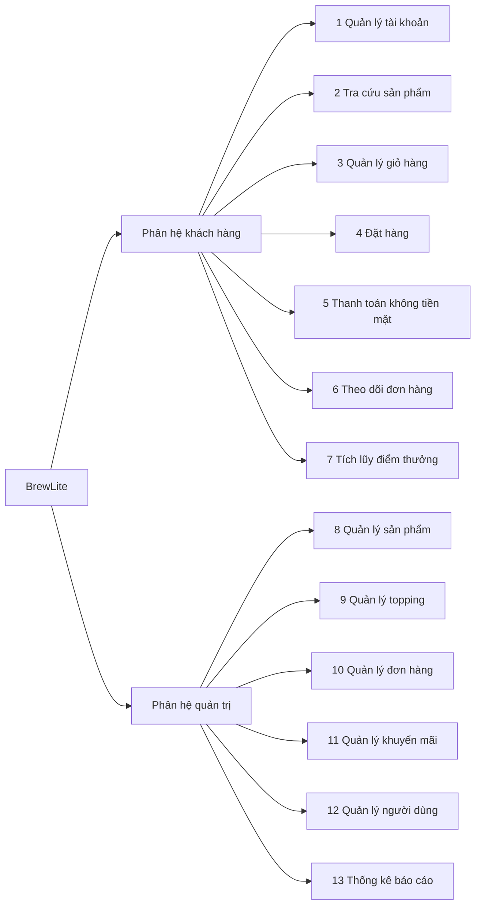

# 01 · BFD — Sơ đồ phân rã chức năng BrewLite

Nguồn gốc: `BFD-BrewLite.drawio` (3 trang: Tổng quan, Khách hàng, Quản trị). File này là bản chữ để AI đọc. **Đây là nguồn gốc của mọi sơ đồ khác.** Cột UC cho biết chức năng BFD được phủ bởi use case nào (xem `02-use_case/UseCase-BrewLite.md`).

Cột "Loại" có 2 giá trị: **UC** là có use case riêng. **Bước hệ thống** là hệ thống tự làm trong một use case khác, không vẽ thành use case.

## Phân hệ khách hàng

| Mã | Chức năng | UC | Loại |
|---|---|---|---|
| 1.1 | Đăng ký tài khoản | UC01 | UC |
| 1.2 | Đăng nhập | UC02 | UC |
| 1.3 | Đăng xuất | UC03 | UC |
| 1.4 | Xem và cập nhật thông tin cá nhân | UC04, UC05 | UC |
| 1.5 | Đổi mật khẩu | UC06 | UC |
| 1.6 | Quên mật khẩu (lấy lại bằng OTP) — **bổ sung ngoài BFD gốc** | UC68 | UC |
| 2.1 | Xem danh sách menu | UC07 | UC |
| 2.2 | Tìm kiếm sản phẩm theo tên | UC08 | UC |
| 2.3 | Lọc sản phẩm theo danh mục | UC09 | UC |
| 2.4 | Xem chi tiết sản phẩm | UC10 | UC |
| 2.5 | Chọn size | UC12 | UC |
| 2.6 | Chọn mức đá và mức đường | UC13 | UC |
| 2.7 | Chọn topping thêm | UC14 | UC |
| 2.8 | Hiển thị sản phẩm đã khóa bán | UC10 | Bước hệ thống |
| 3.1 | Thêm sản phẩm vào giỏ | UC11 | UC |
| 3.2 | Sửa số lượng sản phẩm | UC15 | UC |
| 3.3 | Sửa tùy chọn của dòng giỏ hàng | UC16 | UC |
| 3.4 | Xóa sản phẩm khỏi giỏ | UC17 | UC |
| 3.5 | Tính tổng tiền giỏ hàng | UC11, UC15, UC16, UC17 | Bước hệ thống |
| 4.1 | Kiểm tra tùy chọn hợp lệ | UC18 | Bước hệ thống |
| 4.2 | Tạo đơn hàng | UC18 | UC |
| 4.3 | Áp dụng mã khuyến mãi | UC19 | UC |
| 4.4 | Xác nhận thông tin đơn | UC20 | UC |
| 5.1 | Chọn phương thức thanh toán | UC21 | UC |
| 5.2 | Thực hiện giao dịch thanh toán | UC22 | UC |
| 5.3 | Xử lý kết quả thanh toán | UC22 | Bước hệ thống |
| 5.4 | Thử lại khi thanh toán thất bại | UC23 | UC |
| 6.1 | Xem xác nhận đơn và mã đơn | UC20 | UC |
| 6.2 | Xem lịch sử đơn hàng | UC24 | UC |
| 6.3 | Xem chi tiết một đơn | UC25 | UC |
| 6.4 | Hủy đơn hàng | UC27 | UC |
| 6.5 | Phản hồi dịch vụ theo thang 5 sao (thay cho "Phản hồi khi đơn bị báo thiếu hàng") | UC28 | UC |
| 6.6 | Xem mã nhận hàng khi đơn sang READY | UC26 | UC |
| 6.7 | Xem ví hoàn tiền — **bổ sung ngoài BFD gốc** | UC71 | UC |
| 6.8 | Yêu cầu rút tiền từ ví — **bổ sung ngoài BFD gốc** | UC72 | UC |
| 7.1 | Cộng điểm sau khi đơn PAID | UC22 | Bước hệ thống |
| 7.2 | Xem số điểm tích lũy | UC29 | UC |
| 7.3 | Xem các mã giảm giá của tôi (mã thưởng) — **bổ sung ngoài BFD gốc** | UC70 | UC |

## Phân hệ quản trị

| Mã | Chức năng | UC | Loại |
|---|---|---|---|
| 8.1 | Xem danh sách sản phẩm | UC40 | UC |
| 8.2 | Thêm sản phẩm mới | UC41 | UC |
| 8.3 | Cập nhật thông tin sản phẩm | UC46 | UC |
| 8.4 | Ẩn / hiện sản phẩm | UC47 | UC |
| 8.5 | Quản lý danh mục sản phẩm | UC48, UC49, UC50, UC51 | UC |
| 8.6 | Thiết lập size và giá theo size | UC42 | UC |
| 8.7 | Thiết lập topping áp dụng cho sản phẩm | UC43 | UC |
| 8.8 | Thiết lập mức đá min / max và mặc định | UC44 | UC |
| 8.9 | Thiết lập mức đường min / max và mặc định | UC45 | UC |
| 8.10 | Khóa / mở bán sản phẩm tức thời | UC39 | UC |
| 8.11 | Thiết lập số ly bán trong ngày — **bổ sung ngoài BFD gốc** | UC76 | UC |
| 8.12 | Dùng lại số ly của hôm qua — **bổ sung ngoài BFD gốc** | UC77 | UC |
| 9.1 | Xem danh sách topping | UC52 | UC |
| 9.2 | Thêm topping mới | UC53 | UC |
| 9.3 | Cập nhật tên và giá topping | UC54 | UC |
| 9.4 | Khóa / mở bán topping | UC55 | UC |
| 10.1 | Xem danh sách đơn hàng | UC30 | UC |
| 10.2 | Lọc đơn theo trạng thái | UC31 | UC |
| 10.3 | Xem chi tiết đơn hàng | UC32 | UC |
| 10.4 | Cập nhật trạng thái đơn | UC34 | UC |
| 10.5 | Hủy đơn hàng | UC36 | UC |
| 10.6 | Xem thông tin thanh toán của đơn | UC33 | UC |
| 10.7 | Xem phản hồi dịch vụ của khách (thay cho "Báo thiếu hàng") | UC37 | UC |
| 10.8 | Xử lý hoàn tiền cho phần hủy (nay là hoàn tiền vào ví của khách khi hủy đơn đã trả tiền) | UC38 | UC |
| 10.9 | Tra cứu đơn theo mã nhận hàng | UC35 | Bước hệ thống |
| 10.10 | Xác nhận giao món cho khách | UC35 | UC |
| 10.11 | Xử lý yêu cầu rút tiền — **bổ sung ngoài BFD gốc** | UC73 | UC |
| 10.12 | Xử lý món không làm được — **bổ sung ngoài BFD gốc** | UC74 | UC |
| 11.1 | Xem danh sách mã khuyến mãi | UC56 | UC |
| 11.2 | Tạo mã khuyến mãi | UC57 | UC |
| 11.3 | Cập nhật mã khuyến mãi | UC58 | UC |
| 11.4 | Vô hiệu hóa mã khuyến mãi | UC59 | UC |
| 11.5 | Thiết lập tích điểm và thưởng — **bổ sung ngoài BFD gốc** | UC69 | UC |
| 12.1 | Xem danh sách tài khoản khách hàng | UC60 | UC |
| 12.2 | Xem chi tiết tài khoản | UC61 | UC |
| 12.3 | Khóa / mở khóa tài khoản | UC62 | UC |
| 12.4 | Xem điểm tích lũy của khách | UC63 | UC |
| 12.5 | Tạo tài khoản nhân viên — **bổ sung ngoài BFD gốc** | UC75 | UC |
| 13.1 | Thống kê doanh thu theo thời gian | UC64 | UC |
| 13.2 | Thống kê sản phẩm bán chạy | UC65 | UC |
| 13.3 | Thống kê topping được chọn nhiều | UC66 | UC |
| 13.4 | Thống kê số đơn theo trạng thái | UC67 | UC |

**Về luồng thiếu hàng:** nhóm đã bỏ "báo thiếu hàng" qua app (khách kiểm hàng tại quầy lúc nhận, báo tại chỗ, hệ thống không ghi nhận và không hoàn tiền). Hai dòng BFD gốc 6.5 và 10.7 nay là phản hồi dịch vụ 5 sao (khách gửi sau khi nhận hàng, nhân viên xem). Riêng trường hợp món trong đơn hết làm được trước khi giao có chức năng mới 10.12 (UC74). Chưa sửa tên trong BFD vì đó là hình gốc của nhóm.

**Về tên gọi trạng thái món:** tài liệu dùng 3 trạng thái *còn bán, hết bán, khóa bán*. Ba dòng BFD gốc đang dùng từ cũ: 2.8 "Hiển thị sản phẩm đã khóa bán" nghĩa là hiển thị món **hết bán**; 8.4 "Ẩn / hiện" nghĩa là **khóa bán / mở lại**; 8.10 "Khóa / mở bán tức thời" nghĩa là **đặt hết bán / còn bán**. Chưa sửa tên trong BFD vì đó là hình gốc của nhóm.

**Về tồn kho:** đề bài (Task 10) đòi kiểm soát tồn kho khi đặt đồng thời. Quán không quản lý từng nguyên liệu: mỗi ngày quản lý nhìn nguyên liệu đã chuẩn bị rồi tự ước tính **số ly tối đa của từng món trong ngày** (8.11), hoặc dùng lại số của hôm qua nếu nguyên liệu nhập về như cũ (8.12). Đơn đặt trừ dần số ly còn lại (4.2, UC18).

**Ghi chú:** BFD gốc chưa có các việc hệ thống sau, hiện đã được thêm vào tài liệu và không đổi số chức năng lá: xác thực số điện thoại bằng OTP khi đăng ký (thuộc 1.1); gửi thông báo qua SMS mock và email (thuộc nhóm 4, 5, 10); cộng điểm, số ly và tự cấp mã thưởng sau thanh toán (thuộc 7.1); dựng và gửi hóa đơn (thuộc 5.3, 6.3).

Tổng: 13 nhóm, 70 chức năng lá của BFD gốc (34 ở phân hệ khách hàng, 36 ở phân hệ quản trị), cộng 10 chức năng bổ sung (1.6, 6.7, 6.8, 7.3, 8.11, 8.12, 10.11, 10.12, 11.5, 12.5) là 80, được phủ bởi 77 use case UC01–UC77.
