# 03 · ERD — Sơ đồ thực thể liên kết

Suy ra từ BFD và use case. Lược đồ quan hệ chi tiết (kiểu cột, khóa, ràng buộc) ở `RDM-01-BrewLite.md`. Tên thực thể ở đây trùng tên lớp trong `04-class/Class-01-MienDuLieu.md`.

**Không có bảng cho:** giỏ hàng (chỉ ở client, BR06), tồn kho theo nguyên liệu (quán không quản lý nguyên liệu; số ly bán trong ngày là bốn cột của `PRODUCT`, BR49), hóa đơn (dựng từ đơn, thanh toán và hoàn tiền bằng `BillService.buildBill`, BR38). JWT chỉ lưu danh sách thẻ đã đăng xuất (`REVOKED_TOKEN`), không lưu phiên.

```mermaid
erDiagram
  USER ||--o{ ORDER : "đặt"
  CATEGORY ||--o{ PRODUCT : "chứa"
  PRODUCT ||--|{ PRODUCT_SIZE : "có size"
  PRODUCT ||--o{ PRODUCT_TOPPING : "áp dụng"
  TOPPING ||--o{ PRODUCT_TOPPING : "áp dụng cho"
  PROMOTION |o--o{ ORDER : "giảm giá cho"
  ORDER ||--|{ ORDER_ITEM : "gồm"
  PRODUCT ||--o{ ORDER_ITEM : "được đặt trong"
  ORDER_ITEM ||--o{ ORDER_ITEM_TOPPING : "kèm"
  TOPPING ||--o{ ORDER_ITEM_TOPPING : "được chọn trong"
  ORDER ||--o{ PAYMENT : "được trả bằng"
  ORDER ||--o{ REFUND : "được hoàn"
  PAYMENT ||--o{ REFUND : "hoàn từ"
  USER ||--o{ NOTIFICATION : "nhận"
  ORDER ||--o{ NOTIFICATION : "phát sinh"
  ORDER ||--o| SERVICE_FEEDBACK : "được đánh giá"
  USER ||--o{ SERVICE_FEEDBACK : "gửi"
  USER ||--o{ REVOKED_TOKEN : "đã đăng xuất"
  USER ||--o{ WALLET_TRANSACTION : "biến động ví"
  USER ||--o{ WITHDRAWAL_REQUEST : "yêu cầu rút tiền"
  REFUND ||--o| WALLET_TRANSACTION : "cộng vào ví"
  WITHDRAWAL_REQUEST ||--o{ WALLET_TRANSACTION : "trừ hoặc trả ví"
  ORDER ||--o{ ITEM_ISSUE : "món có vấn đề"
  ORDER_ITEM ||--o{ ITEM_ISSUE : "được xử lý"
  ITEM_ISSUE |o--o| REFUND : "hoàn vào ví"
  USER |o--o{ ORDER : "người hủy đơn"
  USER ||--o{ PROMOTION : "sở hữu mã riêng"
  PROMOTION ||--o{ PROMOTION_PRODUCT : "tặng các món"
  PRODUCT ||--o{ PROMOTION_PRODUCT : "được tặng"
  REWARD_RULE ||--o{ REWARD_RULE_PRODUCT : "tặng các món"
  PRODUCT ||--o{ REWARD_RULE_PRODUCT : "được tặng"
  REWARD_RULE ||--o{ PROMOTION : "sinh ra mã thưởng"
  PROMOTION ||--o{ PROMOTION_USAGE : "được dùng"
  USER ||--o{ PROMOTION_USAGE : "dùng mã"
  ORDER |o--o| PROMOTION_USAGE : "dùng mã cho đơn"

  USER {
    int id PK
    string phone UK "bắt buộc"
    boolean isPhoneVerified
    string email UK "tùy chọn, null được"
    string passwordHash
    string fullName
    string role "CUSTOMER STAFF MANAGER"
    boolean isActive
    int loyaltyPoints
    int walletBalance "ví chỉ nhận hoàn tiền"
    int totalCups
    datetime createdAt
  }
  CATEGORY {
    int id PK
    string name UK
    boolean isVisible
  }
  PRODUCT {
    int id PK
    int categoryId FK
    string name
    string description
    string imageUrl
    string status "ON_SALE SOLD_OUT LOCKED"
    int dailyQuota "số ly tối đa quản lý nhập gần nhất"
    int stockRemaining "số ly còn lại của ngày stockDate"
    datetime stockDate "ngày nhập, null nếu chưa nhập"
    int stockVersion "khóa lạc quan khi trừ ly"
    boolean allowHot
    boolean allowCold
    string defaultTemperature "HOT COLD"
    int maxPerTopping
    int maxToppingTotal
    int iceMin
    int iceMax
    int iceDefault
    int sugarMin
    int sugarMax
    int sugarDefault
  }
  PRODUCT_SIZE {
    int id PK
    int productId FK
    string sizeCode "S M L"
    int price
    int volumeMl "tùy chọn, ml"
  }
  TOPPING {
    int id PK
    string name UK
    int price
    boolean isAvailable
  }
  PRODUCT_TOPPING {
    int productId PK
    int toppingId PK
  }
  PROMOTION {
    int id PK
    string code UK
    string scope "PUBLIC PERSONAL"
    int userId FK "chỉ mã riêng"
    int ruleId FK "chỉ mã thưởng"
    string discountType "PERCENT FIXED FREE_DRINK"
    int discountValue
    int maxDiscountAmount "PERCENT bắt buộc, FREE_DRINK tùy chọn"
    int minOrderAmount
    int maxTotalUses "null là không giới hạn"
    int maxUsesPerUser
    datetime startsAt
    datetime endsAt
    boolean isActive
  }
  ORDER {
    int id PK
    string orderCode UK
    int userId FK
    int promotionId FK
    string promotionCode "ảnh chụp mã đã dùng"
    string status "7 trạng thái"
    int subtotal
    int discountAmount
    int totalAmount
    int pointsAwarded "điểm đã cộng khi PAID, để thu hồi nếu hủy"
    string pickupCode UK
    string cancelReason
    int cancelledByUserId FK "người hủy"
    string cancelNote "lý do, bắt buộc khi nhân viên hủy"
    datetime createdAt
    datetime updatedAt
  }
  ORDER_ITEM {
    int id PK
    int orderId FK
    int productId FK
    string productName
    string sizeCode
    int sizeVolumeMl
    int unitPrice
    int iceLevel
    int sugarLevel
    string temperature "HOT COLD"
    string note "tùy chọn, tối đa 20 từ"
    int quantity
    int lineTotal
  }
  ORDER_ITEM_TOPPING {
    int id PK
    int orderItemId FK
    int toppingId FK
    string toppingName
    int price
    int quantity
  }
  PAYMENT {
    int id PK
    int orderId FK
    string method "EWALLET CARD TRANSFER"
    int amount
    string status "SUCCESS FAILED"
    string idempotencyKey UK
    string gatewayRef
    string cardLast4 "chỉ với CARD"
    string transferRef "chỉ với TRANSFER"
    datetime expiresAt "chỉ với TRANSFER"
    datetime createdAt
  }
  REFUND {
    int id PK
    int orderId FK
    int paymentId FK
    int amount
    string reason "CANCEL MISSING_ITEM"
    int createdByUserId FK
    string note
    datetime createdAt
  }
  WALLET_TRANSACTION {
    int id PK
    int userId FK
    string type "REFUND_IN WITHDRAW_OUT WITHDRAW_RETURN"
    int amount "dương là cộng, âm là trừ"
    int refundId FK
    int withdrawalId FK
    datetime createdAt
  }
  WITHDRAWAL_REQUEST {
    int id PK
    int userId FK
    int amount
    string destinationType "EWALLET CARD BANK"
    string accountName
    string accountNumber
    string bankName
    string status "PENDING COMPLETED REJECTED"
    string rejectReason
    string transferRef
    int handledByUserId FK
    datetime handledAt
    datetime createdAt
  }
  ITEM_ISSUE {
    int id PK
    int orderId FK
    int orderItemId FK
    int quantity
    string resolution "REFUND_TO_WALLET EXCHANGE"
    int refundId FK
    string note
    int handledByUserId FK
    datetime createdAt
  }
  OTP_CODE {
    int id PK
    string phone
    string purpose "REGISTER RESET_PASSWORD"
    string codeHash
    datetime expiresAt
    int attempts
    datetime consumedAt
    datetime createdAt
  }
  NOTIFICATION {
    int id PK
    int userId FK
    int orderId FK "null với REWARD_ISSUED"
    string event "ORDER_CREATED PAYMENT_SUCCESS ORDER_READY ORDER_COMPLETED REWARD_ISSUED WITHDRAWAL_COMPLETED WITHDRAWAL_REJECTED"
    string channel "SMS EMAIL"
    string recipient
    string content
    string status "SENT FAILED"
    datetime createdAt
  }
  REVOKED_TOKEN {
    int id PK
    string jti UK
    int userId FK
    datetime expiresAt
    datetime createdAt
  }
  PROMOTION_USAGE {
    int id PK
    int promotionId FK
    int userId FK
    int orderId FK "UK"
    datetime createdAt
    datetime releasedAt "null nếu còn tính"
  }
  REWARD_RULE {
    int id PK
    string name
    string kind "POINTS CUPS"
    int threshold
    string discountType "PERCENT FIXED FREE_DRINK"
    int discountValue
    int maxDiscountAmount
    int minOrderAmount
    int validDays
    boolean isActive
  }
  PROMOTION_PRODUCT {
    int promotionId PK
    int productId PK
  }
  REWARD_RULE_PRODUCT {
    int ruleId PK
    int productId PK
  }
  SERVICE_FEEDBACK {
    int id PK
    int orderId FK "UK"
    int userId FK
    int rating "1 đến 5"
    string comment "tùy chọn"
    datetime createdAt
  }
  LOYALTY_SETTING {
    int id PK "luôn là 1"
    int amountStep
    int pointsPerStep
  }
```

## Lý do từng quan hệ

| Quan hệ | Xuất phát từ |
|---|---|
| USER → ORDER | UC18: đơn thuộc một khách; UC24, UC25 lọc theo khách |
| CATEGORY → PRODUCT | UC09 lọc theo danh mục; UC51 ẩn danh mục (BR01) |
| PRODUCT → PRODUCT_SIZE | UC42: mỗi sản phẩm nhiều size, giá riêng |
| PRODUCT ↔ TOPPING qua PRODUCT_TOPPING | UC43: topping áp dụng cho sản phẩm, quan hệ nhiều–nhiều |
| PROMOTION → ORDER | UC19: đơn có thể dùng 0 hoặc 1 mã |
| ORDER → ORDER_ITEM → ORDER_ITEM_TOPPING | UC18: dòng đơn kèm topping, lưu ảnh chụp tên, giá và số phần (BR26, BR37) |
| ORDER → PAYMENT | UC22, UC23: một đơn có thể có nhiều lần thanh toán (thất bại rồi thành công), UC33 xem lại |
| ORDER → REFUND, PAYMENT → REFUND | UC38: hoàn tiền gắn với đơn và với lần thanh toán `SUCCESS` được hoàn |
| USER, ORDER → NOTIFICATION | BR28: mỗi thông báo gửi cho một khách, về một đơn, qua một kênh (SMS hoặc email) |
| USER → REVOKED_TOKEN | UC03, BR19: mỗi lần đăng xuất, mã `jti` của JWT được ghi vào đây để máy chủ từ chối thẻ đó từ nay về sau |
| ORDER → SERVICE_FEEDBACK, USER → SERVICE_FEEDBACK | UC28: mỗi đơn đã `COMPLETED` có tối đa một phản hồi dịch vụ 1 đến 5 sao (BR14) |
| USER → PROMOTION (mã riêng), REWARD_RULE → PROMOTION | BR39, BR40: mã thưởng là mã riêng của một khách, do quy tắc thưởng sinh ra |
| PROMOTION → PROMOTION_USAGE, USER → PROMOTION_USAGE, ORDER → PROMOTION_USAGE | BR39: mỗi lượt dùng mã gắn với khách và đơn; hủy đơn thì ghi `releasedAt` để trả lại lượt |
| LOYALTY_SETTING (một dòng), REWARD_RULE | BR40: tỉ lệ tích điểm và các quy tắc thưởng do quản lý chỉnh |
| USER → ORDER (người hủy) | BR13: `Order.cancelledByUserId` ghi khách hoặc nhân viên đã hủy đơn, kèm lý do `cancelNote` |
| USER → WALLET_TRANSACTION, REFUND → WALLET_TRANSACTION | BR43: mỗi khoản hoàn tiền sinh một dòng cộng vào ví (`REFUND_IN`); số dư ví `walletBalance` bằng tổng các dòng |
| USER → WITHDRAWAL_REQUEST, WITHDRAWAL_REQUEST → WALLET_TRANSACTION | BR44: khách gửi yêu cầu rút (trừ ví `WITHDRAW_OUT`), bị từ chối thì trả lại ví (`WITHDRAW_RETURN`); quản lý xử lý ghi ở `handledByUserId` |
| ORDER, ORDER_ITEM → ITEM_ISSUE, ITEM_ISSUE → REFUND | BR45: một lần xử lý món không làm được gắn với dòng đơn; nếu hoàn tiền vào ví thì gắn với `Refund`; nhân viên xử lý ghi ở `handledByUserId` |
| PROMOTION → PROMOTION_PRODUCT, REWARD_RULE → REWARD_RULE_PRODUCT (nhiều–nhiều với PRODUCT) | BR07, BR40: danh sách món được tặng của mã (hoặc quy tắc thưởng) loại `FREE_DRINK`; khi cấp mã thưởng, danh sách được sao sang mã |
| OTP_CODE (không có khóa ngoại) | BR27: mã OTP gắn với số điện thoại, có thể phát sinh trước khi tài khoản xác thực xong. Cột `purpose` (`REGISTER` hoặc `RESET_PASSWORD`) để mã đăng ký không dùng được cho đặt lại mật khẩu (BR31) |

## Enum

| Enum | Giá trị |
|---|---|
| `Role` | `CUSTOMER`, `STAFF`, `MANAGER` |
| `SizeCode` | `S`, `M`, `L` **[GĐ]** |
| `OrderStatus` | `PENDING`, `PAID`, `PAYMENT_FAILED`, `PREPARING`, `READY`, `COMPLETED`, `CANCELLED` |
| `CancelReason` | `CUSTOMER_CANCEL`, `STAFF_CANCEL` |
| `PaymentMethod` | `EWALLET` (ví giả lập), `CARD` (thẻ), `TRANSFER` (chuyển khoản) **[GĐ]** |
| `PaymentStatus` | `SUCCESS`, `FAILED` |
| `RefundReason` | `CANCEL` (hủy đơn), `MISSING_ITEM` (hoàn tiền món không làm được) |
| `WalletTxType` | `REFUND_IN` (hoàn tiền vào ví), `WITHDRAW_OUT` (trừ ví khi gửi yêu cầu rút), `WITHDRAW_RETURN` (trả lại ví khi yêu cầu bị từ chối) |
| `WithdrawalStatus` | `PENDING`, `COMPLETED`, `REJECTED` |
| `DestinationType` | `EWALLET` (ví điện tử), `CARD` (thẻ), `BANK` (tài khoản ngân hàng) |
| `ItemResolution` | `REFUND_TO_WALLET` (hoàn tiền món vào ví), `EXCHANGE` (đổi món khác) |
| `DiscountType` | `PERCENT` (giảm %, kèm mức giảm tối đa), `FIXED` (giảm thẳng tiền), `FREE_DRINK` (tặng 1 ly: khách chọn một ly trong đơn thuộc danh sách món quản lý cho phép, giảm đúng giá ly đó) |
| `PromotionScope` | `PUBLIC` (mã chung), `PERSONAL` (mã riêng của một tài khoản) |
| `RewardKind` | `POINTS` (thưởng theo mốc điểm), `CUPS` (thưởng theo mốc số ly) |
| `Temperature` | `HOT` (nóng), `COLD` (lạnh) |
| `ProductStatus` | `ON_SALE` (còn bán), `SOLD_OUT` (hết bán), `LOCKED` (khóa bán) |
| `OtpPurpose` | `REGISTER`, `RESET_PASSWORD` |
| `NotificationEvent` | `ORDER_CREATED`, `PAYMENT_SUCCESS`, `ORDER_READY`, `ORDER_COMPLETED`, `REWARD_ISSUED`, `WITHDRAWAL_COMPLETED`, `WITHDRAWAL_REJECTED` |
| `NotificationChannel` | `SMS`, `EMAIL` |
| `NotificationStatus` | `SENT`, `FAILED` |
