# 04 · Sơ đồ lớp (1/4) — Miền dữ liệu

Các lớp thực thể, một-một với bảng ở `03-erd/RDM-01-BrewLite.md` (tên lớp PascalCase, tên bảng snake_case). Thực thể chỉ chứa dữ liệu, **logic nằm ở service** (`Class-02-DichVu.md`). Enum giống bảng Enum ở `03-erd/ERD-01-BrewLite.md`.

```mermaid
classDiagram
  direction LR

  class User {
    +int id
    +string phone
    +boolean isPhoneVerified
    +string email
    +string passwordHash
    +string fullName
    +Role role
    +boolean isActive
    +int loyaltyPoints
    +int walletBalance
    +int totalCups
    +datetime createdAt
  }
  class Category {
    +int id
    +string name
    +boolean isVisible
  }
  class Product {
    +int id
    +int categoryId
    +string name
    +string description
    +string imageUrl
    +ProductStatus status
    +int dailyQuota
    +int stockRemaining
    +datetime stockDate
    +int stockVersion
    +boolean allowHot
    +boolean allowCold
    +Temperature defaultTemperature
    +int maxPerTopping
    +int maxToppingTotal
    +int iceMin
    +int iceMax
    +int iceDefault
    +int sugarMin
    +int sugarMax
    +int sugarDefault
  }
  class ProductSize {
    +int id
    +int productId
    +SizeCode sizeCode
    +int price
    +int volumeMl
  }
  class Topping {
    +int id
    +string name
    +int price
    +boolean isAvailable
  }
  class ProductTopping {
    +int productId
    +int toppingId
  }
  class Promotion {
    +int id
    +string code
    +PromotionScope scope
    +int userId
    +int ruleId
    +DiscountType discountType
    +int discountValue
    +int maxDiscountAmount
    +int minOrderAmount
    +datetime startsAt
    +int maxTotalUses
    +int maxUsesPerUser
    +datetime endsAt
    +boolean isActive
  }
  class Order {
    +int id
    +string orderCode
    +int userId
    +int promotionId
    +string promotionCode
    +OrderStatus status
    +int subtotal
    +int discountAmount
    +int totalAmount
    +int pointsAwarded
    +string pickupCode
    +CancelReason cancelReason
    +int cancelledByUserId
    +string cancelNote
    +datetime createdAt
    +datetime updatedAt
  }
  class OrderItem {
    +int id
    +int orderId
    +int productId
    +string productName
    +SizeCode sizeCode
    +int sizeVolumeMl
    +int unitPrice
    +int iceLevel
    +int sugarLevel
    +Temperature temperature
    +string note
    +int quantity
    +int lineTotal
  }
  class OrderItemTopping {
    +int id
    +int orderItemId
    +int toppingId
    +string toppingName
    +int price
    +int quantity
  }
  class Payment {
    +int id
    +int orderId
    +PaymentMethod method
    +int amount
    +PaymentStatus status
    +string idempotencyKey
    +string gatewayRef
    +string cardLast4
    +string transferRef
    +datetime expiresAt
    +datetime createdAt
  }
  class Refund {
    +int id
    +int orderId
    +int paymentId
    +int amount
    +RefundReason reason
    +int createdByUserId
    +string note
    +datetime createdAt
  }

  class WalletTransaction {
    +int id
    +int userId
    +WalletTxType type
    +int amount
    +int refundId
    +int withdrawalId
    +datetime createdAt
  }
  class WithdrawalRequest {
    +int id
    +int userId
    +int amount
    +DestinationType destinationType
    +string accountName
    +string accountNumber
    +string bankName
    +WithdrawalStatus status
    +string rejectReason
    +string transferRef
    +int handledByUserId
    +datetime handledAt
    +datetime createdAt
  }
  class ItemIssue {
    +int id
    +int orderId
    +int orderItemId
    +int quantity
    +ItemResolution resolution
    +int refundId
    +string note
    +int handledByUserId
    +datetime createdAt
  }
  class ServiceFeedback {
    +int id
    +int orderId
    +int userId
    +int rating
    +string comment
    +datetime createdAt
  }
  class OtpCode {
    +int id
    +string phone
    +OtpPurpose purpose
    +string codeHash
    +datetime expiresAt
    +int attempts
    +datetime consumedAt
    +datetime createdAt
  }
  class Notification {
    +int id
    +int userId
    +int orderId
    +NotificationEvent event
    +NotificationChannel channel
    +string recipient
    +string content
    +NotificationStatus status
    +datetime createdAt
  }

  class RevokedToken {
    +int id
    +string jti
    +int userId
    +datetime expiresAt
    +datetime createdAt
  }

  class Temperature {
    <<enumeration>>
    HOT
    COLD
  }
  class PromotionProduct {
    +int promotionId
    +int productId
  }
  class RewardRuleProduct {
    +int ruleId
    +int productId
  }
  class PromotionUsage {
    +int id
    +int promotionId
    +int userId
    +int orderId
    +datetime createdAt
    +datetime releasedAt
  }
  class RewardRule {
    +int id
    +string name
    +RewardKind kind
    +int threshold
    +DiscountType discountType
    +int discountValue
    +int maxDiscountAmount
    +int minOrderAmount
    +int validDays
    +boolean isActive
  }
  class LoyaltySetting {
    +int id
    +int amountStep
    +int pointsPerStep
  }
  class PromotionScope {
    <<enumeration>>
    PUBLIC
    PERSONAL
  }
  class RewardKind {
    <<enumeration>>
    POINTS
    CUPS
  }
  class ProductStatus {
    <<enumeration>>
    ON_SALE
    SOLD_OUT
    LOCKED
  }
  class OtpPurpose {
    <<enumeration>>
    REGISTER
    RESET_PASSWORD
  }
  class NotificationEvent {
    <<enumeration>>
    ORDER_CREATED
    PAYMENT_SUCCESS
    ORDER_READY
    ORDER_COMPLETED
    REWARD_ISSUED
    WITHDRAWAL_COMPLETED
    WITHDRAWAL_REJECTED
  }
  class NotificationChannel {
    <<enumeration>>
    SMS
    EMAIL
  }
  class NotificationStatus {
    <<enumeration>>
    SENT
    FAILED
  }
  class Role {
    <<enumeration>>
    CUSTOMER
    STAFF
    MANAGER
  }
  class SizeCode {
    <<enumeration>>
    S
    M
    L
  }
  class OrderStatus {
    <<enumeration>>
    PENDING
    PAID
    PAYMENT_FAILED
    PREPARING
    READY
    COMPLETED
    CANCELLED
  }
  class CancelReason {
    <<enumeration>>
    CUSTOMER_CANCEL
    STAFF_CANCEL
  }
  class PaymentMethod {
    <<enumeration>>
    EWALLET
    CARD
    TRANSFER
  }
  class PaymentStatus {
    <<enumeration>>
    SUCCESS
    FAILED
  }
  class RefundReason {
    <<enumeration>>
    CANCEL
    MISSING_ITEM
  }
  class WalletTxType {
    <<enumeration>>
    REFUND_IN
    WITHDRAW_OUT
    WITHDRAW_RETURN
  }
  class WithdrawalStatus {
    <<enumeration>>
    PENDING
    COMPLETED
    REJECTED
  }
  class DestinationType {
    <<enumeration>>
    EWALLET
    CARD
    BANK
  }
  class ItemResolution {
    <<enumeration>>
    REFUND_TO_WALLET
    EXCHANGE
  }
  class DiscountType {
    <<enumeration>>
    PERCENT
    FIXED
    FREE_DRINK
  }

  User "1" --> "0..*" Order : đặt
  Category "1" --> "0..*" Product : chứa
  Product "1" *-- "1..*" ProductSize : có size
  Product "1" --> "0..*" ProductTopping
  Topping "1" --> "0..*" ProductTopping
  Promotion "0..1" --> "0..*" Order : giảm giá
  Order "1" *-- "1..*" OrderItem : gồm
  OrderItem "1" *-- "0..*" OrderItemTopping : kèm
  OrderItem "0..*" --> "1" Product : đặt món
  OrderItemTopping "0..*" --> "1" Topping : chọn
  Order "1" --> "0..*" Payment : trả bằng
  Order "1" --> "0..*" Refund : được hoàn
  Payment "1" --> "0..*" Refund : hoàn từ
  User "1" --> "0..*" Notification : nhận
  Order "1" --> "0..*" Notification : phát sinh
  Order "1" --> "0..1" ServiceFeedback : được đánh giá
  User "1" --> "0..*" WalletTransaction : biến động ví
  User "1" --> "0..*" WithdrawalRequest : yêu cầu rút tiền
  Refund "1" --> "0..1" WalletTransaction : cộng vào ví
  Order "1" --> "0..*" ItemIssue : món có vấn đề
  OrderItem "1" --> "0..*" ItemIssue : được xử lý
  ItemIssue "0..1" --> "0..1" Refund : hoàn vào ví
  User "1" --> "0..*" ServiceFeedback : gửi
  User "1" --> "0..*" RevokedToken : đã đăng xuất
  User "1" --> "0..*" Promotion : sở hữu mã riêng
  RewardRule "1" --> "0..*" Promotion : sinh mã thưởng
  Promotion "1" --> "0..*" PromotionUsage : được dùng
  Promotion "1" --> "0..*" PromotionProduct : tặng các món
  Product "1" --> "0..*" PromotionProduct
  RewardRule "1" --> "0..*" RewardRuleProduct : tặng các món
  Product "1" --> "0..*" RewardRuleProduct
  User "1" --> "0..*" PromotionUsage : dùng mã
  Order "1" --> "0..1" PromotionUsage : dùng mã
```

## Ghi chú

- `ProductTopping` là lớp liên kết của quan hệ nhiều–nhiều giữa `Product` và `Topping` (UC43).
- `Order` là thực thể gốc của khối "đơn": `OrderItem`, `OrderItemTopping` sống và chết theo `Order` (hình thoi đặc).
- `OrderItem.productName`, `unitPrice`, `OrderItemTopping.toppingName`, `price` là ảnh chụp lúc đặt (BR26), không tính lại khi giá sản phẩm đổi.
- `OtpCode` không có khóa ngoại sang `User`, chỉ gắn theo `phone` (BR27). `Notification` là nhật ký thông báo đã gửi (BR28).
- Giỏ hàng không phải lớp miền: nó là `CartStore` ở frontend (`Class-03-GiaoDien.md`).
