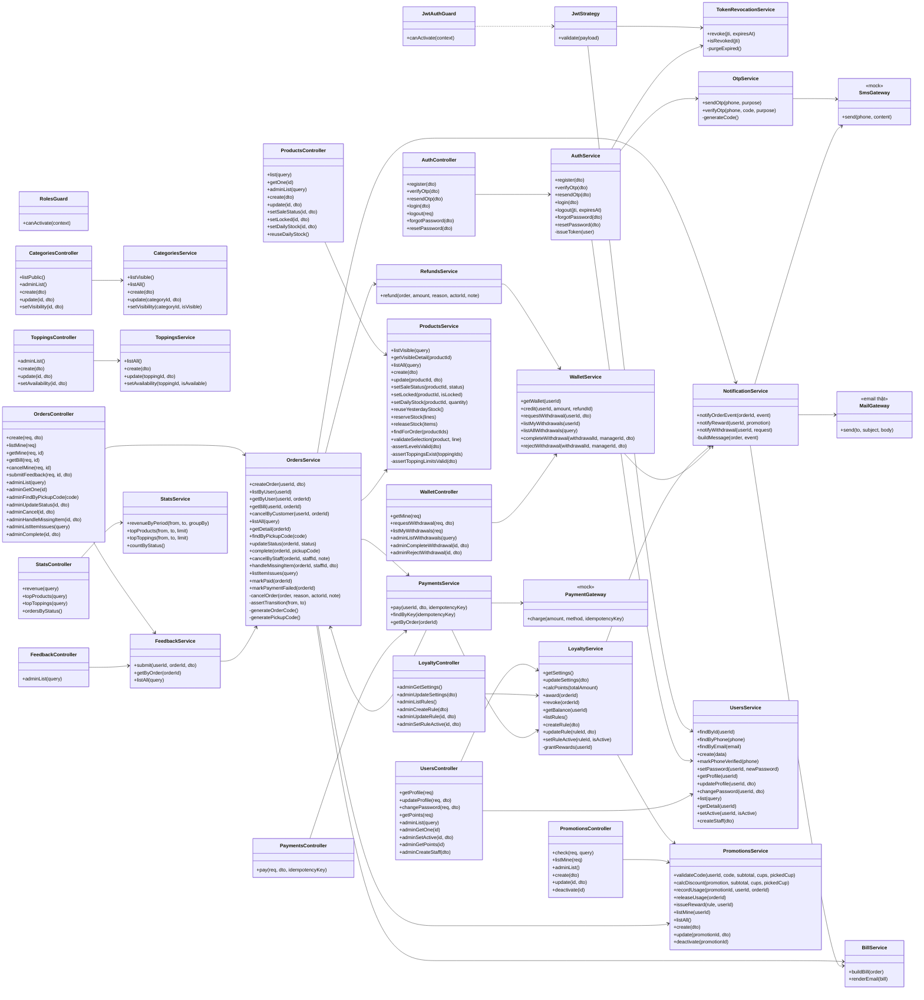

# 04 · Sơ đồ lớp (2/4) — Backend: controller, service, gateway

**Đây là nguồn duy nhất cho tên hàm backend và route.** Mọi sơ đồ sequence, collaboration và bảng đối chiếu phải dùng đúng tên ở đây; `09-doi-chieu/check_consistency.py` kiểm tự động.

Quy ước: controller chỉ nhận request, validate DTO và gọi một service. Mọi service dùng `PrismaService` để truy cập DB (không vẽ mũi tên cho gọn). Route có JWT đi qua `JwtAuthGuard` rồi `RolesGuard`. `OrdersService` và `PaymentsService` gọi qua lại nhau nên khai báo `forwardRef` (NestJS).

## Bảng route (nguồn duy nhất cho API)

Vai trò: `-` không cần JWT · `C` Khách hàng · `S` Nhân viên trở lên · `M` chỉ Quản lý. DTO và mã lỗi xem `DacTa-UseCase.md`.

| UC | Route | Controller.method | Service.method | Vai trò |
|---|---|---|---|---|
| UC01 | `POST /auth/register` | AuthController.register | AuthService.register | - |
| UC01 | `POST /auth/verify-otp` | AuthController.verifyOtp | AuthService.verifyOtp | - |
| UC01, UC02 | `POST /auth/resend-otp` | AuthController.resendOtp | AuthService.resendOtp | - |
| UC02 | `POST /auth/login` | AuthController.login | AuthService.login | - |
| UC68 | `POST /auth/forgot-password` | AuthController.forgotPassword | AuthService.forgotPassword | - |
| UC68 | `POST /auth/reset-password` | AuthController.resetPassword | AuthService.resetPassword | - |
| UC03 | `POST /auth/logout` | AuthController.logout | AuthService.logout | C |
| UC04 | `GET /users/me` | UsersController.getProfile | UsersService.getProfile | C |
| UC05 | `PATCH /users/me` | UsersController.updateProfile | UsersService.updateProfile | C |
| UC06 | `PATCH /users/me/password` | UsersController.changePassword | UsersService.changePassword | C |
| UC07, UC08, UC09 | `GET /products` (tham số `search`, `categoryId`) | ProductsController.list | ProductsService.listVisible | - |
| UC07, UC09 | `GET /categories` | CategoriesController.listPublic | CategoriesService.listVisible | - |
| UC10 | `GET /products/:id` | ProductsController.getOne | ProductsService.getVisibleDetail | - |
| UC12, UC13, UC14 | không có (chọn ở client) | ProductDetailPage.selectSize, selectLevels, setToppingQuantity | | - |
| UC11, UC15–UC17 | không có (giỏ ở client, cần đăng nhập) | CartStore.* | | C |
| UC18 | `POST /orders` | OrdersController.create | OrdersService.createOrder | C |
| UC19 | `GET /promotions/validate` (tham số `code`, `subtotal`, `pickedCup`) | PromotionsController.check | PromotionsService.validateCode | C |
| UC70 | `GET /promotions/mine` | PromotionsController.listMine | PromotionsService.listMine | C |
| UC20 | dùng kết quả `POST /orders` | CheckoutPage.onConfirm | | C |
| UC21 | không có (chọn ở client) | PaymentPage.selectMethod | | C |
| UC22, UC23 | `POST /payments` (header `Idempotency-Key`) | PaymentsController.pay | PaymentsService.pay | C |
| UC24 | `GET /orders/me` | OrdersController.listMine | OrdersService.listByUser | C |
| UC25, UC26 | `GET /orders/:id` | OrdersController.getMine | OrdersService.getByUser | C |
| UC25 | `GET /orders/:id/bill` | OrdersController.getBill | OrdersService.getBill | C |
| UC27 | `POST /orders/:id/cancel` | OrdersController.cancelMine | OrdersService.cancelByCustomer | C |
| UC28 | `POST /orders/:id/feedback` | OrdersController.submitFeedback | FeedbackService.submit | C |
| UC29 | `GET /users/me/points` | UsersController.getPoints | LoyaltyService.getBalance | C |
| UC30, UC31 | `GET /admin/orders` (tham số `status`) | OrdersController.adminList | OrdersService.listAll | S |
| UC32, UC33 | `GET /admin/orders/:id` | OrdersController.adminGetOne | OrdersService.getDetail | S |
| UC34 | `PATCH /admin/orders/:id/status` | OrdersController.adminUpdateStatus | OrdersService.updateStatus | S |
| UC35 | `GET /admin/orders/by-pickup-code/:code` | OrdersController.adminFindByPickupCode | OrdersService.findByPickupCode | S |
| UC35 | `POST /admin/orders/:id/complete` | OrdersController.adminComplete | OrdersService.complete | S |
| UC36 | `POST /admin/orders/:id/cancel` (gửi `note` lý do, bắt buộc) | OrdersController.adminCancel | OrdersService.cancelByStaff | S |
| UC74 | `POST /admin/orders/:id/item-issues` | OrdersController.adminHandleMissingItem | OrdersService.handleMissingItem | S |
| UC74 | `GET /admin/item-issues` | OrdersController.adminListItemIssues | OrdersService.listItemIssues | M |
| UC37 | `GET /admin/feedback` (tham số `rating`) | FeedbackController.adminList | FeedbackService.listAll | S |
| UC38 | không có (nội bộ) | | RefundsService.refund | |
| UC71 | `GET /wallet` | WalletController.getMine | WalletService.getWallet | C |
| UC72 | `POST /wallet/withdrawals` | WalletController.requestWithdrawal | WalletService.requestWithdrawal | C |
| UC72 | `GET /wallet/withdrawals` | WalletController.listMyWithdrawals | WalletService.listMyWithdrawals | C |
| UC73 | `GET /admin/withdrawals` | WalletController.adminListWithdrawals | WalletService.listAllWithdrawals | M |
| UC73 | `PATCH /admin/withdrawals/:id/complete` | WalletController.adminCompleteWithdrawal | WalletService.completeWithdrawal | M |
| UC73 | `PATCH /admin/withdrawals/:id/reject` | WalletController.adminRejectWithdrawal | WalletService.rejectWithdrawal | M |
| UC39 | `PATCH /admin/products/:id/sale-status` | ProductsController.setSaleStatus | ProductsService.setSaleStatus | S |
| UC40 | `GET /admin/products` | ProductsController.adminList | ProductsService.listAll | S |
| UC41–UC45 | `POST /admin/products` | ProductsController.create | ProductsService.create | M |
| UC46 | `PATCH /admin/products/:id` | ProductsController.update | ProductsService.update | M |
| UC47 | `PATCH /admin/products/:id/lock` | ProductsController.setLocked | ProductsService.setLocked | M |
| UC76 | `PUT /admin/products/:id/daily-stock` | ProductsController.setDailyStock | ProductsService.setDailyStock | M |
| UC77 | `POST /admin/products/daily-stock/reuse` | ProductsController.reuseDailyStock | ProductsService.reuseYesterdayStock | M |
| UC48 | `GET /admin/categories` | CategoriesController.adminList | CategoriesService.listAll | M |
| UC49 | `POST /admin/categories` | CategoriesController.create | CategoriesService.create | M |
| UC50 | `PATCH /admin/categories/:id` | CategoriesController.update | CategoriesService.update | M |
| UC51 | `PATCH /admin/categories/:id/visibility` | CategoriesController.setVisibility | CategoriesService.setVisibility | M |
| UC52 | `GET /admin/toppings` | ToppingsController.adminList | ToppingsService.listAll | M |
| UC53 | `POST /admin/toppings` | ToppingsController.create | ToppingsService.create | M |
| UC54 | `PATCH /admin/toppings/:id` | ToppingsController.update | ToppingsService.update | M |
| UC55 | `PATCH /admin/toppings/:id/availability` | ToppingsController.setAvailability | ToppingsService.setAvailability | M |
| UC56 | `GET /admin/promotions` | PromotionsController.adminList | PromotionsService.listAll | M |
| UC57 | `POST /admin/promotions` | PromotionsController.create | PromotionsService.create | M |
| UC58 | `PATCH /admin/promotions/:id` | PromotionsController.update | PromotionsService.update | M |
| UC59 | `PATCH /admin/promotions/:id/deactivate` | PromotionsController.deactivate | PromotionsService.deactivate | M |
| UC60 | `GET /admin/users` | UsersController.adminList | UsersService.list | M |
| UC61 | `GET /admin/users/:id` | UsersController.adminGetOne | UsersService.getDetail | M |
| UC62 | `PATCH /admin/users/:id/active` | UsersController.adminSetActive | UsersService.setActive | M |
| UC63 | `GET /admin/users/:id/points` | UsersController.adminGetPoints | LoyaltyService.getBalance | M |
| UC75 | `POST /admin/staff` | UsersController.adminCreateStaff | UsersService.createStaff | M |
| UC69 | `GET /admin/loyalty/settings` | LoyaltyController.adminGetSettings | LoyaltyService.getSettings | M |
| UC69 | `PATCH /admin/loyalty/settings` | LoyaltyController.adminUpdateSettings | LoyaltyService.updateSettings | M |
| UC69 | `GET /admin/loyalty/rules` | LoyaltyController.adminListRules | LoyaltyService.listRules | M |
| UC69 | `POST /admin/loyalty/rules` | LoyaltyController.adminCreateRule | LoyaltyService.createRule | M |
| UC69 | `PATCH /admin/loyalty/rules/:id` | LoyaltyController.adminUpdateRule | LoyaltyService.updateRule | M |
| UC69 | `PATCH /admin/loyalty/rules/:id/active` | LoyaltyController.adminSetRuleActive | LoyaltyService.setRuleActive | M |
| UC64 | `GET /admin/stats/revenue` | StatsController.revenue | StatsService.revenueByPeriod | M |
| UC65 | `GET /admin/stats/top-products` | StatsController.topProducts | StatsService.topProducts | M |
| UC66 | `GET /admin/stats/top-toppings` | StatsController.topToppings | StatsService.topToppings | M |
| UC67 | `GET /admin/stats/orders-by-status` | StatsController.ordersByStatus | StatsService.countByStatus | M |

## Ghi chú thiết kế

- `ProductsService.setSaleStatus` chỉ đổi giữa `ON_SALE` và `SOLD_OUT` (Nhân viên làm được), món đang `LOCKED` thì 409. `ProductsService.setLocked(productId, true)` đặt `LOCKED`, `false` đưa về `ON_SALE` (chỉ Quản lý) (BR33).
- `ProductsService.validateSelection(product, line)` kiểm BR02, BR04, BR05, BR37 và trả `unitPrice` (BR03). `OrdersService.createOrder` gọi lặp cho từng dòng.
- `OrdersService.cancelOrder(order, reason, actorId, note)` là hàm nội bộ dùng chung của `cancelByCustomer` và `cancelByStaff`. Hàm này ghi người hủy (`actorId`) và lý do (`note`, bắt buộc khi nhân viên hủy), và gọi `RefundsService.refund` khi đơn đã trả tiền.
- Số ly bán trong ngày (BR49, BR50): `ProductsService.reserveStock(lines)` do `OrdersService.createOrder` gọi trong cùng giao dịch với việc lưu đơn, gộp số ly theo món, cập nhật có điều kiện kèm `stockVersion`, thiếu thì 422. `ProductsService.releaseStock(items)` do `OrdersService.cancelOrder` gọi, chỉ cộng lại khi `stockDate` là hôm nay và đơn tạo hôm nay. `setDailyStock` và `reuseYesterdayStock` chỉ Quản lý.
- `OrdersService.assertTransition(from, to)` chỉ chấp nhận `PAID → PREPARING` và `PREPARING → READY` cho `updateStatus` (BR12).
- Thông báo (BR28) không có UC riêng, là bước hệ thống: `OrdersService.createOrder`, `OrdersService.markPaid`, `OrdersService.updateStatus` (khi sang `READY`), `OrdersService.complete` đều gọi `NotificationService.notifyOrderEvent`. Hàm này gửi SMS mock qua `SmsGateway.send` tới số điện thoại, và gửi email thật qua `MailGateway.send` nếu khách có email. Lỗi gửi chỉ ghi `Notification.status = FAILED`, không làm hỏng đơn.
- **Ví hoàn tiền và rút tiền** (BR43, BR44): `RefundsService.refund` luôn cộng tiền vào ví khách bằng `WalletService.credit` (không gọi cổng thanh toán); ví không dùng để thanh toán đơn. `WalletService.requestWithdrawal` trừ ví ngay (giữ chỗ); quản lý chuyển khoản thủ công rồi `completeWithdrawal`, hoặc `rejectWithdrawal` để trả lại ví. Hai hàm này gọi `NotificationService.notifyWithdrawal` báo khách. `OrdersService.handleMissingItem` ghi một `ItemIssue`: hoàn tiền món vào ví (qua `RefundsService.refund`, lý do `MISSING_ITEM`) hoặc đổi món khác (chỉ ghi nhận, không tiền) (UC74).
- **Phản hồi dịch vụ** (BR14, BR15): `FeedbackService.submit` kiểm đơn của khách (`OrdersService.getByUser`), đơn `COMPLETED`, chưa có phản hồi, `rating` từ 1 đến 5, rồi lưu `ServiceFeedback`. `OrdersService.getByUser` và `OrdersService.getDetail` đính kèm phản hồi qua `FeedbackService.getByOrder`. Phản hồi không đổi trạng thái đơn và không tự hoàn tiền.
- **Mã khuyến mãi và thưởng** (BR07, BR39, BR40): `PromotionsService.validateCode` kiểm mã tồn tại, còn bật, trong hạn, đủ giá trị tối thiểu, đúng chủ (mã `PERSONAL`) và còn lượt (tổng và mỗi khách), rồi `calcDiscount` tính tiền giảm (tham số `cups` là các dòng trong đơn và `pickedCup` là dòng khách chọn làm ly được tặng, dùng cho mã `FREE_DRINK`; ly phải có món thuộc danh sách `PromotionProduct` của mã). `OrdersService.createOrder` gọi `PromotionsService.recordUsage` để giữ lượt dùng, `OrdersService.cancelOrder` gọi `PromotionsService.releaseUsage` để trả lại. `LoyaltyService.award` (sau thanh toán thành công) cộng điểm theo `LoyaltyService.getSettings`, cộng số ly, rồi `LoyaltyService.grantRewards` cấp mã thưởng qua `PromotionsService.issueReward` và báo bằng `NotificationService.notifyReward`.
- Hóa đơn (BR38, mẫu ở `02-use_case/MauHoaDon.md`) không có bảng riêng: `BillService.buildBill(order)` dựng từ đơn, lần thanh toán thành công và các lần hoàn tiền. `OrdersService.getBill` (xem trong app, UC25) kiểm đơn của khách và đã thanh toán rồi gọi `buildBill`. `NotificationService.notifyOrderEvent` với `PAYMENT_SUCCESS` gọi `buildBill` rồi `BillService.renderEmail` để gửi hóa đơn qua `MailGateway.send`.
- `OtpService.sendOtp` và `OtpService.verifyOtp` (BR27) do `AuthService` gọi, luôn kèm `purpose` (`REGISTER` hoặc `RESET_PASSWORD`, BR31) để mã không dùng chéo; `UsersService.setPassword` lưu mật khẩu mới (băm) cho UC68; OTP gửi bằng `SmsGateway.send`, cùng cổng mock với thông báo.
- `AuthService.issueToken(user)` ký JWT với thời hạn **7 ngày**, không có refresh token (BR30). Payload chứa `userId`, `role` và `jti` (mã riêng của từng thẻ).
- Đăng xuất (UC03): `AuthService.logout` đưa `jti` vào danh sách thu hồi qua `TokenRevocationService.revoke`; `revoke` tiện thể dọn các dòng đã quá hạn bằng `purgeExpired` nên không cần tác vụ định kỳ. `JwtStrategy.validate` hỏi `TokenRevocationService.isRevoked` trước, thẻ bị thu hồi thì trả 401 (BR19).
- `JwtStrategy.validate(payload)` đọc lại `User` qua `UsersService.findById` ở mỗi request và từ chối nếu `isActive = false` (BR17).
- Tài khoản nhân viên (BR46): `UsersService.createStaff` tạo `User` vai trò `STAFF`, `isPhoneVerified = true`, không qua OTP. Tài khoản `MANAGER` đầu tiên được tạo sẵn khi triển khai.
- Danh sách quản trị (BR47): các hàm `list...` và `listAll...` nhận `page` và `pageSize` (mặc định 20, tối đa 50) và trả kèm tổng số dòng. Không có hàm xóa hẳn nào; muốn bỏ dữ liệu thì khóa, ẩn hoặc vô hiệu hóa.
- Sửa mã khuyến mãi (BR48): `PromotionsService.update` từ chối đổi `code`, cách giảm, giá trị, mức tối đa khi mã đã có lượt dùng.
- `PaymentGateway` (mock) chỉ có `charge`. Hoàn tiền không đi qua cổng mà qua `WalletService.credit`.
