# 04 · Sơ đồ lớp (3/4) — Frontend: store và trang

Các lớp phía Next.js mà sequence gọi tới. Tên hàm ở đây là nguồn duy nhất cho phần frontend, cùng vai trò với `Class-02-DichVu.md` cho backend. Thiết kế giao diện (bố cục, màn hình) sẽ nằm ở `10-giao-dien/` sau này.

```mermaid
classDiagram
  direction LR

  class AuthStore {
    +string token
    +User user
    +setSession(token, user)
    +logout()
    +isLoggedIn()
    +getRole()
  }
  class CartStore {
    +CartLine[] items
    +loadForUser(userId)
    +savePending(line)
    +applyPending()
    +addItem(line)
    +updateQuantity(lineId, quantity)
    +updateOptions(lineId, options)
    +removeItem(lineId)
    +clear()
    +getItems()
    +getTotal()
    +getCount()
  }
  class AppHeader {
    +renderMenu()
    +onLogout()
  }

  class LoginPage {
    +submit(form)
  }
  class RegisterPage {
    +submit(form)
  }
  class VerifyOtpPage {
    +load(phone)
    +submit(form)
    +onResend()
  }
  class ForgotPasswordPage {
    +onRequestOtp(form)
    +onResend()
    +onResetPassword(form)
  }
  class ProfilePage {
    +load()
    +saveProfile(form)
    +savePassword(form)
    +loadPoints()
    +loadVouchers()
  }
  class MenuPage {
    +load()
    +onType(text)
    -filterSuggestions(text)
    +onPickSuggestion(name)
    +onSearch(text)
    +onSelectCategory(categoryId)
  }
  class ProductDetailPage {
    +load(productId)
    +selectSize(sizeCode)
    +selectLevels(iceLevel, sugarLevel)
    +selectTemperature(temperature)
    +setToppingQuantity(toppingId, quantity)
    +setNote(note)
    +calcUnitPrice()
    +onAddToCart()
  }
  class CartPage {
    +load()
    +onChangeQuantity(lineId, quantity)
    +onEditOptions(lineId, options)
    +onRemove(lineId)
  }
  class CheckoutPage {
    +open()
    +loadMyVouchers()
    +onPickFreeCup(lineId)
    +onApplyPromo(code)
    +onConfirm()
  }
  class PaymentPage {
    +load(orderId)
    +selectMethod(method)
    +newIdempotencyKey()
    +onPay()
    +onRetry()
  }
  class OrderHistoryPage {
    +load()
  }
  class OrderDetailPage {
    +load(orderId)
    +poll()
    +openBill()
    +onCancel()
    +onSubmitFeedback(rating, comment)
  }

  class AdminOrdersPage {
    +load(status)
    +onOpen(orderId)
    +onChangeStatus(orderId, status)
    +onLookupPickup(code)
    +onDeliver(orderId, pickupCode)
    +onCancel(orderId, note)
    +onHandleMissingItem(orderId, orderItemId, quantity, resolution, note)
    +loadItemIssues(query)
  }
  class WalletPage {
    +load()
    +onRequestWithdrawal(form)
    +loadWithdrawals()
  }
  class AdminWithdrawalsPage {
    +load(query)
    +onComplete(withdrawalId, form)
    +onReject(withdrawalId, form)
  }
  class AdminFeedbackPage {
    +load(query)
  }
  class AdminProductsPage {
    +load(query)
    +onCreate(form)
    +onUpdate(productId, form)
    +onSetSaleStatus(productId, status)
    +onToggleLocked(productId, isLocked)
    +onSetDailyStock(productId, quantity)
    +onReuseYesterdayStock()
  }
  class AdminCategoriesPage {
    +load()
    +onCreate(form)
    +onUpdate(categoryId, form)
    +onToggleVisibility(categoryId, isVisible)
  }
  class AdminToppingsPage {
    +load()
    +onCreate(form)
    +onUpdate(toppingId, form)
    +onToggleAvailability(toppingId, isAvailable)
  }
  class AdminPromotionsPage {
    +load()
    +onCreate(form)
    +onUpdate(promotionId, form)
    +onDeactivate(promotionId)
  }
  class AdminUsersPage {
    +load(query)
    +onOpen(userId)
    +onToggleActive(userId, isActive)
    +onViewPoints(userId)
    +onCreateStaff(form)
  }
  class AdminLoyaltyPage {
    +load()
    +onSaveSettings(form)
    +onCreateRule(form)
    +onUpdateRule(ruleId, form)
    +onToggleRule(ruleId, isActive)
  }
  class AdminStatsPage {
    +loadRevenue(from, to, groupBy)
    +loadTopProducts(from, to)
    +loadTopToppings(from, to)
    +loadOrdersByStatus()
  }

  LoginPage --> AuthStore
  RegisterPage --> VerifyOtpPage
  LoginPage --> VerifyOtpPage
  LoginPage --> ForgotPasswordPage
  VerifyOtpPage --> AuthStore
  AppHeader --> AuthStore
  ProductDetailPage --> CartStore
  ProductDetailPage --> AuthStore
  LoginPage --> CartStore
  VerifyOtpPage --> CartStore
  CartPage --> CartStore
  CheckoutPage --> CartStore
  CheckoutPage --> AuthStore
```

## Quy ước

- Trang gọi backend bằng `fetch` tới các route ở `Class-02-DichVu.md`, đính JWT từ `AuthStore.token` vào header `Authorization`. Không vẽ lớp `ApiClient` riêng.
- `CartStore` dùng Zustand với middleware `persist` (lưu `localStorage`, BR06), **mỗi tài khoản một giỏ riêng** (khóa `cart:<userId>`). `CartStore.loadForUser` nạp giỏ của tài khoản vừa đăng nhập. Đăng xuất thì giỏ trong bộ nhớ được dọn, bản đã lưu vẫn còn cho lần đăng nhập sau.
- `CartStore.savePending` nhớ tạm món khách vừa chọn khi họ chưa đăng nhập (lưu `sessionStorage`). Sau khi đăng nhập hoặc xác thực OTP xong, `CartStore.applyPending` thêm món đó vào giỏ rồi xóa bản nhớ tạm (BR29). `CartLine` gồm `lineId`, `productId`, `productName`, `sizeCode`, `iceLevel`, `sugarLevel`, `temperature`, `note`, `toppings` (mỗi phần tử gồm `toppingId` và `quantity` là số phần), `quantity`, `unitPrice`, và `options` là ảnh chụp các tùy chọn món có thể chọn lúc thêm vào giỏ (size kèm giá và ml, khoảng đá và đường, nhiệt độ được phép, topping kèm giá, hai giới hạn topping) để sửa tùy chọn ở giỏ (UC16) không cần gọi máy chủ.
- `CartStore.addItem` gộp vào dòng sẵn có nếu cùng `productId`, `sizeCode`, `iceLevel`, `sugarLevel`, `temperature`, `note` và cùng tập `toppings` với cùng số phần. `CartStore.getTotal` trả `Σ unitPrice × quantity` (BFD 3.5).
- Gợi ý tìm kiếm (UC08) tính **ngay trên client**: `MenuPage.filterSuggestions` lọc tên trong danh sách món mà `MenuPage.load` đã tải, không gọi máy chủ (BR32). Chỉ khi khách chọn gợi ý hoặc bấm Enter thì `MenuPage.onSearch` mới hỏi máy chủ.
- `OrderDetailPage.poll` gọi lại `GET /orders/:id` mỗi 10 giây (BR24).
- Trang quản trị `Admin*Page` chỉ hiện chức năng đúng vai trò (BR18): `STAFF` thấy `AdminOrdersPage` (kể cả xử lý món không làm được `AdminOrdersPage.onHandleMissingItem`), `AdminFeedbackPage` và nút hết bán / còn bán (`AdminProductsPage.onSetSaleStatus`) của `AdminProductsPage`. `MANAGER` thấy tất cả, thêm `AdminWithdrawalsPage`, `AdminLoyaltyPage`, `AdminUsersPage`, `AdminStatsPage` và `AdminOrdersPage.loadItemIssues`.
- Ví hoàn tiền (BR43): `WalletPage` hiện số dư, lịch sử và form rút tiền; ví không xuất hiện ở `PaymentPage` vì không dùng để thanh toán. Mã QR của mã nhận hàng (BR42) được dựng ngay trên client từ chuỗi 6 số của đơn, không gọi thêm máy chủ.
