# 04 · Sơ đồ lớp (4/4) — DTO: dữ liệu vào và ra của API

Hình dạng request và response của các route ở `Class-02-DichVu.md`, kèm ràng buộc validate bằng class-validator. Lỗi validate trả 400; vi phạm nghiệp vụ (kiểm trong service) trả 422. Đây là bản thiết kế cho sơ đồ, không thay thế `API-CONTRACT.md` hiện có của nhóm (file đó là file dùng chung, đổi phải báo người kia).

```mermaid
classDiagram
  direction LR

  class RegisterDto {
    +string phone
    +string password
    +string fullName
    +string email
  }
  class VerifyOtpDto {
    +string phone
    +string code
  }
  class ResendOtpDto {
    +string phone
  }
  class ForgotPasswordDto {
    +string phone
  }
  class ResetPasswordDto {
    +string phone
    +string code
    +string newPassword
  }
  class LoginDto {
    +string phone
    +string password
  }
  class UpdateProfileDto {
    +string fullName
    +string email
  }
  class ChangePasswordDto {
    +string oldPassword
    +string newPassword
  }
  class AuthResult {
    +string token
    +User user
  }

  class ProductQuery {
    +string search
    +int categoryId
  }
  class ProductSizeInput {
    +SizeCode sizeCode
    +int price
    +int volumeMl
  }
  class CreateProductDto {
    +int categoryId
    +string name
    +string description
    +string imageUrl
    +List~ProductSizeInput~ sizes
    +List~int~ toppingIds
    +int maxPerTopping
    +int maxToppingTotal
    +boolean allowHot
    +boolean allowCold
    +Temperature defaultTemperature
    +int iceMin
    +int iceMax
    +int iceDefault
    +int sugarMin
    +int sugarMax
    +int sugarDefault
  }
  class UpdateProductDto {
    +int categoryId
    +string name
    +string description
    +string imageUrl
    +List~ProductSizeInput~ sizes
    +List~int~ toppingIds
    +int maxPerTopping
    +int maxToppingTotal
    +boolean allowHot
    +boolean allowCold
    +Temperature defaultTemperature
    +int iceMin
    +int iceMax
    +int iceDefault
    +int sugarMin
    +int sugarMax
    +int sugarDefault
  }
  class SetVisibilityDto {
    +boolean isVisible
  }
  class SetAvailabilityDto {
    +boolean isAvailable
  }
  class SetSaleStatusDto {
    +ProductStatus status
  }
  class SetDailyStockDto {
    +int quantity
  }
  class SetLockedDto {
    +boolean isLocked
  }
  class SetActiveDto {
    +boolean isActive
  }

  class CreateCategoryDto {
    +string name
  }
  class UpdateCategoryDto {
    +string name
  }
  class CreateToppingDto {
    +string name
    +int price
  }
  class UpdateToppingDto {
    +string name
    +int price
  }
  class CreatePromotionDto {
    +string code
    +DiscountType discountType
    +int discountValue
    +int maxDiscountAmount
    +int minOrderAmount
    +int maxTotalUses
    +int maxUsesPerUser
    +List~int~ productIds
    +datetime startsAt
    +datetime endsAt
  }
  class UpdatePromotionDto {
    +DiscountType discountType
    +int discountValue
    +int maxDiscountAmount
    +int minOrderAmount
    +int maxTotalUses
    +int maxUsesPerUser
    +datetime startsAt
    +datetime endsAt
    +boolean isActive
  }
  class PromoCheckQuery {
    +string code
    +int subtotal
    +int pickedCup
  }
  class MyVoucherView {
    +string code
    +PromotionScope scope
    +string label
    +datetime expiresAt
    +boolean isUsable
  }
  class UpdateLoyaltySettingsDto {
    +int amountStep
    +int pointsPerStep
  }
  class CreateRewardRuleDto {
    +string name
    +RewardKind kind
    +int threshold
    +DiscountType discountType
    +int discountValue
    +int maxDiscountAmount
    +int minOrderAmount
    +int validDays
    +List~int~ productIds
  }
  class UpdateRewardRuleDto {
    +string name
    +int threshold
    +DiscountType discountType
    +int discountValue
    +int maxDiscountAmount
    +int minOrderAmount
    +int validDays
  }
  class ValidatedPromotion {
    +Promotion promotion
    +int discountAmount
  }

  class OrderLineDto {
    +int productId
    +SizeCode sizeCode
    +int iceLevel
    +int sugarLevel
    +Temperature temperature
    +string note
    +int quantity
    +List~OrderToppingDto~ toppings
  }
  class OrderToppingDto {
    +int toppingId
    +int quantity
  }
  class CreateOrderDto {
    +List~OrderLineDto~ items
    +string promotionCode
    +int freeCupLine
  }
  class OrderListQuery {
    +OrderStatus status
  }
  class UpdateStatusDto {
    +OrderStatus status
  }
  class CompleteOrderDto {
    +string pickupCode
  }
  class CancelOrderDto {
    +string note
  }
  class HandleMissingItemDto {
    +int orderItemId
    +int quantity
    +ItemResolution resolution
    +string note
  }
  class ItemIssueQuery {
    +datetime from
    +datetime to
    +ItemResolution resolution
  }
  class RequestWithdrawalDto {
    +int amount
    +DestinationType destinationType
    +string accountName
    +string accountNumber
    +string bankName
  }
  class WithdrawalQuery {
    +WithdrawalStatus status
  }
  class CompleteWithdrawalDto {
    +string transferRef
  }
  class RejectWithdrawalDto {
    +string rejectReason
  }
  class WalletView {
    +int balance
    +List~WalletTransaction~ transactions
  }
  class SubmitFeedbackDto {
    +int rating
    +string comment
  }
  class FeedbackQuery {
    +int rating
  }

  class PayDto {
    +int orderId
    +PaymentMethod method
    +CardInput card
  }
  class CardInput {
    +string number
    +string holderName
    +string expiry
    +string cvv
  }
  PayDto "1" *-- "0..1" CardInput
  class PaymentResult {
    +Payment payment
    +Order order
  }
  class GatewayResult {
    +boolean success
    +string gatewayRef
  }
  class BillView {
    +string orderCode
    +datetime paidAt
    +string customerName
    +string phoneMasked
    +PaymentMethod paymentMethod
    +string transactionCode
    +List~BillLine~ lines
    +int subtotal
    +int discountAmount
    +string promotionCode
    +string promotionLabel
    +int totalAmount
    +int pointsEarned
    +List~int~ refundAmounts
    +int netAmount
    +boolean isCancelled
  }
  class BillLine {
    +int quantity
    +string productName
    +string sizeLabel
    +int unitPrice
    +int lineTotal
    +string optionsText
    +string toppingsText
    +string note
  }
  BillView "1" *-- "1..*" BillLine

  class UserListQuery {
    +string search
    +Role role
    +boolean isActive
    +int page
    +int pageSize
  }
  class CreateStaffDto {
    +string phone
    +string fullName
    +string password
    +string email
  }
  class StatsQuery {
    +datetime from
    +datetime to
    +string groupBy
    +int limit
  }

  CreateOrderDto "1" *-- "1..*" OrderLineDto
  OrderLineDto "1" *-- "0..*" OrderToppingDto
  CreateProductDto "1" *-- "1..*" ProductSizeInput
  UpdateProductDto "1" *-- "0..*" ProductSizeInput
```

## Ràng buộc validate (class-validator)

| DTO.trường | Ràng buộc | Lỗi | Quy tắc |
|---|---|---|---|
| RegisterDto.phone, VerifyOtpDto.phone, ResendOtpDto.phone, LoginDto.phone, ForgotPasswordDto.phone, ResetPasswordDto.phone | **bắt buộc**, đúng 10 chữ số, bắt đầu bằng 0 | 400 | BR22 |
| RegisterDto.email, UpdateProfileDto.email | **tùy chọn**, nếu có thì là email hợp lệ, tối đa 255, lưu chữ thường | 400 | BR22 |
| RegisterDto.password, ChangePasswordDto.newPassword, ResetPasswordDto.newPassword | chuỗi, tối thiểu 8 ký tự | 400 | BR22 |
| RegisterDto.fullName, UpdateProfileDto.fullName | không rỗng, tối đa 100 | 400 | |
| VerifyOtpDto.code, ResetPasswordDto.code | đúng 6 chữ số | 400 (sai dạng), 422 (sai mã, hết hạn, quá 5 lần) | BR27 |
| SetDailyStockDto.quantity | số nguyên từ 0 đến 9999 | 400 | BR49 |
| SetSaleStatusDto.status | chỉ `ON_SALE` hoặc `SOLD_OUT`; món đang `LOCKED` thì không đổi được | 400, 409 | BR02, BR33 |
| ProductSizeInput.sizeCode | thuộc `S`, `M`, `L`, không trùng trong một sản phẩm | 400 | G09 |
| ProductSizeInput.price, CreateToppingDto.price | số nguyên ≥ 0 | 400 | |
| ProductSizeInput.volumeMl | **tùy chọn**; nếu có là số nguyên từ 1 đến 2000 (ml) | 400 | BR34 |
| CreateProductDto.sizes | ít nhất 1 phần tử | 400 | UC42 |
| CreateProductDto.toppingIds | mỗi id phải tồn tại | 404 | UC43 |
| CreateProductDto.maxPerTopping, maxToppingTotal | Món có topping: `1 ≤ maxPerTopping ≤ maxToppingTotal ≤ 10`. Món không có topping: cả hai bằng 0 | 400 | UC43, BR37 |
| CreateProductDto.allowHot, allowCold, defaultTemperature | ít nhất một trong `allowHot`, `allowCold` là `true`; `defaultTemperature` phải thuộc nhiệt độ được phép | 400 | BR35 |
| CreateProductDto.iceMin, iceMax, iceDefault, sugarMin, sugarMax, sugarDefault | `0 ≤ min ≤ default ≤ max ≤ 100` | 400 | UC44, UC45, BR04 |
| CreatePromotionDto.code | không rỗng, tối đa 50, lưu chữ hoa, duy nhất | 400, 409 | |
| CreatePromotionDto.discountValue | > 0; `PERCENT` thì từ 1 đến 100 | 400 | BR07 |
| CreatePromotionDto.maxDiscountAmount | `PERCENT`: **bắt buộc**, số nguyên > 0 (đồng). `FREE_DRINK`: tùy chọn. `FIXED`: phải để trống | 400 | BR07 |
| CreatePromotionDto.discountType | `PERCENT`, `FIXED` hoặc `FREE_DRINK`. `FREE_DRINK` thì không có `discountValue` | 400 | BR07 |
| CreatePromotionDto.maxTotalUses | tùy chọn; bỏ trống là không giới hạn tổng lượt; nếu có là số nguyên ≥ 1 | 400 | BR39 |
| CreatePromotionDto.maxUsesPerUser | số nguyên ≥ 1, mặc định 1 | 400 | BR39 |
| PromoCheckQuery.pickedCup | tùy chọn; số thứ tự dòng trong giỏ mà khách chọn làm ly được tặng. **Bắt buộc với mã `FREE_DRINK`**, dòng đó phải thuộc danh sách món của mã (xem trước) | 400, 422 | BR07 |
| CreateOrderDto.freeCupLine | tùy chọn; dòng khách chọn làm ly được tặng, bắt buộc khi đơn dùng mã `FREE_DRINK`; món của dòng phải thuộc danh sách của mã | 422 | BR07 |
| CreatePromotionDto.productIds | bắt buộc ít nhất 1 món khi `discountType = FREE_DRINK`, mỗi id phải tồn tại; các loại khác để trống | 400, 404 | BR07 |
| CreateRewardRuleDto.productIds | bắt buộc ít nhất 1 món khi loại mã thưởng là `FREE_DRINK` | 400, 404 | BR40 |
| UpdateLoyaltySettingsDto.amountStep | số nguyên ≥ 1000 (đồng) | 400 | BR11 |
| UpdateLoyaltySettingsDto.pointsPerStep | số nguyên ≥ 1 | 400 | BR11 |
| CreateRewardRuleDto.kind | `POINTS` hoặc `CUPS` | 400 | BR40 |
| CreateRewardRuleDto.threshold | số nguyên ≥ 1 (cứ mỗi bấy nhiêu điểm hoặc ly) | 400 | BR40 |
| CreateRewardRuleDto.discountType, discountValue, maxDiscountAmount | cùng quy tắc như mã khuyến mãi (xem trên) | 400 | BR07, BR40 |
| CreateRewardRuleDto.validDays | số nguyên từ 1 đến 365 | 400 | BR40 |
| CreatePromotionDto.endsAt | sau `startsAt` | 400 | |
| OrderLineDto.quantity | số nguyên từ 1 đến 20 | 400 | BR52 |
| OrderLineDto.iceLevel, sugarLevel | số nguyên, trong min–max của sản phẩm | 422 | BR04 |
| OrderLineDto.temperature | `HOT` hoặc `COLD`, phải được món cho phép (`allowHot`, `allowCold`) | 422 | BR35 |
| OrderLineDto.iceLevel khi `temperature = HOT` | phải bằng 0 | 422 | BR35 |
| OrderLineDto.note | **tùy chọn**, tối đa **20 từ** (tách theo khoảng trắng) và không quá 200 ký tự, văn bản thuần, cắt khoảng trắng đầu cuối | 400 | BR36 |
| OrderToppingDto.toppingId | thuộc topping của sản phẩm và đang bán, không trùng trong một dòng | 422 | BR05 |
| OrderToppingDto.quantity | số nguyên ≥ 1 và ≤ `maxPerTopping` của món | 422 | BR37 |
| OrderLineDto.toppings | tổng `quantity` các topping ≤ `maxToppingTotal` của món | 422 | BR37 |
| CreateOrderDto.items | ít nhất 1 phần tử | 400 | |
| CreateOrderDto.promotionCode | tùy chọn, hợp lệ theo `PromotionsService.validateCode` | 422 | BR07 |
| UpdateStatusDto.status | chỉ `PREPARING` hoặc `READY` | 409 nếu ngoài luồng | BR12 |
| CancelOrderDto.note | **bắt buộc khi nhân viên hủy**, từ 5 đến 200 ký tự; khi khách tự hủy thì tùy chọn | 400 | BR13 |
| HandleMissingItemDto.orderItemId, quantity | dòng thuộc đơn; `quantity` từ 1 đến số ly còn lại chưa xử lý của dòng | 422 | BR45 |
| HandleMissingItemDto.resolution | `REFUND_TO_WALLET` hoặc `EXCHANGE` | 400 | BR45 |
| HandleMissingItemDto.note | **bắt buộc**, từ 5 đến 200 ký tự | 400 | BR45 |
| RequestWithdrawalDto.amount | số nguyên từ 10.000 đến số dư ví | 400, 422 | BR44 |
| RequestWithdrawalDto.destinationType | `EWALLET`, `CARD` hoặc `BANK` | 400 | BR44 |
| RequestWithdrawalDto.accountName, accountNumber | bắt buộc, tên tối đa 100 ký tự, số tối đa 30 ký tự | 400 | BR44 |
| RequestWithdrawalDto.bankName | bắt buộc khi `destinationType` là `CARD` hoặc `BANK` | 400 | BR44 |
| CompleteWithdrawalDto.transferRef | bắt buộc, mã giao dịch chuyển thủ công, tối đa 50 ký tự | 400 | BR44 |
| RejectWithdrawalDto.rejectReason | bắt buộc, từ 5 đến 200 ký tự | 400 | BR44 |
| CreateStaffDto.phone | bắt buộc, 10 chữ số bắt đầu bằng 0, chưa ai dùng (trùng 409) | 400, 409 | BR46 |
| CreateStaffDto.password | bắt buộc, tối thiểu 8 ký tự | 400 | BR46 |
| CreateStaffDto.fullName | bắt buộc, tối đa 100 ký tự | 400 | BR46 |
| UserListQuery.role | tùy chọn: `CUSTOMER`, `STAFF`, `MANAGER` | 400 | UC60 |
| Mọi query danh sách (`page`, `pageSize`) | `page` ≥ 1, `pageSize` từ 1 đến 50, mặc định 20 | 400 | BR47 |
| ChangePasswordDto.oldPassword | bắt buộc, chuỗi không rỗng | 400 | BR22 |
| ProductQuery.search | tùy chọn, tối đa 50 ký tự | 400 | BR32 |
| ProductQuery.categoryId | tùy chọn, số nguyên, danh mục phải đang hiện | 400 | BR01 |
| CreateProductDto.categoryId | bắt buộc, danh mục tồn tại | 400, 404 | UC41 |
| CreateProductDto.name | bắt buộc, 1 đến 150 ký tự | 400 | UC41 |
| CreateProductDto.description, imageUrl | tùy chọn, mô tả tối đa 1000 ký tự, đường dẫn ảnh tối đa 500 ký tự | 400 | UC41 |
| UpdateProductDto (mọi trường) | tùy chọn, cùng ràng buộc như `CreateProductDto`; danh sách `sizes` và `toppingIds` nếu gửi thì thay thế toàn bộ | 400, 404 | UC46 |
| SetVisibilityDto.isVisible, SetAvailabilityDto.isAvailable, SetLockedDto.isLocked, SetActiveDto.isActive | bắt buộc, kiểu boolean | 400 | UC47, UC51, UC55, UC62 |
| CreateCategoryDto.name, UpdateCategoryDto.name | bắt buộc, 1 đến 100 ký tự, không trùng danh mục khác | 400, 409 | UC49, UC50 |
| CreateToppingDto.name, UpdateToppingDto.name | bắt buộc, 1 đến 100 ký tự, không trùng topping khác | 400, 409 | UC53, UC54 |
| CreatePromotionDto.minOrderAmount | số nguyên ≥ 0, mặc định 0 | 400 | BR07 |
| UpdatePromotionDto.minOrderAmount, isActive | tùy chọn; số nguyên ≥ 0 và boolean. Khi mã đã dùng chỉ đổi được hạn, tổng lượt, số lần mỗi khách, đơn tối thiểu, bật tắt (BR48) | 400, 409 | BR48 |
| PromoCheckQuery.subtotal | bắt buộc, số nguyên ≥ 0 (tạm tính của đơn) | 400 | BR07 |
| CreateRewardRuleDto.name, UpdateRewardRuleDto.name | bắt buộc, 1 đến 100 ký tự | 400 | BR40 |
| CreateRewardRuleDto.minOrderAmount, UpdateRewardRuleDto.minOrderAmount | số nguyên ≥ 0, mặc định 0 | 400 | BR40 |
| CompleteOrderDto.pickupCode | đúng 6 chữ số, phải khớp mã của đơn | 400, 422 | BR12 |
| UserListQuery.search | tùy chọn, tối đa 50 ký tự, tìm theo số điện thoại hoặc tên | 400 | UC60 |
| UserListQuery.isActive | tùy chọn, boolean | 400 | UC60 |
| StatsQuery.limit | tùy chọn, số nguyên từ 1 đến 50, mặc định 10 | 400 | UC65, UC66 |
| SubmitFeedbackDto.rating | số nguyên từ 1 đến 5 | 400 | BR14 |
| SubmitFeedbackDto.comment | tùy chọn, tối đa 50 từ và không quá 300 ký tự, văn bản thuần | 400 | BR14 |
| FeedbackQuery.rating | tùy chọn, số nguyên từ 1 đến 5 | 400 | BR14 |
| PayDto.orderId | số nguyên, đơn thuộc khách | 400, 404 | BR09 |
| PayDto.method | `EWALLET`, `CARD` hoặc `TRANSFER` | 400 | BR41 |
| PayDto.card | **bắt buộc khi `method = CARD`**, các trường dưới đây; không lưu, không ghi log | 400 | BR41 |
| CardInput.number | đúng 16 chữ số | 400 | BR41 |
| CardInput.holderName | tùy chọn, chữ không dấu, tối đa 50 ký tự | 400 | BR41 |
| CardInput.expiry | dạng MM/YY, phải còn hạn | 400 | BR41 |
| CardInput.cvv | đúng 3 chữ số | 400 | BR41 |
| Header `Idempotency-Key` | bắt buộc ở `POST /payments`, tối đa 100 ký tự | 400 | BR10 |
| StatsQuery.groupBy | `day` hoặc `month` | 400 | UC64 |
| StatsQuery.from, to | `from` không sau `to` | 400 | UC64 |
| OrderListQuery.status | thuộc enum `OrderStatus` | 400 | UC31 |

## Thành phần lồng nhau và phản hồi

Các lớp dưới đây không phải route riêng mà nằm trong DTO khác hoặc là dữ liệu trả về: `OrderLineDto` và `OrderToppingDto` (trong `CreateOrderDto`), `ProductSizeInput` (trong `CreateProductDto`, `UpdateProductDto`), `CardInput` (trong `PayDto`), `AuthResult` (trả về của `AuthController.verifyOtp` và `AuthController.login`), `PaymentResult` (trả về của `PaymentsController.pay`), `ValidatedPromotion` (trả về của `PromotionsController.check`), `GatewayResult` (kết quả `PaymentGateway.charge`, nội bộ), `BillView` và `BillLine` (trả về của `OrdersController.getBill`), `WalletView`, `MyVoucherView`. Phản hồi sản phẩm (`GET /products`, `GET /products/:id`, `GET /admin/products`) có thêm `remainingToday` (BR49); chỉ route quản trị trả thêm `dailyQuota`.

## DTO ↔ hàm nhận

| DTO | Controller.method | UC |
|---|---|---|
| RegisterDto | AuthController.register | UC01 |
| VerifyOtpDto | AuthController.verifyOtp | UC01 |
| ResendOtpDto | AuthController.resendOtp | UC01, UC02 |
| LoginDto | AuthController.login | UC02 |
| ForgotPasswordDto | AuthController.forgotPassword | UC68 |
| ResetPasswordDto | AuthController.resetPassword | UC68 |
| UpdateProfileDto | UsersController.updateProfile | UC05 |
| ChangePasswordDto | UsersController.changePassword | UC06 |
| ProductQuery | ProductsController.list | UC07–UC09 |
| CreateOrderDto | OrdersController.create | UC18 |
| PromoCheckQuery | PromotionsController.check | UC19 |
| PayDto | PaymentsController.pay | UC22 |
| (phản hồi) MyVoucherView | PromotionsController.listMine | UC70 |
| UpdateLoyaltySettingsDto | LoyaltyController.adminUpdateSettings | UC69 |
| CreateRewardRuleDto | LoyaltyController.adminCreateRule | UC69 |
| UpdateRewardRuleDto | LoyaltyController.adminUpdateRule | UC69 |
| SetActiveDto | LoyaltyController.adminSetRuleActive | UC69 |
| (phản hồi) BillView, BillLine | OrdersController.getBill | UC25, mẫu ở `02-use_case/MauHoaDon.md` |
| SubmitFeedbackDto | OrdersController.submitFeedback | UC28 |
| CancelOrderDto | OrdersController.adminCancel | UC36 |
| HandleMissingItemDto | OrdersController.adminHandleMissingItem | UC74 |
| ItemIssueQuery | OrdersController.adminListItemIssues | UC74 |
| RequestWithdrawalDto | WalletController.requestWithdrawal | UC72 |
| WithdrawalQuery | WalletController.adminListWithdrawals | UC73 |
| CompleteWithdrawalDto | WalletController.adminCompleteWithdrawal | UC73 |
| RejectWithdrawalDto | WalletController.adminRejectWithdrawal | UC73 |
| (phản hồi) WalletView | WalletController.getMine | UC71 |
| OrderListQuery | OrdersController.adminList | UC30, UC31 |
| UpdateStatusDto | OrdersController.adminUpdateStatus | UC34 |
| CompleteOrderDto | OrdersController.adminComplete | UC35 |
| FeedbackQuery | FeedbackController.adminList | UC37 |
| CreateProductDto, UpdateProductDto | ProductsController.create, ProductsController.update | UC41–UC46 |
| SetVisibilityDto | CategoriesController.setVisibility | UC51 |
| SetAvailabilityDto | ToppingsController.setAvailability | UC55 |
| SetSaleStatusDto | ProductsController.setSaleStatus | UC39 |
| SetDailyStockDto | ProductsController.setDailyStock | UC76 |
| SetLockedDto | ProductsController.setLocked | UC47 |
| CreateCategoryDto, UpdateCategoryDto | CategoriesController.create, CategoriesController.update | UC49, UC50 |
| CreateToppingDto, UpdateToppingDto | ToppingsController.create, ToppingsController.update | UC53, UC54 |
| CreatePromotionDto, UpdatePromotionDto | PromotionsController.create, PromotionsController.update | UC57, UC58 |
| UserListQuery, SetActiveDto | UsersController.adminList, UsersController.adminSetActive | UC60, UC62 |
| CreateStaffDto | UsersController.adminCreateStaff | UC75 |
| StatsQuery | StatsController.revenue, StatsController.topProducts, StatsController.topToppings | UC64–UC66 |
