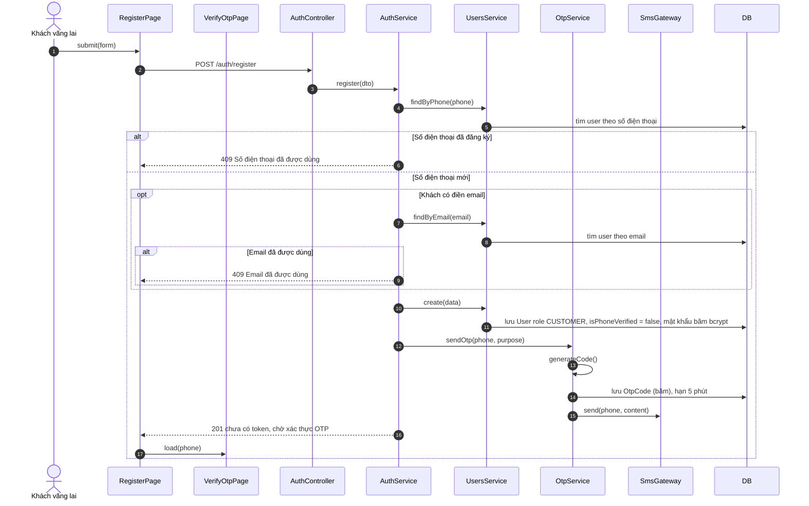
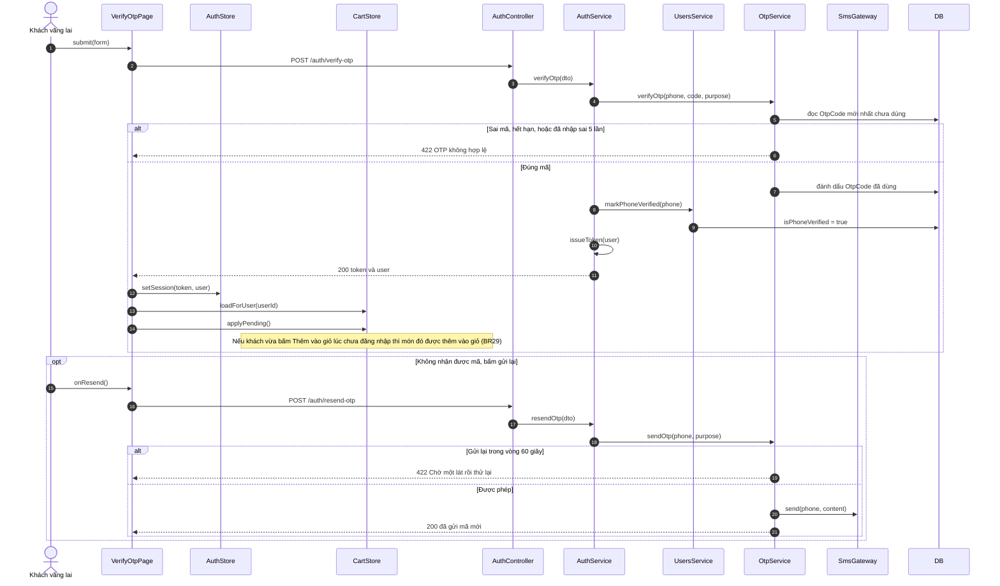
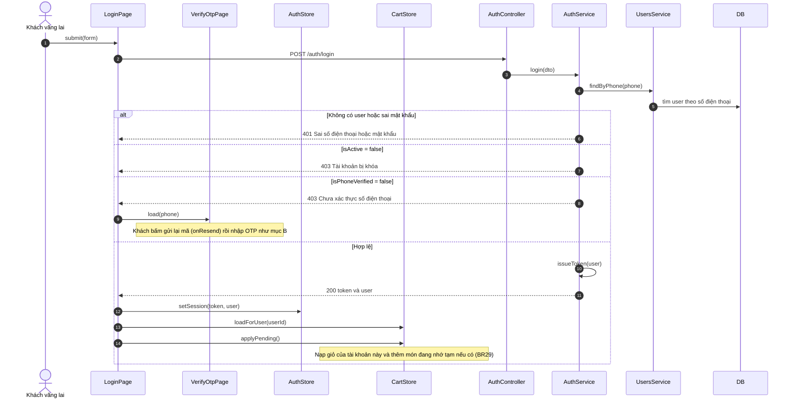
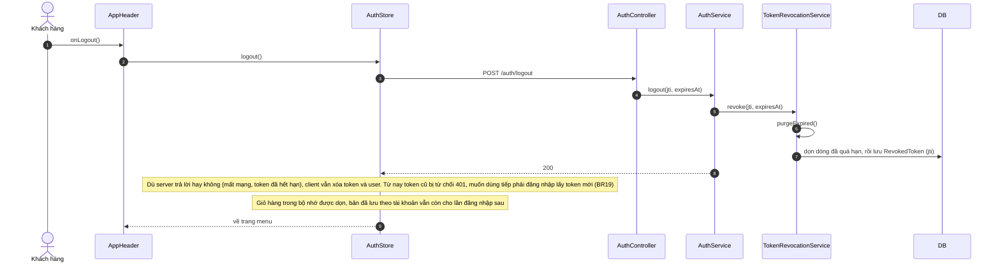
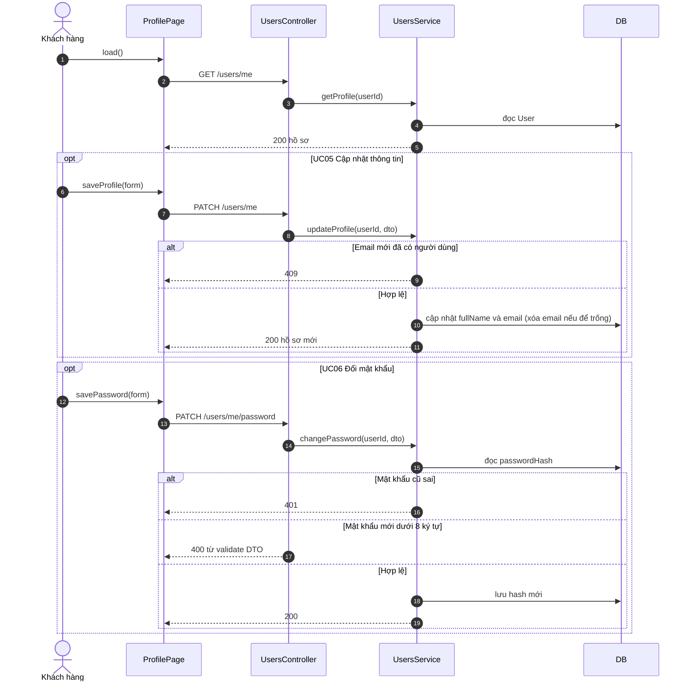
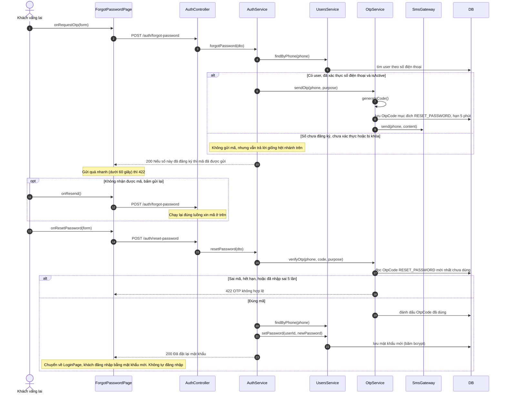

# 05 · Sequence 01 — Tài khoản (UC01–UC06, UC68)

Phủ: UC01 Đăng ký (gồm xác thực OTP), UC02 Đăng nhập, UC03 Đăng xuất, UC04 Xem thông tin, UC05 Cập nhật thông tin, UC06 Đổi mật khẩu, UC68 Quên mật khẩu (mục F). Quy tắc: BR17, BR19, BR22, BR27, BR31. Số điện thoại là bắt buộc và là tên đăng nhập; email tùy chọn. Tên hàm theo `04-class/Class-02-DichVu.md` và `Class-03-GiaoDien.md`.

## A. Đăng ký (UC01), bước 1: tạo tài khoản và gửi OTP

## B. Đăng ký (UC01), bước 2: nhập OTP

## C. Đăng nhập (UC02)

## D. Đăng xuất (UC03)

## E. Xem và cập nhật thông tin, đổi mật khẩu (UC04, UC05, UC06)

## F. Quên mật khẩu (UC68, bổ sung ngoài BFD gốc)

Khách chưa đăng nhập nhập số điện thoại, nhận OTP mock, nhập mã cùng mật khẩu mới thì đặt lại được. OTP có mục đích riêng `RESET_PASSWORD` nên mã gửi lúc đăng ký không dùng được ở đây (BR31). Bước xin mã **luôn trả cùng một câu** dù số có đăng ký hay không, để người lạ không dò ra số nào đã có tài khoản.

Mật khẩu mới dưới 8 ký tự trả 400. Đặt lại xong, các JWT đã cấp trước đó **không** bị thu hồi **[GĐ]**.

Mọi route `/users/*` đi qua `JwtAuthGuard` (thiếu hoặc sai token trả 401, user bị khóa trả 403). Số điện thoại **không đổi được** sau khi đăng ký (đã chốt), nên UC05 chỉ sửa họ tên và email.
