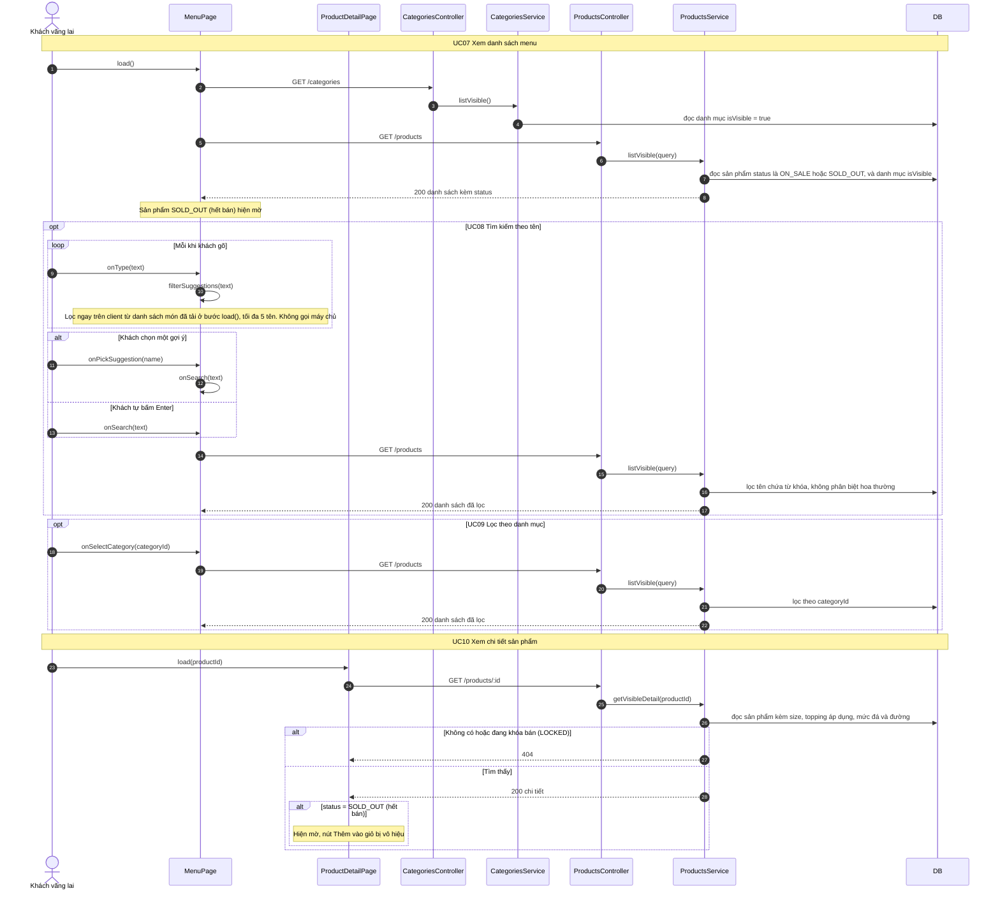

# 05 · Sequence 02 — Xem menu (UC07–UC10)

Phủ: UC07 Xem danh sách menu, UC08 Tìm kiếm (extend), UC09 Lọc theo danh mục (extend), UC10 Xem chi tiết (gồm hiển thị sản phẩm hết bán, BFD 2.8). Quy tắc: BR01, BR02.

Gợi ý khi gõ (BR32) lọc trên client từ chính danh sách món đang hiện đã tải, nên không tốn request và không bao giờ gợi ý món khóa bán. Tìm kiếm và lọc là hai tham số `search` và `categoryId` của cùng route `GET /products` nên chung một hàm `ProductsService.listVisible`.
