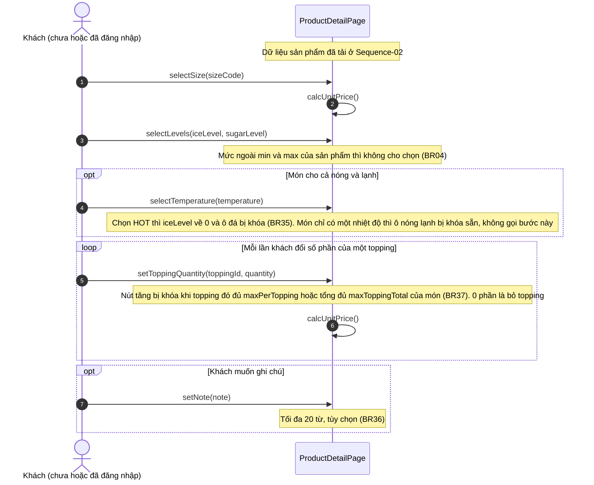
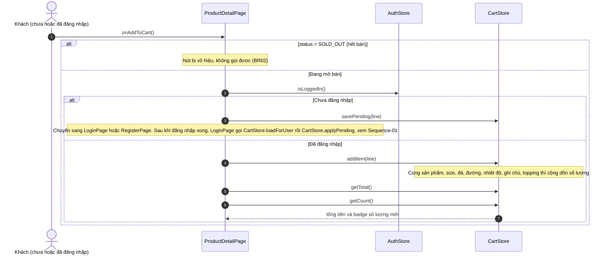
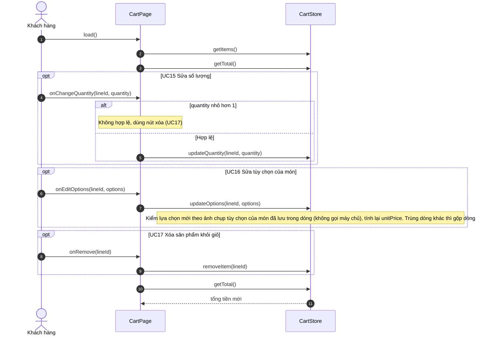

# 05 · Sequence 03 — Giỏ hàng (UC11–UC17)

Phủ: UC12 Chọn size, UC13 Chọn đá và đường (kèm nóng/lạnh và ghi chú), UC14 Chọn topping (khách vãng lai làm được), UC11 Thêm món vào giỏ (**cần đăng nhập**, include UC12–UC14), UC15 Sửa số lượng, UC16 Sửa tùy chọn, UC17 Xóa (cần đăng nhập vì giỏ chỉ có sau khi đăng nhập). Giỏ chỉ ở client (BR06) nên **không có request nào tới server**; tổng tiền là BFD 3.5. Khách chưa đăng nhập bấm thêm vào giỏ thì món được nhớ tạm, đăng nhập hoặc đăng ký xong sẽ tự thêm (Sequence-01).

## A. Chọn tùy chọn món (UC12, UC13, UC14), không cần đăng nhập

## B. Thêm vào giỏ (UC11), cần đăng nhập

## C. Sửa giỏ hàng (UC15, UC16, UC17), Khách hàng

