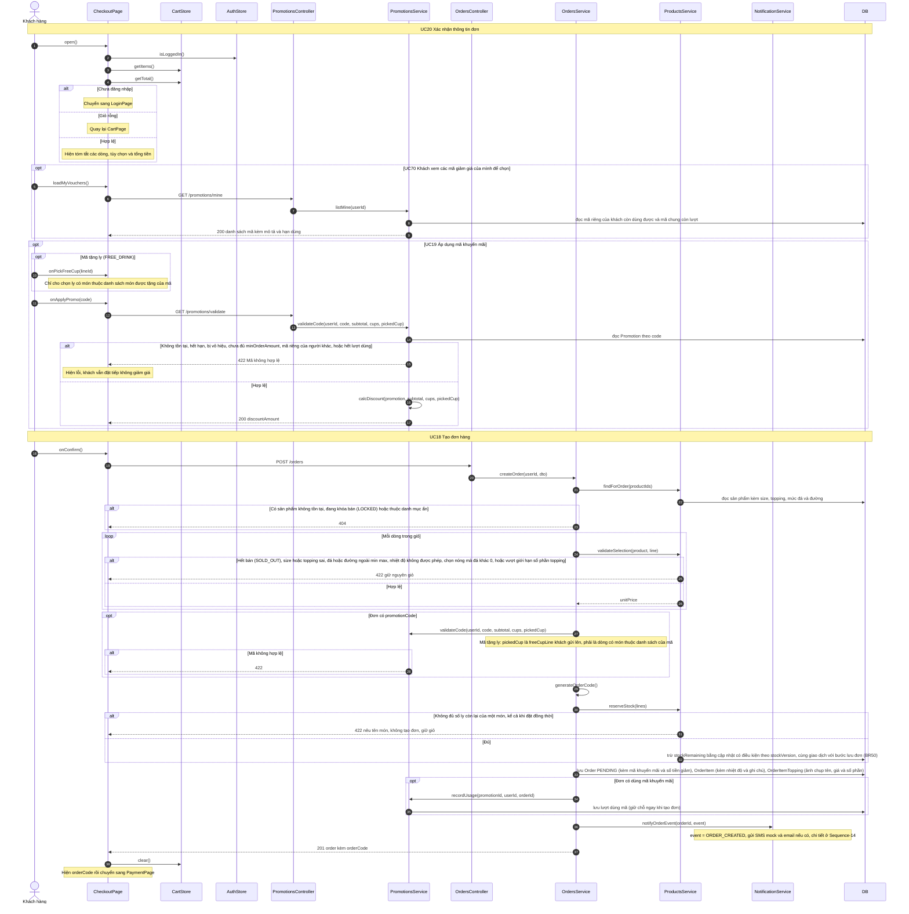

# 05 · Sequence 04 — Đặt hàng (UC18–UC20)

Phủ: UC20 Xác nhận thông tin đơn, UC19 Áp dụng mã khuyến mãi (extend UC18), UC18 Tạo đơn hàng (gồm kiểm tùy chọn, BFD 4.1). Quy tắc: BR02, BR03, BR04, BR05, BR07, BR08, BR09, BR20, BR25, BR26, BR35, BR36, BR37, BR39. Luồng tiếp theo là `Sequence-05-ThanhToan`. Collaboration tương ứng: `08-collaboration/Collaboration-01-DatHang.md` (cùng thứ tự gọi hàm).

Giá khách thấy ở giỏ chỉ để hiển thị. `OrdersService.createOrder` luôn tự tính lại từ DB (BR06), và đọc DB mỗi lần nên đổi trạng thái món (hết bán, khóa bán) có hiệu lực ngay (BR20).
