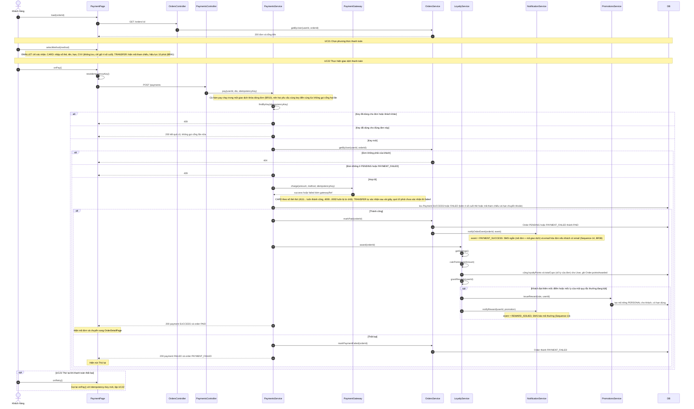

# 05 · Sequence 05 — Thanh toán (UC21–UC23, cộng điểm BFD 7.1)

Phủ: UC21 Chọn phương thức, UC22 Thực hiện giao dịch thanh toán (include UC21, tác nhân phụ Cổng mock), UC23 Thử lại khi thất bại (extend UC22), và bước hệ thống cộng điểm sau `PAID`. Quy tắc: BR09, BR10, BR11, BR38, BR40, BR41. Collaboration tương ứng: `08-collaboration/Collaboration-02-ThanhToan.md`.

Lần `charge` thất bại vẫn lưu một dòng `Payment` `FAILED`, nên `Order` có thể có nhiều `Payment` (UC33 sẽ thấy hết).
