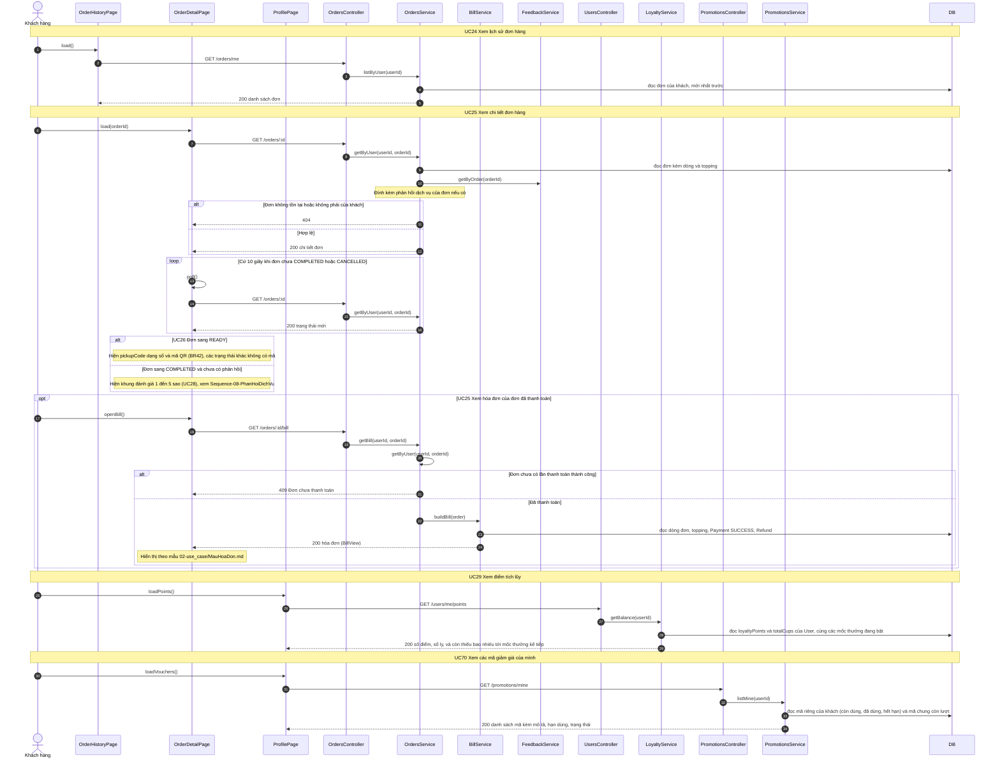

# 05 · Sequence 06 — Theo dõi đơn hàng, điểm và mã giảm giá (UC24, UC25, UC26, UC29, UC70)

Phủ: UC24 Lịch sử đơn, UC25 Chi tiết đơn, UC26 Xem mã nhận hàng, UC29 Xem điểm tích lũy (kèm số ly), UC70 Xem các mã giảm giá của mình. Hủy đơn (UC27) ở `Sequence-07-HuyDon`, phản hồi dịch vụ 5 sao (UC28) ở `Sequence-08-PhanHoiDichVu`. Quy tắc: BR11, BR12, BR14, BR23, BR24, BR38, BR39, BR40, BR42.

