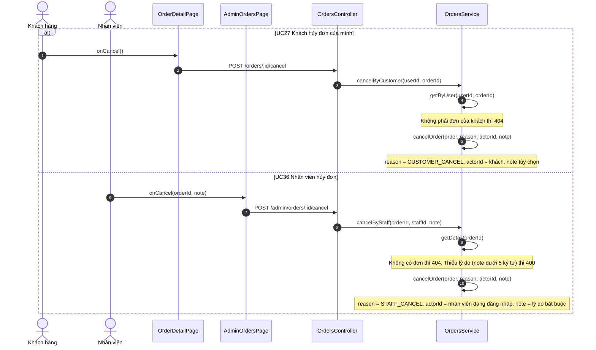
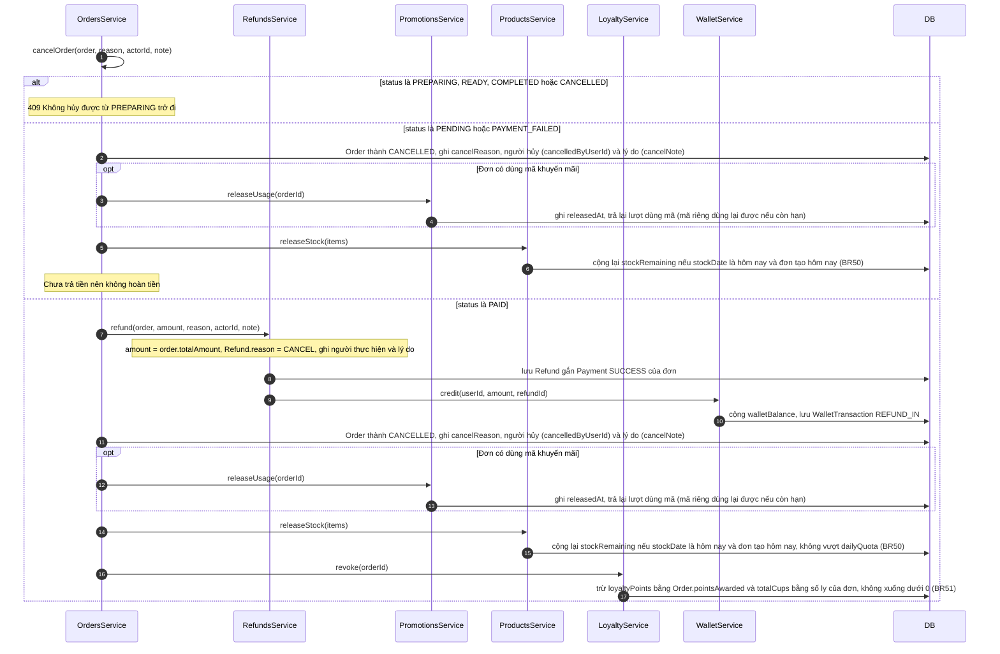

# 05 · Sequence 07 — Hủy đơn hàng và hoàn tiền (UC27, UC36, UC38)

Phủ: UC27 Khách hủy đơn của mình, UC36 Nhân viên hủy đơn bất kỳ, UC38 Hoàn tiền (khi đơn đã trả tiền). Hai đường vào dùng chung hàm nội bộ `OrdersService.cancelOrder`. Quy tắc: BR13, BR16, BR43. Hoàn tiền **cộng vào ví trên web của khách** (xem `Sequence-15-ViHoanTien`), không trả về cổng thanh toán. Trạng thái xem `06-state/State-01-DonHang.md`.

## A. Hai đường vào

## B. Chi tiết `cancelOrder` (dùng chung, gồm UC38)

Kết quả trả về là đơn đã `CANCELLED`. Hủy đơn chỉ có hai lý do: `CUSTOMER_CANCEL` và `STAFF_CANCEL`. Đơn đã hủy lưu sẵn **ai hủy và vì sao**, quản lý xem lại ở danh sách đơn lọc `CANCELLED` và chi tiết đơn (`Sequence-09-XuLyDon`), kể cả các món trong đơn.
