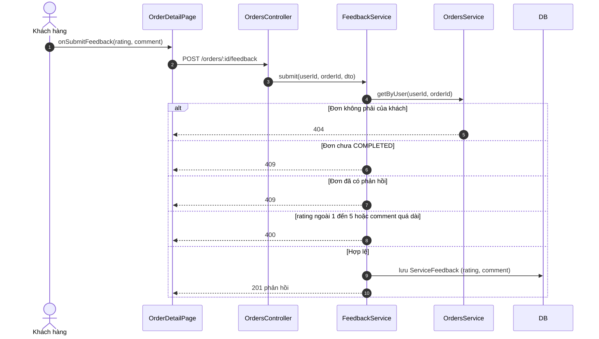
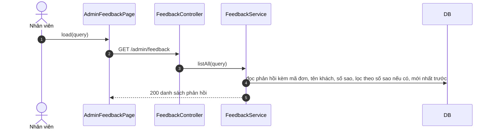

# 05 · Sequence 08 — Phản hồi dịch vụ (UC28, UC37)

Phủ: UC28 Khách gửi phản hồi dịch vụ theo thang 5 sao sau khi đã nhận hàng, UC37 Nhân viên và Quản lý xem phản hồi. Quy tắc: BR14, BR15, BR18. Collaboration tương ứng: `08-collaboration/Collaboration-03-PhanHoiDichVu.md`.

Khách có trách nhiệm kiểm hàng tại quầy: thiếu món thì nói trực tiếp với nhân viên, không báo qua app. Phản hồi qua app chỉ là đánh giá và ghi nhận, **không tự hoàn tiền**.

## A. Khách gửi phản hồi (UC28)

## B. Nhân viên xem phản hồi (UC37)

Phản hồi của một đơn cũng hiện ở chi tiết đơn của nhân viên (`Sequence-09-XuLyDon`) và của khách (`Sequence-06-TheoDoiDon`). Route `/admin/feedback` yêu cầu `STAFF` hoặc `MANAGER`.
