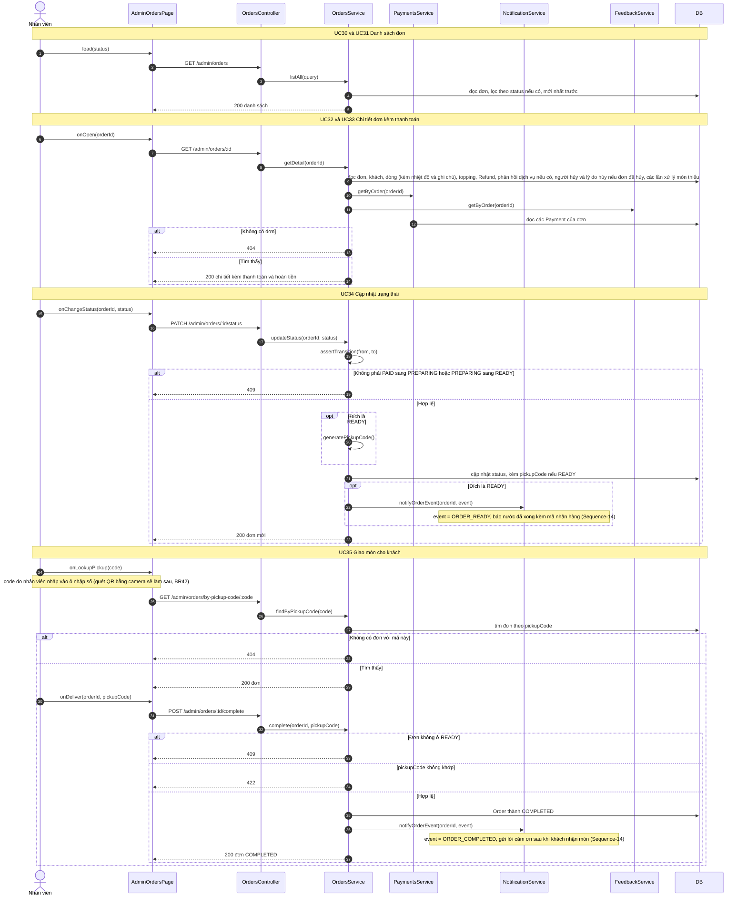

# 05 · Sequence 09 — Nhân viên xử lý đơn (UC30–UC35)

Phủ: UC30 Xem danh sách đơn, UC31 Lọc theo trạng thái (extend), UC32 Xem chi tiết (include UC33 Xem thông tin thanh toán), UC34 Cập nhật trạng thái, UC35 Giao món (gồm tra cứu theo mã nhận hàng, BFD 10.9). Quy tắc: BR12, BR13, BR18, BR28, BR42. Hủy đơn (UC36) ở `Sequence-07-HuyDon.md`, phản hồi dịch vụ (UC28, UC37) ở `Sequence-08-PhanHoiDichVu`. Mọi route `/admin/orders*` yêu cầu `STAFF` hoặc `MANAGER`, vai trò khác trả 403.

`updateStatus` không nhận đích `COMPLETED` hay `CANCELLED`: hai trạng thái đó chỉ đến từ `complete` (UC35) và `cancelOrder` (UC27, UC36).
