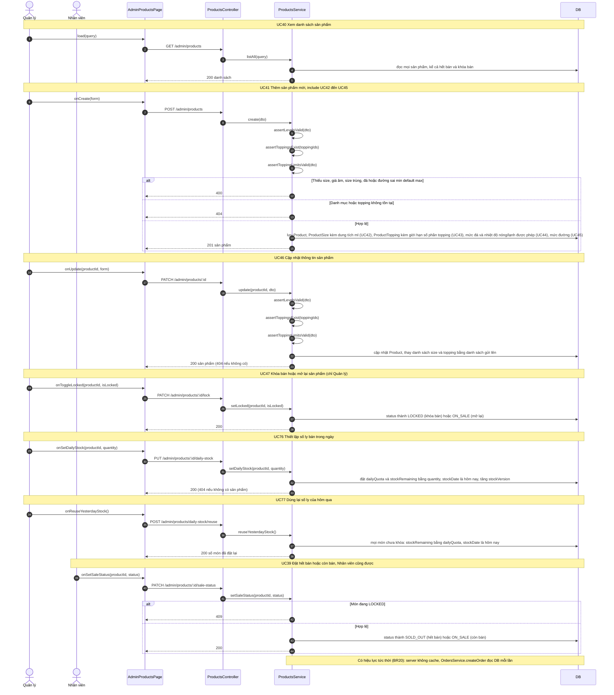

# 05 · Sequence 10 — Quản lý sản phẩm và số ly bán trong ngày (UC39–UC47, UC76, UC77)

Phủ: UC39 Đặt hết bán / còn bán (Nhân viên, Quản lý), UC40 Xem danh sách, UC41 Thêm mới (include UC42 size/giá, UC43 topping, UC44 mức đá, UC45 mức đường), UC46 Cập nhật, UC47 Khóa bán / mở lại (chỉ Quản lý), UC76 Thiết lập số ly bán trong ngày và UC77 Dùng lại số ly của hôm qua (chỉ Quản lý). Quy tắc: BR01, BR02, BR18, BR20, BR33, BR49. Món có **một trạng thái** `status`: `ON_SALE` còn bán, `SOLD_OUT` hết bán (vẫn hiện nhưng mờ, không đặt được), `LOCKED` khóa bán (ẩn khỏi menu).

Route `/admin/products*` yêu cầu `MANAGER`, riêng `PATCH /admin/products/:id/sale-status` và `GET /admin/products` cho phép `STAFF` và `MANAGER` (BR18, BR33), vì nhân viên phải xem danh sách mới chọn được món để đặt hết bán.
