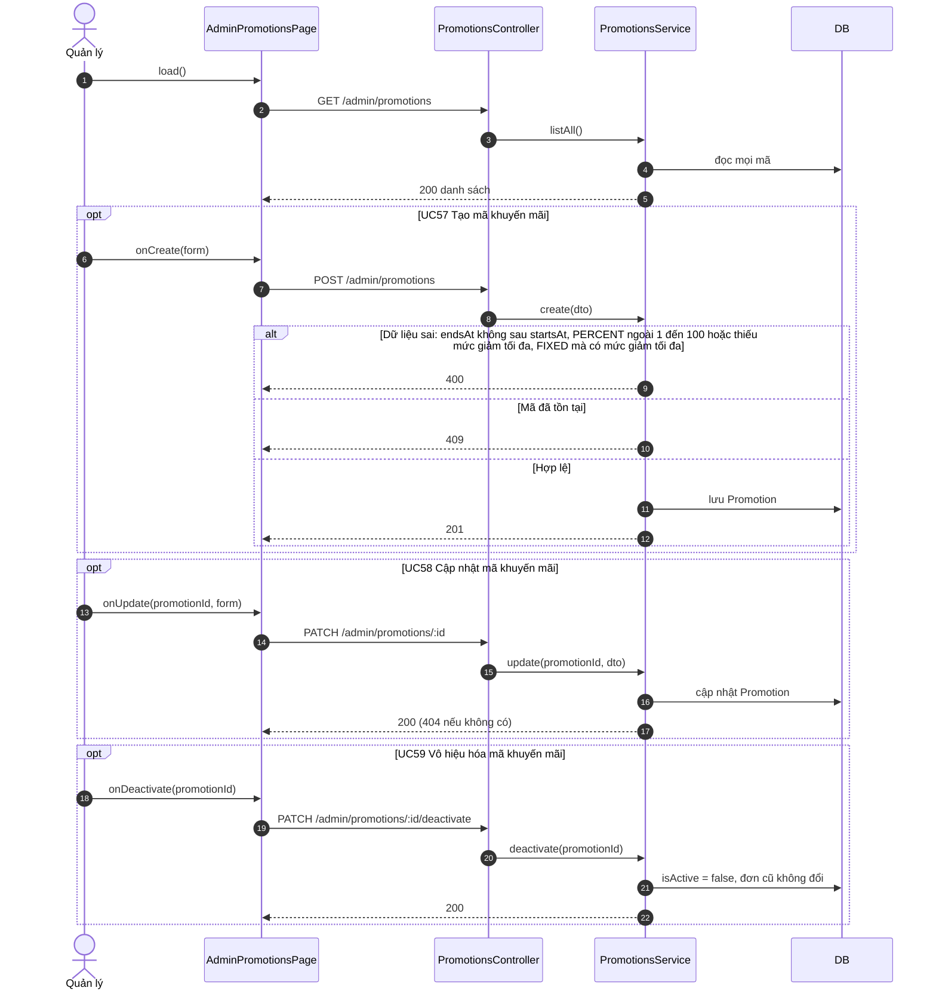
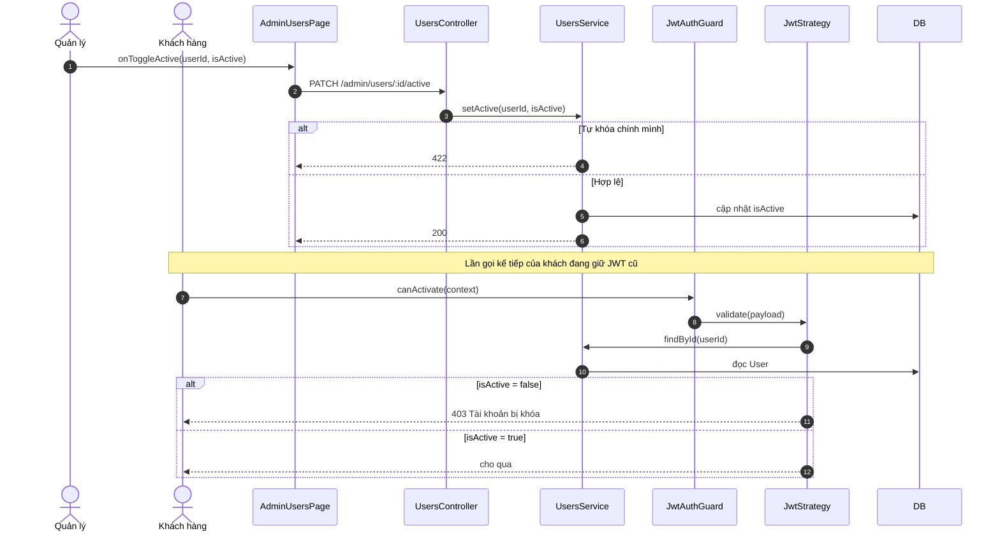
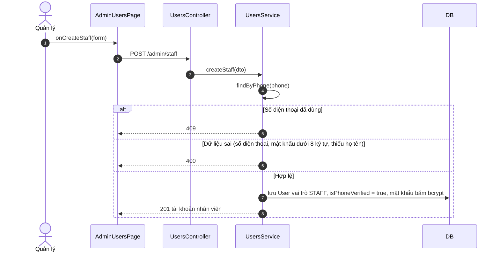
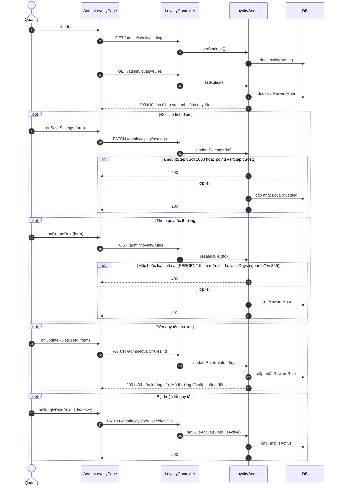

# 05 · Sequence 11 — Quản trị dạng CRUD, tích điểm và tài khoản nhân viên (UC48–UC63, UC69, UC75)

Phủ: danh mục (UC48–UC51), topping (UC52–UC55), khuyến mãi (UC56–UC59), người dùng (UC60–UC63), tích điểm và thưởng (UC69), tạo tài khoản nhân viên (UC75). Các nhóm này **cùng một khuôn**, nên vẽ một sơ đồ mẫu bằng khuyến mãi (nhóm có thêm kiểm tra nghiệp vụ), sau đó liệt kê từng UC ở bảng ánh xạ. Riêng khóa tài khoản (UC62) có ảnh hưởng tới JWT nên vẽ riêng ở mục B. Quy tắc: BR17, BR18. Mọi route yêu cầu `MANAGER`.

## A. Khuôn mẫu (ví dụ khuyến mãi, UC56–UC59)

## B. Khóa / mở khóa tài khoản và hiệu lực lên JWT (UC62, BR17)

## B3. Tạo tài khoản nhân viên (UC75, bổ sung ngoài BFD gốc)

Quản lý đưa số điện thoại và mật khẩu khởi tạo cho nhân viên; nhân viên đăng nhập rồi tự đổi mật khẩu (UC06). Khóa tài khoản nhân viên dùng UC62 (mục B).

## B2. Thiết lập tích điểm và thưởng (UC69, bổ sung ngoài BFD gốc)

Quản lý chỉnh **tỉ lệ tích điểm** (mỗi bao nhiêu đồng được bao nhiêu điểm) và các **quy tắc thưởng** (cứ mỗi N điểm hoặc N ly thì tặng một mã riêng loại nào, hạn bao nhiêu ngày). Quy tắc: BR11, BR40.

Đổi tỉ lệ hay quy tắc chỉ áp dụng cho các đơn thanh toán **từ lúc đổi trở đi**; điểm và mã đã cấp không bị tính lại.

## C. Ánh xạ từng UC sang hàm (cùng khuôn mục A)

| UC | Trang | Controller | Service | Ghi chú |
|---|---|---|---|---|
| UC48 | AdminCategoriesPage.load | CategoriesController.adminList | CategoriesService.listAll | |
| UC49 | AdminCategoriesPage.onCreate | CategoriesController.create | CategoriesService.create | Tên trùng → 409 |
| UC50 | AdminCategoriesPage.onUpdate | CategoriesController.update | CategoriesService.update | |
| UC51 | AdminCategoriesPage.onToggleVisibility | CategoriesController.setVisibility | CategoriesService.setVisibility | Ẩn danh mục thì sản phẩm của nó ẩn khỏi menu (BR01) |
| UC52 | AdminToppingsPage.load | ToppingsController.adminList | ToppingsService.listAll | |
| UC53 | AdminToppingsPage.onCreate | ToppingsController.create | ToppingsService.create | Tên trùng → 409 |
| UC54 | AdminToppingsPage.onUpdate | ToppingsController.update | ToppingsService.update | Đơn cũ không đổi (BR26) |
| UC55 | AdminToppingsPage.onToggleAvailability | ToppingsController.setAvailability | ToppingsService.setAvailability | |
| UC56 | AdminPromotionsPage.load | PromotionsController.adminList | PromotionsService.listAll | Vẽ ở mục A |
| UC57 | AdminPromotionsPage.onCreate | PromotionsController.create | PromotionsService.create | Vẽ ở mục A |
| UC58 | AdminPromotionsPage.onUpdate | PromotionsController.update | PromotionsService.update | Vẽ ở mục A |
| UC59 | AdminPromotionsPage.onDeactivate | PromotionsController.deactivate | PromotionsService.deactivate | Vẽ ở mục A |
| UC60 | AdminUsersPage.load | UsersController.adminList | UsersService.list | Chỉ role CUSTOMER |
| UC61 | AdminUsersPage.onOpen | UsersController.adminGetOne | UsersService.getDetail | |
| UC62 | AdminUsersPage.onToggleActive | UsersController.adminSetActive | UsersService.setActive | Vẽ ở mục B |
| UC63 | AdminUsersPage.onViewPoints | UsersController.adminGetPoints | LoyaltyService.getBalance | |
| UC75 | AdminUsersPage.onCreateStaff | UsersController.adminCreateStaff | UsersService.createStaff | Vẽ ở mục B3 |
| UC69 | AdminLoyaltyPage.load, onSaveSettings, onCreateRule, onUpdateRule, onToggleRule | LoyaltyController.adminGetSettings, adminUpdateSettings, adminListRules, adminCreateRule, adminUpdateRule, adminSetRuleActive | LoyaltyService.getSettings, updateSettings, listRules, createRule, updateRule, setRuleActive | Vẽ ở mục B2 |
