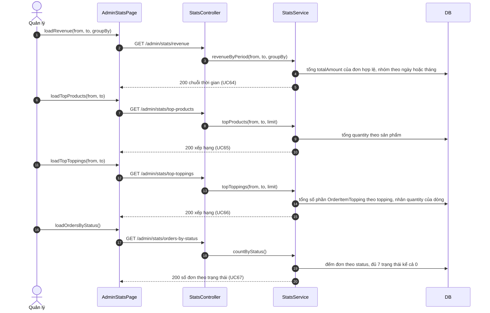

# 05 · Sequence 12 — Thống kê báo cáo (UC64–UC67)

Phủ: UC64 Doanh thu theo thời gian, UC65 Sản phẩm bán chạy, UC66 Topping được chọn nhiều, UC67 Số đơn theo trạng thái. Chỉ `MANAGER`. Quy tắc: BR21 (chỉ tính đơn `PAID`, `PREPARING`, `READY`, `COMPLETED`, riêng UC67 đếm cả 7 trạng thái).

Dữ liệu sai (`from` sau `to`, `groupBy` ngoài `day`/`month`) trả 400.
