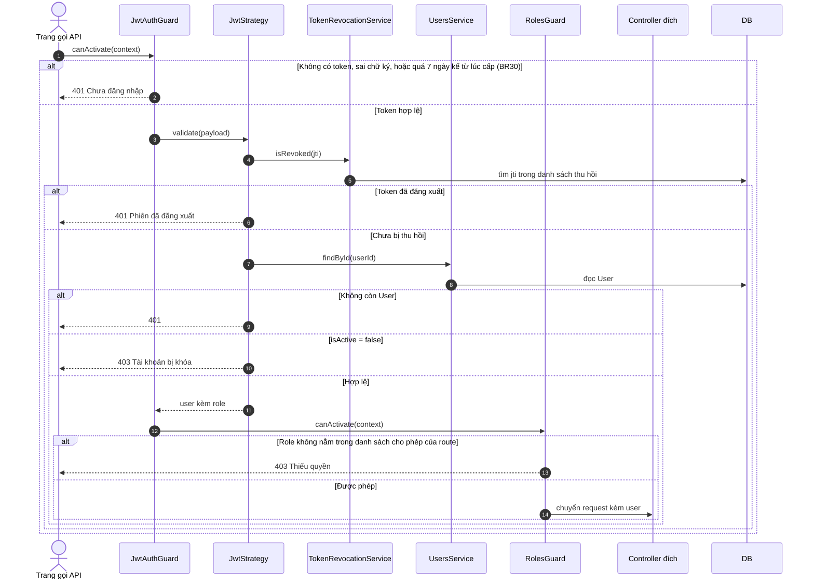
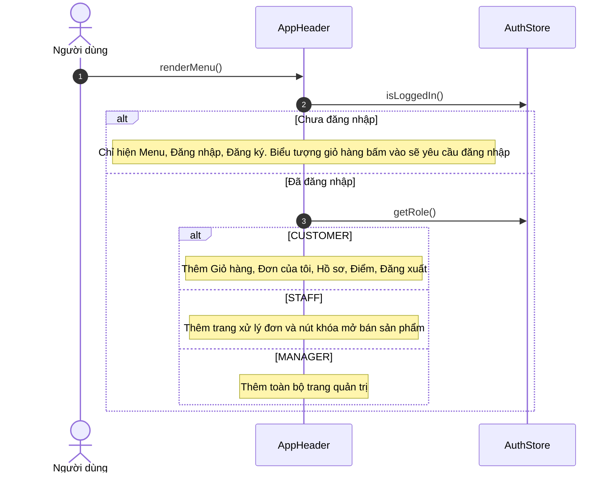

# 05 · Sequence 13 — Xác thực và phân quyền (xuyên suốt mọi route)

Luồng chung mà **mọi route có JWT** đi qua trước khi vào controller. Không thuộc một UC riêng nhưng quyết định kết quả 401, 403, 404 ở tất cả UC. Quy tắc: BR17, BR18, BR19, BR22, BR30.

## A. Guard xử lý một request

## A2. Phía giao diện: ẩn hiện menu theo vai trò

Giao diện chỉ **ẩn** chức năng cho gọn, không phải lớp bảo vệ. Bảo vệ thật là các guard ở mục A.

## B. Quyền theo nhóm route

Nhìn từ `Class-02-DichVu.md` (cột vai trò). Quản lý kế thừa Nhân viên (G01) nên `MANAGER` làm được mọi thứ `STAFF` làm được.

| Nhóm route | Vai trò cho phép | UC |
|---|---|---|
| `POST /auth/register`, `/auth/verify-otp`, `/auth/resend-otp`, `/auth/login`, `/auth/forgot-password`, `/auth/reset-password`, `GET /products`, `GET /products/:id`, `GET /categories` | không cần JWT | UC01, UC02, UC68, UC07–UC10 |
| `POST /auth/logout` | mọi người đã đăng nhập | UC03 |
| `/users/me*`, `/orders*`, `POST /payments`, `GET /promotions/validate`, `GET /promotions/mine` | `CUSTOMER` trở lên | UC04–UC06, UC18–UC29, UC70 |
| `/admin/orders*` (kể cả `POST /admin/orders/:id/item-issues`), `GET /admin/feedback` | `STAFF`, `MANAGER` | UC30–UC37, UC74 |
| `/wallet*` | `CUSTOMER` trở lên | UC71, UC72 |
| `/admin/withdrawals*`, `GET /admin/item-issues`, `POST /admin/staff` | `MANAGER` | UC73, UC74, UC75 |
| `PATCH /admin/products/:id/sale-status`, `GET /admin/products` | `STAFF`, `MANAGER` | UC39, UC40 |
| `PUT /admin/products/:id/daily-stock`, `POST /admin/products/daily-stock/reuse` | `MANAGER` | UC76, UC77 |
| Các route `/admin/*` còn lại | `MANAGER` | UC41–UC67, UC69 |

## C. Quyền sở hữu (khác với phân quyền theo vai trò)

Vai trò chưa đủ: khách chỉ được thấy **đơn của mình**. Kiểm trong service, không trong guard.

| Hàm | Kiểm | Sai thì |
|---|---|---|
| `OrdersService.getByUser(userId, orderId)` | `Order.userId = userId` | 404 (không lộ là đơn có tồn tại) |
| `OrdersService.cancelByCustomer`, `FeedbackService.submit` | gọi `getByUser` trước | 404 |
| `PaymentsService.pay` | gọi `OrdersService.getByUser` trước | 404 |
| `/admin/orders*` | không kiểm sở hữu | Nhân viên xem và xử lý mọi đơn |
