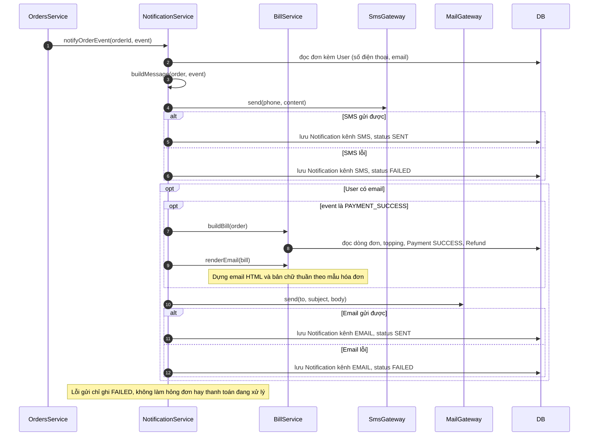
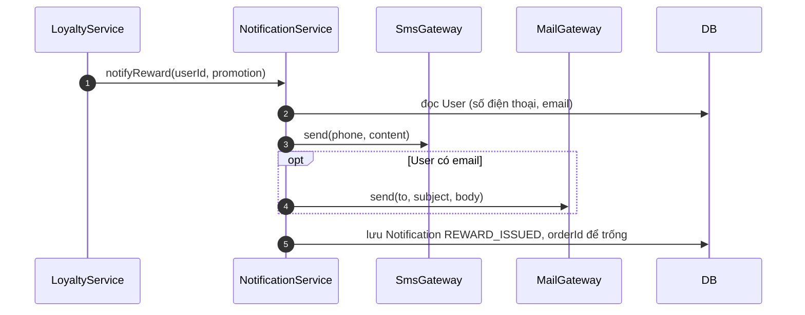

# 05 · Sequence 14 — Gửi thông báo cho khách (bước hệ thống, BR28, BR38)

Không phải use case riêng mà là bước hệ thống chạy kèm UC18, UC22, UC34, UC35 (thông báo đơn hàng), UC22 (cấp mã thưởng) và UC73 (kết quả rút tiền). Mọi thông báo gửi qua **hai kênh**: SMS (mock, tới số điện thoại bắt buộc) và email thật (chỉ khi khách có điền email). Riêng `PAYMENT_SUCCESS`: SMS chỉ một dòng ngắn, còn email là **hóa đơn đầy đủ** (mẫu ở `02-use_case/MauHoaDon.md`). Quy tắc: BR27, BR28, BR38. Collaboration tương ứng: `08-collaboration/Collaboration-13-ThongBao.md`.

## Thông báo mã thưởng (`REWARD_ISSUED`, không gắn với một đơn)

Nội dung: bạn nhận được mã giảm giá `code`, mô tả mã (ví dụ giảm 20.000đ, hoặc tặng 1 ly trong danh sách món), hạn dùng. Mã thưởng cũng xem được trong hồ sơ (UC70).

## Thông báo yêu cầu rút tiền (`WITHDRAWAL_COMPLETED`, `WITHDRAWAL_REJECTED`)

`WalletService.completeWithdrawal` và `WalletService.rejectWithdrawal` gọi `NotificationService.notifyWithdrawal(userId, request)` (xem `Sequence-15-ViHoanTien`). Gửi SMS tới số điện thoại (và email nếu có): đã chuyển thành công số tiền X kèm mã giao dịch, hoặc bị từ chối kèm lý do và tiền đã trả lại ví. Không gắn với đơn nào nên `Notification.orderId` để trống.

## Các sự kiện và nội dung

| `event` | Gọi từ | Lúc nào | SMS (mock) | Email (nếu có) |
|---|---|---|---|---|
| `ORDER_CREATED` | `OrdersService.createOrder` | Vừa tạo đơn `PENDING` (UC18) | Đã nhận đơn mã `orderCode`, tổng tiền, nhắc thanh toán | Nội dung tương tự SMS |
| `PAYMENT_SUCCESS` | `OrdersService.markPaid` | Thanh toán thành công (UC22) | **Một dòng ngắn:** đã thanh toán thành công, mã đơn, **mã giao dịch** | **Hóa đơn đầy đủ** (BR38) |
| `ORDER_READY` | `OrdersService.updateStatus` | Đơn sang `READY` (UC34) | Nước đã xong, **mã nhận hàng** `pickupCode` | Nội dung tương tự SMS |
| `ORDER_COMPLETED` | `OrdersService.complete` | Đơn sang `COMPLETED` (UC35) | Lời cảm ơn sau khi nhận món, hẹn gặp lại | Nội dung tương tự SMS |
| `WITHDRAWAL_COMPLETED`, `WITHDRAWAL_REJECTED` | `WalletService.completeWithdrawal`, `WalletService.rejectWithdrawal` qua `NotificationService.notifyWithdrawal` | Quản lý chuyển tiền xong hoặc từ chối yêu cầu rút (BR44) | Số tiền, mã giao dịch hoặc lý do từ chối | Nội dung tương tự SMS |
| `REWARD_ISSUED` | `LoyaltyService.award` qua `NotificationService.notifyReward` | Khách đạt mốc điểm hoặc mốc ly và được cấp mã thưởng (BR40) | Mã thưởng, mô tả, hạn dùng | Nội dung tương tự SMS |

Các sự kiện khác (hủy đơn, hoàn tiền, nhắc gửi phản hồi dịch vụ) **chưa gửi thông báo** **[GĐ]**; khách vẫn thấy qua `OrderDetailPage.poll`.

## Cổng gửi

| Cổng | Loại | Ghi chú |
|---|---|---|
| `SmsGateway.send` | mock | Không gửi SMS thật: ghi nội dung ra log máy chủ. Cũng dùng để gửi mã OTP (UC01, BR27) |
| `MailGateway.send` | email thật | Gửi qua SMTP theo cấu hình môi trường. Chỉ gọi khi `User.email` khác rỗng. Với hóa đơn, `body` là email HTML do `BillService.renderEmail` dựng |
