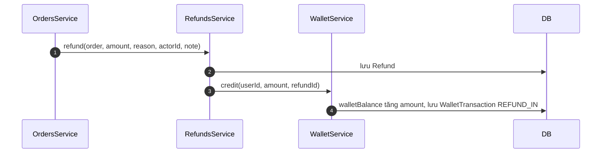
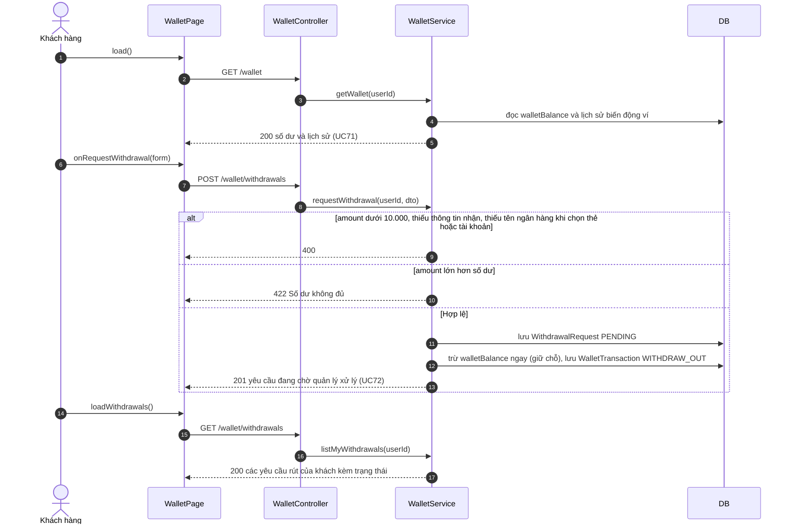
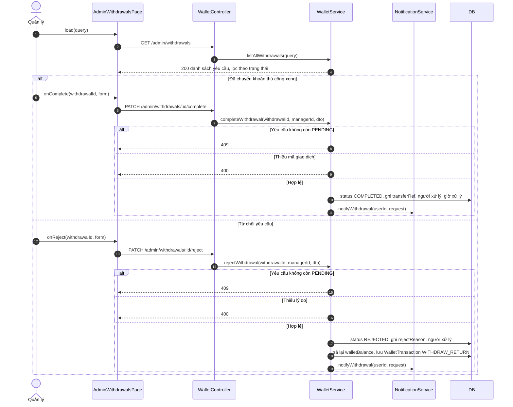

# 05 · Sequence 15 — Ví hoàn tiền và rút tiền (UC71, UC72, UC73)

Ví trên web của khách **chỉ nhận tiền hoàn** (hủy đơn, hoàn tiền món không làm được), **không dùng để thanh toán đơn**. Muốn lấy tiền ra, khách gửi yêu cầu rút kèm thông tin nhận, quản lý **chuyển thủ công** rồi đánh dấu đã xong. Quy tắc: BR43, BR44. Collaboration tương ứng: `08-collaboration/Collaboration-14-ViHoanTien.md`.

## A. Cộng tiền hoàn vào ví (do hệ thống chạy, từ UC38 và UC74)

## B. Khách xem ví và gửi yêu cầu rút tiền (UC71, UC72)

## C. Quản lý xử lý yêu cầu rút tiền (UC73)

Các route `/wallet*` yêu cầu `CUSTOMER`, `/admin/withdrawals*` yêu cầu `MANAGER`. Báo khách bằng SMS (và email nếu có) khi yêu cầu đã chuyển xong hoặc bị từ chối (`Sequence-14-ThongBao`).
