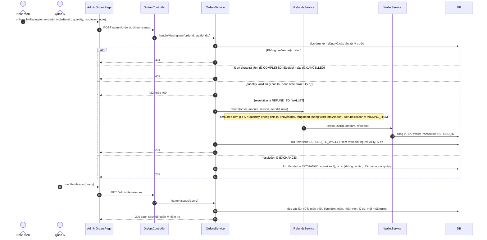

# 05 · Sequence 16 — Nhân viên xử lý món không làm được (UC74)

Khi một món trong đơn **hết làm được** (hết nguyên liệu), nhân viên phát hiện lúc chuẩn bị hoặc trước khi giao, ghi nhận trong hệ thống và chọn **một trong hai cách**: hoàn tiền món đó vào ví của khách, hoặc đổi món khác cho khách (đổi ngoài quầy, hệ thống chỉ ghi nhận). Mỗi lần xử lý lưu **ai xử lý và vì sao** để quản lý kiểm tra. Quy tắc: BR45, BR43. Collaboration tương ứng: `08-collaboration/Collaboration-15-XuLyMonKhongLamDuoc.md`.

Chỉ làm được khi đơn đang `PAID`, `PREPARING` hoặc `READY` (trước khi giao). Xử lý món không làm được **không đổi trạng thái đơn**. `POST /admin/orders/:id/item-issues` cho `STAFF` và `MANAGER`; `GET /admin/item-issues` chỉ `MANAGER`.
