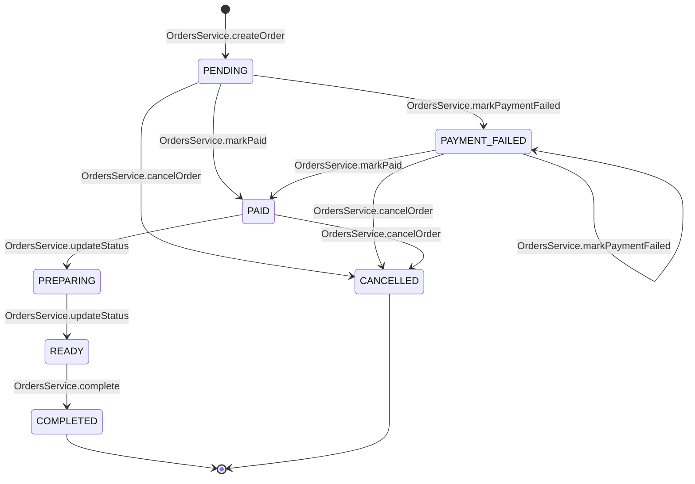

# 06 · State 01 — Máy trạng thái đơn hàng

Vòng đời của `Order.status` (7 trạng thái, enum `OrderStatus` ở `04-class/Class-01-MienDuLieu.md`). Mọi chuyển trạng thái nằm trong `OrdersService` và gọi qua hàm ghi trên mũi tên. Quy tắc: BR09, BR12, BR13.

## A. Trạng thái đơn

## B. Bảng chuyển trạng thái

| Từ | Đến | Hàm | Use case | Điều kiện / tác dụng phụ |
|---|---|---|---|---|
| (mới) | `PENDING` | `OrdersService.createOrder` | UC18 | Giỏ hợp lệ (BR09) |
| `PENDING` | `PAID` | `OrdersService.markPaid` | UC22 | Cổng trả thành công, cộng điểm (BR11) |
| `PENDING` | `PAYMENT_FAILED` | `OrdersService.markPaymentFailed` | UC22 | Cổng trả thất bại |
| `PAYMENT_FAILED` | `PAID` | `OrdersService.markPaid` | UC23 | Thử lại thành công |
| `PAYMENT_FAILED` | `PAYMENT_FAILED` | `OrdersService.markPaymentFailed` | UC23 | Thử lại vẫn thất bại |
| `PENDING`, `PAYMENT_FAILED` | `CANCELLED` | `OrdersService.cancelOrder` | UC27, UC36 | Chưa trả tiền nên không hoàn tiền |
| `PAID` | `CANCELLED` | `OrdersService.cancelOrder` | UC27, UC36, UC38 | Hoàn đủ `totalAmount`, `Refund.reason = CANCEL` (BR13) |
| `PAID` | `PREPARING` | `OrdersService.updateStatus` | UC34 | Nhân viên (BR12) |
| `PREPARING` | `READY` | `OrdersService.updateStatus` | UC34 | Sinh `pickupCode` (BR12) |
| `READY` | `COMPLETED` | `OrdersService.complete` | UC35 | Nhập đúng `pickupCode`; sau đó khách mới gửi được phản hồi dịch vụ (UC28, BR14) |

**Không chuyển được:** từ `PREPARING`, `READY` sang `CANCELLED` (BR13); `COMPLETED` và `CANCELLED` là trạng thái cuối. Mọi chuyển ngoài bảng trả 409.

Trạng thái theo vai trò gọi: khách gây ra `PENDING`, `PAID`, `PAYMENT_FAILED` (qua thanh toán) và `CANCELLED`. Nhân viên gây ra `PREPARING`, `READY`, `COMPLETED`, `CANCELLED`.

Phản hồi dịch vụ (UC28) **không làm đổi trạng thái đơn**; nó gắn với đơn `COMPLETED` (`Sequence-08-PhanHoiDichVu`).
