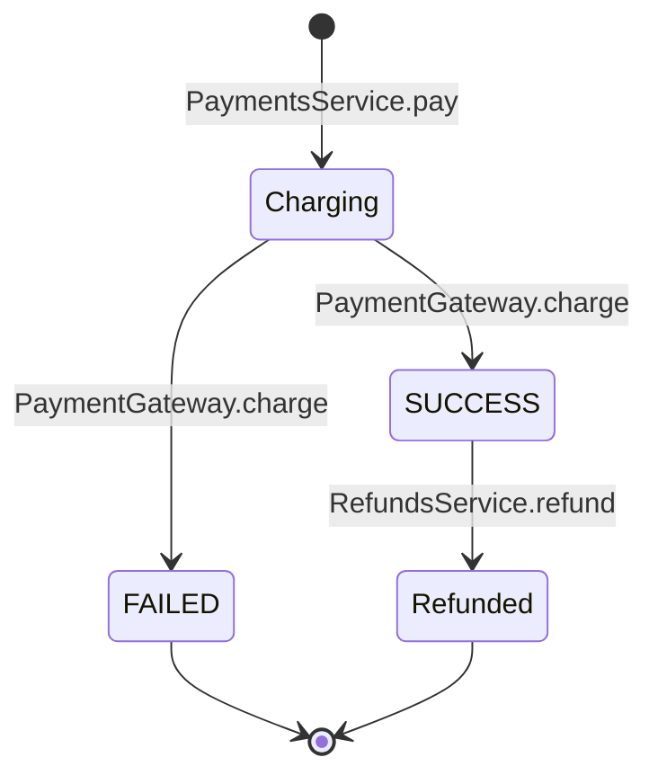

# 06 · State 02 — Giao dịch thanh toán và hoàn tiền

Vòng đời một lần thanh toán (`Payment`) và việc hoàn tiền của nó. `Payment.status` chỉ có `SUCCESS` hoặc `FAILED` (enum `PaymentStatus`). Trạng thái `Refunded` là **suy ra**: không lưu cột, có khi tồn tại `Refund` của lần thanh toán đó. Hoàn tiền xảy ra khi hủy đơn đã trả tiền (hoàn đủ) hoặc khi nhân viên hoàn tiền món thiếu (hoàn theo món). **Tiền hoàn cộng vào ví của khách**, không trả về cổng thanh toán (xem `State-07-YeuCauRutTien`). Quy tắc: BR10, BR13, BR16.

| Trạng thái | Lưu ở đâu | Ý nghĩa |
|---|---|---|
| `Charging` | không lưu (đang trong `PaymentsService.pay`) | Đang gọi cổng mock |
| `SUCCESS` | `Payment.status` | Cổng báo thành công, chưa hoàn tiền |
| `FAILED` | `Payment.status` | Cổng báo thất bại. Khách thử lại bằng `Idempotency-Key` mới thì tạo `Payment` mới, không sửa dòng này |
| `Refunded` | suy ra | Đã có `Refund` của lần thanh toán này: hoàn đủ khi hủy đơn (`CANCEL`) hoặc hoàn một phần khi hoàn tiền món thiếu (`MISSING_ITEM`); tiền vào ví của khách |

## Liên hệ với trạng thái đơn

| Sự kiện thanh toán | `Order.status` kết quả | Hàm |
|---|---|---|
| `Payment` `SUCCESS` | `PAID` | `OrdersService.markPaid` |
| `Payment` `FAILED` | `PAYMENT_FAILED` | `OrdersService.markPaymentFailed` |
| `Refund` đủ (`CANCEL`) | `CANCELLED` | `OrdersService.cancelOrder` |
| `Refund` món thiếu (`MISSING_ITEM`) | không đổi | `OrdersService.handleMissingItem` |

Một `Order` có thể có nhiều `Payment`: nhiều lần `FAILED` rồi tối đa một lần `SUCCESS`. Khi `Idempotency-Key` trùng, `PaymentsService.findByKey` trả lại `Payment` cũ nên không tạo dòng mới.
