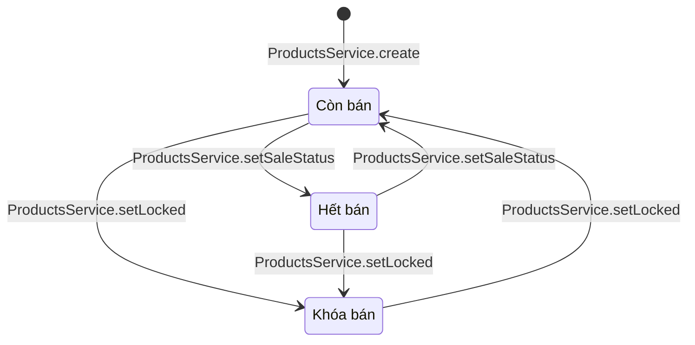
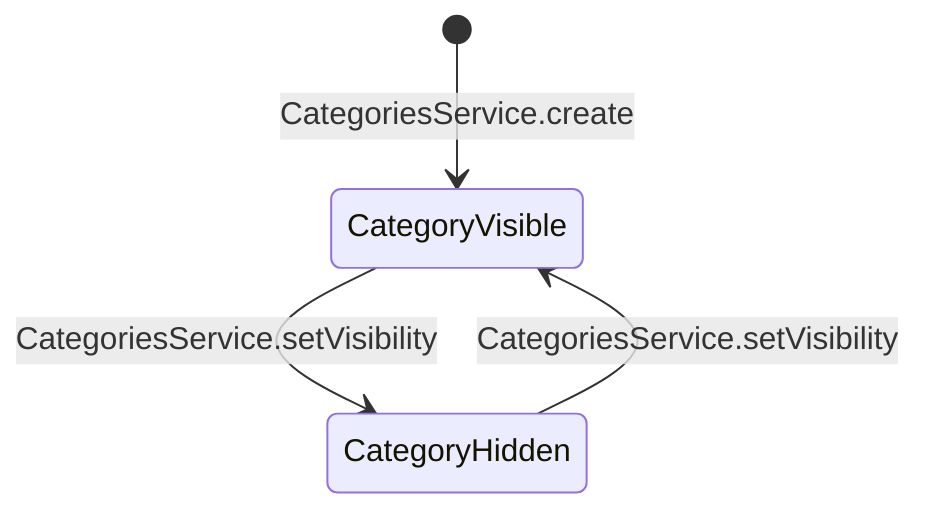
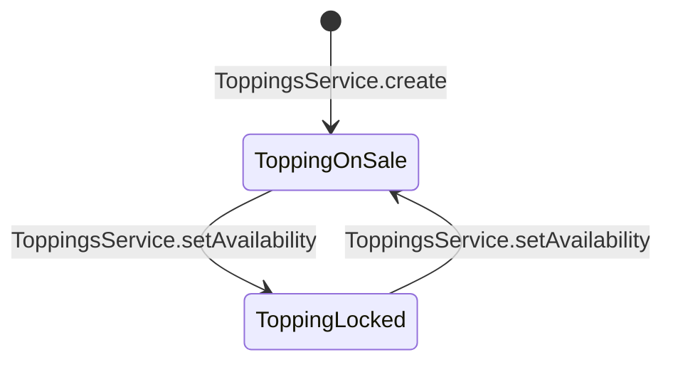

# 06 · State 03 — Sản phẩm, danh mục, topping

Sản phẩm có **một trạng thái** `Product.status` với 3 giá trị: **còn bán** (`ON_SALE`), **hết bán** (`SOLD_OUT`), **khóa bán** (`LOCKED`). Quy tắc: BR01, BR02, BR20, BR33.

Ngoài `status`, món còn có **số ly bán trong ngày** (BR49): `remainingToday` bằng 0 thì món hiện mờ và không đặt được dù `status` vẫn là `ON_SALE`. Đây là một giá trị suy ra, không phải trạng thái thứ tư, nên không vẽ thêm nút.

## A. Sản phẩm

| Trạng thái | `status` | Trên menu (UC07) | Chi tiết (UC10) | Thêm giỏ (UC11) | Tạo đơn (UC18) |
|---|---|---|---|---|---|
| Còn bán | `ON_SALE` | Hiện | 200 | Được | Được |
| Hết bán | `SOLD_OUT` | Hiện, bị mờ | 200, nút thêm giỏ vô hiệu | Không | 422 |
| Khóa bán | `LOCKED` | Không hiện | 404 | Không | 404 |

| Chuyển | Ai làm | UC | Ghi chú |
|---|---|---|---|
| (mới) → Còn bán | Quản lý | UC41 | Món mới tạo luôn là còn bán |
| Còn bán ⇄ Hết bán | Nhân viên, Quản lý | UC39 | `ProductsService.setSaleStatus`. Món đang khóa bán thì 409 |
| Còn bán hoặc Hết bán → Khóa bán | Quản lý | UC47 | `ProductsService.setLocked` với `isLocked = true` |
| Khóa bán → Còn bán | Quản lý | UC47 | `ProductsService.setLocked` với `isLocked = false`, về **còn bán** (không nhớ trạng thái hết bán trước đó) **[GĐ]** |

Sản phẩm còn bị ẩn khỏi menu nếu danh mục của nó đang ẩn (mục B), dù `status` là `ON_SALE` hay `SOLD_OUT`.

## B. Danh mục

Danh mục ẩn thì mọi sản phẩm của nó ẩn khỏi menu (UC07, UC09), nhưng `status` của từng món không đổi, nên mở lại danh mục là món hiện lại như cũ.

## C. Topping

Topping khóa bán: UI ở UC14 không hiện, và `ProductsService.validateSelection` từ chối (422) nếu giỏ cũ vẫn còn topping đó (BR05). Đơn đã đặt không bị ảnh hưởng (BR26). Topping chỉ có hai trạng thái, chưa chia thêm "hết bán" **[GĐ]**.
