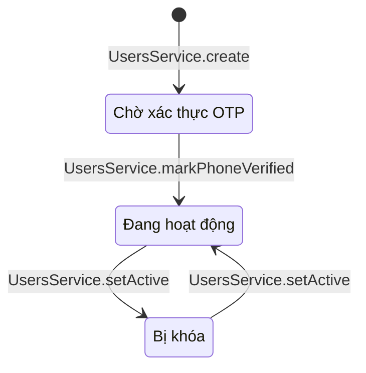
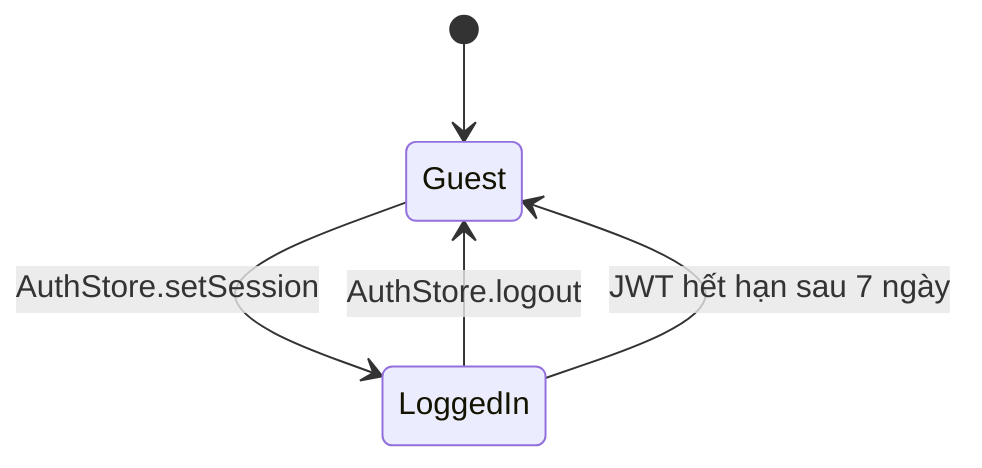
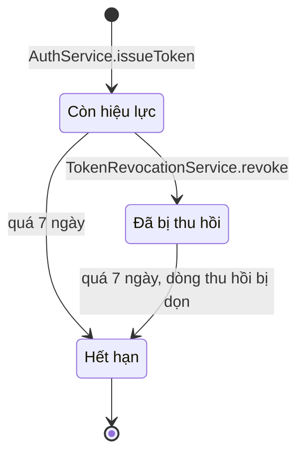

# 06 · State 04 — Tài khoản và phiên đăng nhập

Hai máy trạng thái khác nhau: tài khoản (lưu ở server, `User.isPhoneVerified` và `User.isActive`) và phiên (ở client, `AuthStore`). Quy tắc: BR17, BR19, BR27.

## A. Tài khoản (server)

| Trạng thái | `isPhoneVerified` | `isActive` | Đăng nhập (UC02) | Gọi API với JWT |
|---|---|---|---|---|
| `PendingOtp` | false | true | 403, phải nhập OTP trước | Chưa có JWT |
| `Active` | true | true | Được | Được |
| `Locked` | true | false | 403 | 403 ở lần gọi kế tiếp, do `JwtStrategy.validate` đọc lại `User` mỗi request |

`PendingOtp` chỉ rời đi khi nhập đúng OTP (UC01 bước 2). Quản lý khóa và mở khóa chỉ làm được với tài khoản đã xác thực. Quản lý không tự khóa chính mình (422). Khóa tài khoản không xóa đơn hay điểm của khách.

## B. Phiên đăng nhập (client)

| Trạng thái | `AuthStore.isLoggedIn` | Làm được |
|---|---|---|
| `Guest` | false | UC01, UC02, UC07–UC10 (xem menu, món, topping), UC12–UC14 (chọn size, đá, đường, topping). **Không** thêm giỏ được |
| `LoggedIn` | true | Thêm UC03–UC06, UC11 (thêm giỏ), UC15–UC29; vai trò `STAFF`, `MANAGER` thêm UC30 trở đi |

`AuthStore.setSession` được gọi sau khi **nhập đúng OTP** (UC01) hoặc đăng nhập thành công (UC02). Đăng ký xong mà chưa nhập OTP thì vẫn là `Guest`. JWT sống 7 ngày (BR30): quá hạn thì lần gọi API kế tiếp trả 401, trang xóa phiên và khách về `Guest`, phải đăng nhập lại. `AuthStore.logout` gọi máy chủ thu hồi JWT rồi xóa phiên ở client (BR19). Giỏ hàng lưu theo tài khoản nên đăng nhập lại là thấy (`State-06-GioHang`).

## C. Vòng đời một JWT (server)

| Trạng thái | Máy chủ xử lý | Nguồn gốc |
|---|---|---|
| `Valid` | Cho qua, nếu tài khoản còn hoạt động | `AuthService.issueToken` (đăng nhập, xác thực OTP) |
| `Revoked` | 401 ở `JwtStrategy.validate`, do `TokenRevocationService.isRevoked` | Đăng xuất (UC03, `AuthService.logout`) |
| `Expired` | 401 ở bước kiểm chữ ký và hạn của `JwtAuthGuard` | Hết 7 ngày kể từ lúc cấp |

Thu hồi chỉ áp dụng cho **đúng thẻ vừa đăng xuất** (theo `jti`). Thẻ ở máy khác, nếu có, vẫn dùng được tới khi hết hạn hoặc tài khoản bị khóa (BR17).
