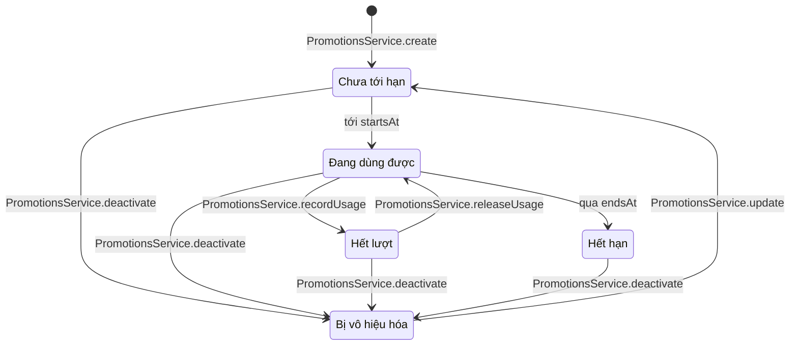
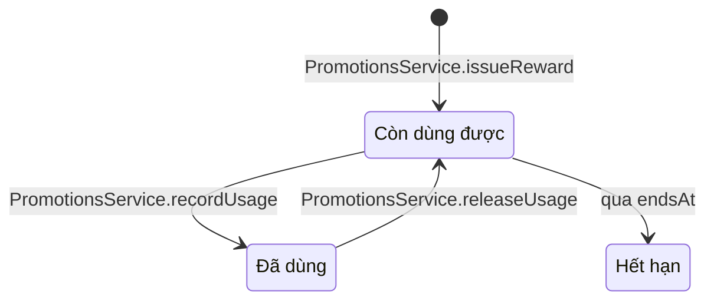

# 06 · State 05 — Mã khuyến mãi

Mã có hai loại (`scope`): **mã chung** (`PUBLIC`, quản lý tạo tay, ai cũng dùng được, có thể giới hạn lượt) và **mã riêng** (`PERSONAL`, gắn một tài khoản, dùng một lần, thường do quy tắc thưởng tự cấp). Quy tắc: BR07, BR39, BR40. Các trạng thái dưới đây trừ `Disabled` đều **suy ra** (từ thời gian và số lượt dùng) nên không có hàm chuyển; chỉ `Disabled` do quản lý đặt (`isActive = false`).

## A. Mã chung

| Trạng thái | Điều kiện | `PromotionsService.validateCode` |
|---|---|---|
| `NotStarted` | `isActive` và `now < startsAt` | 422 |
| `Running` | `isActive`, `startsAt ≤ now ≤ endsAt` và còn lượt (số lượt đang tính nhỏ hơn `maxTotalUses`, hoặc `maxTotalUses` để trống) | Hợp lệ nếu `subtotal ≥ minOrderAmount` và khách chưa dùng quá `maxUsesPerUser` lần |
| `Exhausted` | Số lượt đang tính đã bằng `maxTotalUses` | 422. Hủy một đơn đã dùng mã thì mã trở lại `Running` (`releaseUsage`) |
| `Expired` | `isActive` và `now > endsAt` | 422 |
| `Disabled` | `isActive = false` | 422 |

Lượt dùng được tính ngay khi **tạo đơn** (`recordUsage`) và trả lại khi đơn bị hủy (`releaseUsage`). Đơn thanh toán hỏng vẫn giữ lượt vì khách còn thử lại được (BR39).

## B. Mã riêng (mã thưởng)

| Trạng thái | Điều kiện | Ghi chú |
|---|---|---|
| `Valid` | Chủ mã đang đăng nhập, `now ≤ endsAt`, chưa có lượt dùng nào đang tính | Hiện trong hồ sơ (UC70) và ở bước đặt hàng, chọn để dùng |
| `Used` | Có một lượt dùng đang tính (đơn đã tạo bằng mã này) | Đơn bị hủy thì quay lại `Valid` nếu còn hạn |
| `PersonalExpired` | `now > endsAt` | Không dùng được, vẫn hiện trong danh sách với trạng thái hết hạn |

Người khác gõ mã riêng của khách này bị từ chối (422, cùng thông báo như mã không tồn tại).

## C. Ghi chú chung

Mã `Disabled` được bật lại bằng `PromotionsService.update` (UC58) đặt `isActive = true` **[GĐ]**, sau đó rơi vào `NotStarted`, `Running` hoặc `Expired` tùy thời gian. Đơn đã dùng mã không đổi khi mã bị vô hiệu hóa hay hết hạn. Mã thưởng không do quản lý tạo tay mà do quy tắc thưởng cấp (xem `Sequence-05-ThanhToan`).
