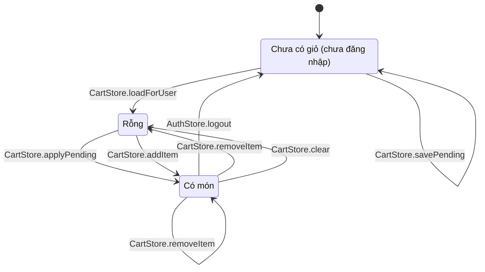

# 06 · State 06 — Giỏ hàng (client)

Trạng thái của `CartStore`. Giỏ chỉ ở client (BR06) nên không có bảng. **Giỏ chỉ tồn tại khi đã đăng nhập** (BR29): mỗi tài khoản một giỏ riêng trên máy (khóa `cart:<userId>`), lưu lại khi tải lại trang và khi đăng xuất, đăng nhập lại là thấy.

Khách chưa đăng nhập chưa có giỏ. Món họ vừa chọn được nhớ tạm trong `CartStore.savePending`, và được thêm vào giỏ ngay sau khi đăng nhập hoặc xác thực OTP.

Khi tài khoản đã có món từ lần trước, `CartStore.loadForUser` đưa thẳng vào `HasItems` (không qua `Empty`).

| Trạng thái | `CartStore.getCount` | `CartStore.getTotal` | `CheckoutPage.open` |
|---|---|---|---|
| `NoCart` | 0 | 0 | Cần đăng nhập, sang `LoginPage` |
| `Empty` | 0 | 0 | Quay lại `CartPage` |
| `HasItems` | tổng số lượng | `Σ unitPrice × quantity` | Mở được |

| Chuyển | UC | Ghi chú |
|---|---|---|
| `NoCart → NoCart` qua `savePending` | UC11 | Khách chưa đăng nhập bấm thêm vào giỏ: nhớ tạm món, chuyển sang đăng nhập hoặc đăng ký |
| `NoCart → Empty` qua `loadForUser` | UC01, UC02 | Vừa vào phiên đăng nhập, nạp giỏ của tài khoản (nếu đã có món thì sang `HasItems`) |
| `Empty → HasItems` qua `applyPending` | UC11 | Thêm món đã nhớ tạm |
| `Empty → HasItems` qua `addItem` | UC11 | Thêm món đầu tiên khi đã đăng nhập |
| `HasItems → HasItems` qua `addItem` | UC11 | Cùng sản phẩm và tùy chọn thì cộng dồn số lượng |
| `HasItems → HasItems` qua `updateQuantity`, `updateOptions` | UC15, UC16 | `updateOptions` trùng dòng khác thì gộp |
| `HasItems → Empty` qua `removeItem` | UC17 | Khi xóa dòng cuối cùng |
| `HasItems → Empty` qua `clear` | UC18 | `CheckoutPage.onConfirm` gọi sau khi tạo đơn thành công. Tạo đơn thất bại (422) thì không `clear`, giữ giỏ |
| `HasItems → NoCart` qua `logout` | UC03 | Giỏ trong bộ nhớ được dọn, bản đã lưu theo tài khoản vẫn còn |
