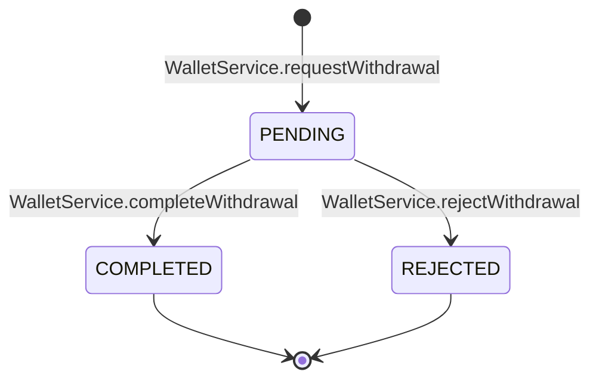

# 06 · State 07 — Ví hoàn tiền và yêu cầu rút tiền

Hai thứ liên quan: số dư ví của khách (`User.walletBalance`) và vòng đời một yêu cầu rút tiền (`WithdrawalRequest.status`). Ví chỉ nhận tiền hoàn, không dùng thanh toán đơn. Quy tắc: BR43, BR44.

## A. Yêu cầu rút tiền

| Trạng thái | Ai gây ra | Tác động lên ví | Ghi chú |
|---|---|---|---|
| `PENDING` | Khách gửi yêu cầu (UC72) | Trừ ví ngay (`WITHDRAW_OUT`, giữ chỗ) | Chờ quản lý chuyển thủ công |
| `COMPLETED` | Quản lý (UC73) | Không đổi (tiền đã trừ từ trước) | Ghi mã giao dịch `transferRef`, người xử lý, giờ xử lý; báo khách |
| `REJECTED` | Quản lý (UC73) | Trả lại ví (`WITHDRAW_RETURN`) | Ghi lý do, người xử lý; báo khách |

Chỉ yêu cầu `PENDING` mới xử lý được, còn lại trả 409. Yêu cầu đã xử lý xong không sửa được.

## B. Số dư ví

Số dư luôn bằng tổng các `WalletTransaction.amount` của khách:

| Loại biến động | Dấu | Khi nào |
|---|---|---|
| `REFUND_IN` | cộng | Hủy đơn đã trả tiền (UC27, UC36), hoặc hoàn tiền món thiếu vào ví (UC74) |
| `WITHDRAW_OUT` | trừ | Khách gửi yêu cầu rút (UC72) |
| `WITHDRAW_RETURN` | cộng | Quản lý từ chối yêu cầu rút (UC73) |

Số dư không bao giờ âm: yêu cầu rút lớn hơn số dư bị từ chối ngay lúc gửi (422).
