# 07 · Activity 01 — Từ chọn món đến thanh toán (phía khách)

Luồng hoạt động xuyên suốt của khách, nối UC07 đến UC23. Mỗi bước ghi UC và hàm thực hiện (tên theo `Class-02-DichVu.md`, `Class-03-GiaoDien.md`). Chi tiết từng bước ở `05-sequence/Sequence-02` đến `Sequence-05-ThanhToan.md`.

```mermaid
flowchart TD
  S((Bắt đầu)) --> A1["UC07 Xem menu: MenuPage.load"]
  A1 --> A2{"Tìm hoặc lọc?"}
  A2 -- "Tìm theo tên UC08" --> A2s["MenuPage.onType: gợi ý ngay trên client"] --> A2a["MenuPage.onPickSuggestion hoặc MenuPage.onSearch"] --> A3
  A2 -- "Lọc danh mục UC09" --> A2b["MenuPage.onSelectCategory"] --> A3
  A2 -- "Không" --> A3["UC10 Xem chi tiết: ProductDetailPage.load"]
  A3 --> B1{"Món còn bán? status = ON_SALE"}
  B1 -- "Không: hết bán" --> A1
  B1 -- "Có" --> C1["UC12 ProductDetailPage.selectSize"]
  C1 --> C2["UC13 ProductDetailPage.selectLevels"]
  C2 --> C3["UC14 ProductDetailPage.setToppingQuantity"]
  C3 --> C3a{"UC11 ProductDetailPage.onAddToCart: đã đăng nhập? AuthStore.isLoggedIn"}
  C3a -- "Chưa" --> C3b["CartStore.savePending, sang đăng nhập UC02 hoặc đăng ký UC01"]
  C3b --> C3c["CartStore.loadForUser, CartStore.applyPending"] --> C4
  C3a -- "Rồi" --> C4["CartStore.addItem"]
  C4 --> D1{"Thêm món khác?"}
  D1 -- "Có" --> A1
  D1 -- "Không" --> D2["Mở CartPage: CartPage.load"]
  D2 --> D3{"Sửa giỏ?"}
  D3 -- "Số lượng UC15" --> D3a["CartPage.onChangeQuantity"] --> D4
  D3 -- "Tùy chọn UC16" --> D3b["CartPage.onEditOptions"] --> D4
  D3 -- "Xóa UC17" --> D3c["CartPage.onRemove"] --> D4
  D3 -- "Không" --> D4["UC20 Xác nhận thông tin đơn: CheckoutPage.open"]
  D4 --> E1{"Đã đăng nhập? AuthStore.isLoggedIn"}
  E1 -- "Chưa" --> E2["UC02 Đăng nhập: LoginPage.submit"] --> D4
  E1 -- "Rồi" --> F1{"Có mã khuyến mãi?"}
  F1 -- "Có" --> F0["UC70 CheckoutPage.loadMyVouchers: chọn mã của mình hoặc tự gõ mã"]
  F0 --> F2["UC19 CheckoutPage.onApplyPromo, PromotionsService.validateCode"]
  F2 --> F3{"Mã hợp lệ?"}
  F3 -- "Không: 422" --> F4["Hiện lỗi, tiếp tục không giảm giá"] --> G1
  F3 -- "Có" --> G1
  F1 -- "Không" --> G1["UC18 CheckoutPage.onConfirm, OrdersService.createOrder"]
  G1 --> G2{"Hợp lệ? ProductsService.validateSelection"}
  G2 -- "Không: 422" --> D2
  G2 -- "Có" --> G2b{"Đủ số ly còn lại? ProductsService.reserveStock"}
  G2b -- "Không: 422" --> D2
  G2b -- "Có" --> G3["Order PENDING, CartStore.clear"]
  G3 --> G4["Gửi thông báo ORDER_CREATED: NotificationService.notifyOrderEvent"]
  G4 --> H1["UC21 PaymentPage.selectMethod"]
  H1 --> H2["UC22 PaymentPage.onPay, PaymentsService.pay"]
  H2 --> H3{"PaymentGateway.charge thành công?"}
  H3 -- "Có" --> I1["Order PAID: OrdersService.markPaid"]
  I1 --> I1b["Gửi SMS ngắn và email hóa đơn PAYMENT_SUCCESS: NotificationService.notifyOrderEvent"]
  I1b --> I2["Cộng điểm và số ly, cấp mã thưởng nếu đạt mốc: LoyaltyService.award"]
  I2 --> I3["UC25 Theo dõi đơn: OrderDetailPage.poll"]
  I3 --> Z((Kết thúc))
  H3 -- "Không" --> J1["Order PAYMENT_FAILED: OrdersService.markPaymentFailed"]
  J1 --> J2{"Thử lại?"}
  J2 -- "Có UC23" --> J3["PaymentPage.onRetry, Idempotency-Key mới"] --> H2
  J2 -- "Không" --> J4["UC27 Hủy đơn: OrderDetailPage.onCancel"] --> Z
```

Điểm quyết định phải khớp state: sau `H3` đơn chỉ có thể là `PAID` hoặc `PAYMENT_FAILED` (`06-state/State-01-DonHang.md`).
