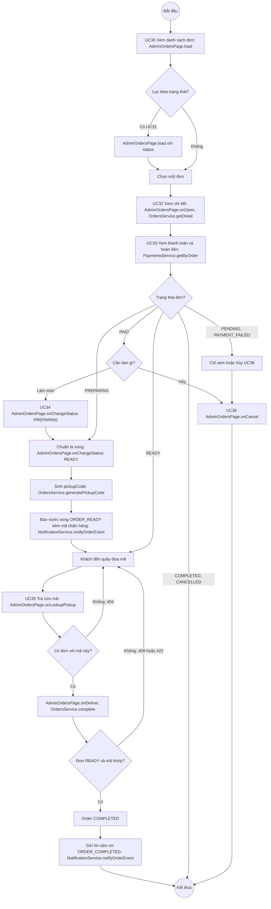

# 07 · Activity 02 — Nhân viên xử lý đơn từ nhận đến giao

Luồng của nhân viên, nối UC30 đến UC37 (xử lý món không làm được UC74 ở `Activity-03-HuyDonVaPhanHoi.md`). Hủy đơn và phản hồi dịch vụ chi tiết ở `Activity-03-HuyDonVaPhanHoi.md`. Chi tiết gọi hàm ở `05-sequence/Sequence-09-XuLyDon.md`.

Nhân viên không đẩy được `PENDING` hoặc `PAYMENT_FAILED` sang `PAID` (chỉ thanh toán mới làm được), và `OrdersService.updateStatus` chỉ cho `PAID → PREPARING`, `PREPARING → READY` (BR12).
