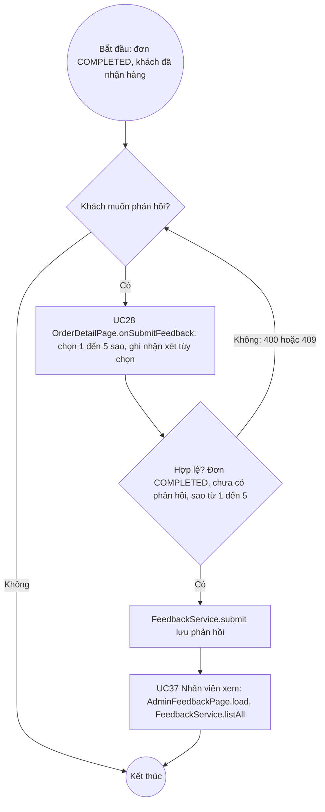
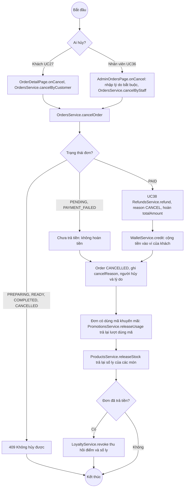
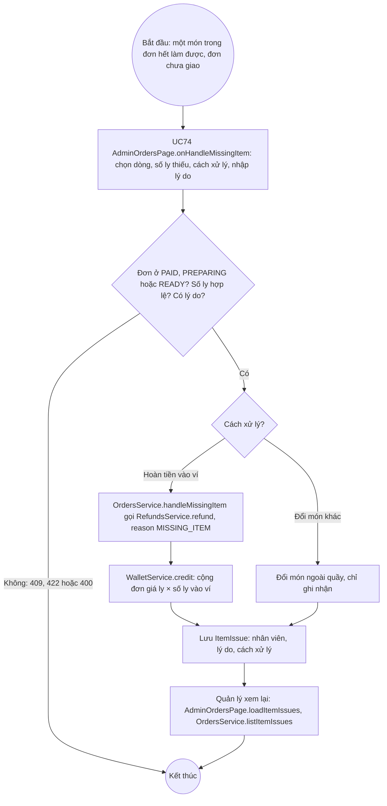

# 07 · Activity 03 — Hủy đơn, hoàn tiền và phản hồi dịch vụ

Ba luồng: hủy đơn có hoàn tiền vào ví (UC27, UC36 → UC38), phản hồi dịch vụ sau khi nhận hàng (UC28 → UC37), và xử lý món không làm được (UC74). Chi tiết gọi hàm ở `05-sequence/Sequence-07-HuyDon.md` và `Sequence-08-PhanHoiDichVu.md`.

## A. Phản hồi dịch vụ

## B. Hủy đơn

## C. Xử lý món không làm được

