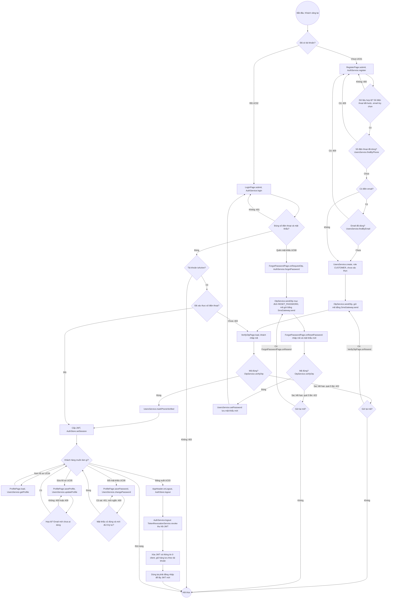

# 07 · Activity 04 — Tài khoản (UC01–UC06, BFD nhóm 1)

Đăng ký (có OTP), đăng nhập, đăng xuất, hồ sơ, đổi mật khẩu. Chi tiết gọi hàm ở `05-sequence/Sequence-01-TaiKhoan.md`. Quy tắc: BR17, BR19, BR22, BR27.

