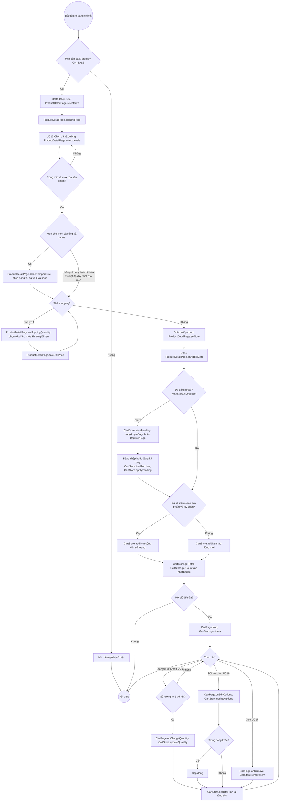

# 07 · Activity 05 — Tùy chỉnh món và giỏ hàng (UC11–UC17, BFD nhóm 3)

Chọn tùy chọn món (UC12–UC14) làm được khi chưa đăng nhập. **Thêm vào giỏ (UC11) và sửa giỏ (UC15–UC17) cần đăng nhập** (BR29). Mọi bước chạy ở client, không gọi server (BR06). Chi tiết ở `05-sequence/Sequence-03-GioHang.md`.

