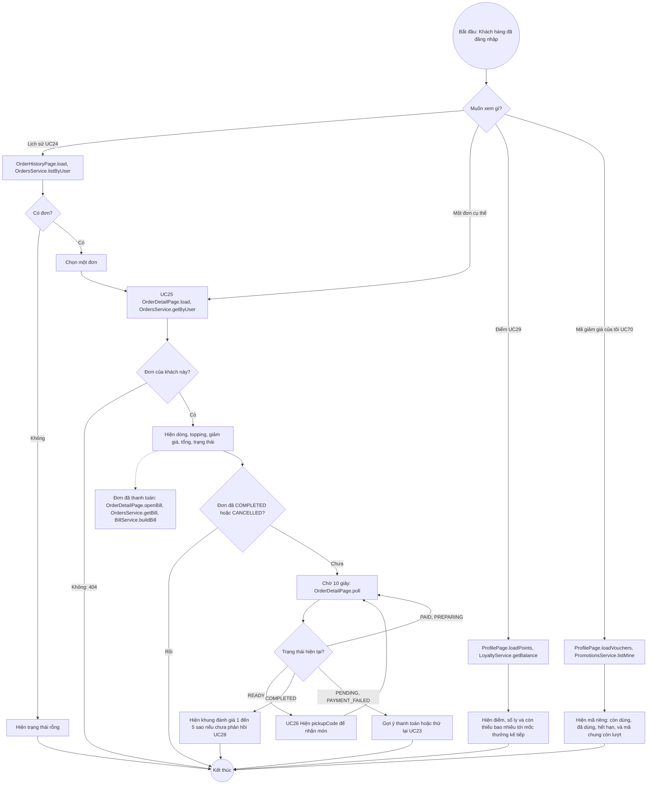

# 07 · Activity 06 — Theo dõi đơn hàng và điểm (UC24–UC29 trừ hủy và phản hồi, BFD nhóm 6 và 7)

Hủy đơn (UC27) và phản hồi dịch vụ (UC28) ở `Activity-03-HuyDonVaPhanHoi.md`. Chi tiết gọi hàm ở `05-sequence/Sequence-06-TheoDoiDon.md`. Quy tắc: BR11, BR12, BR23, BR24.

