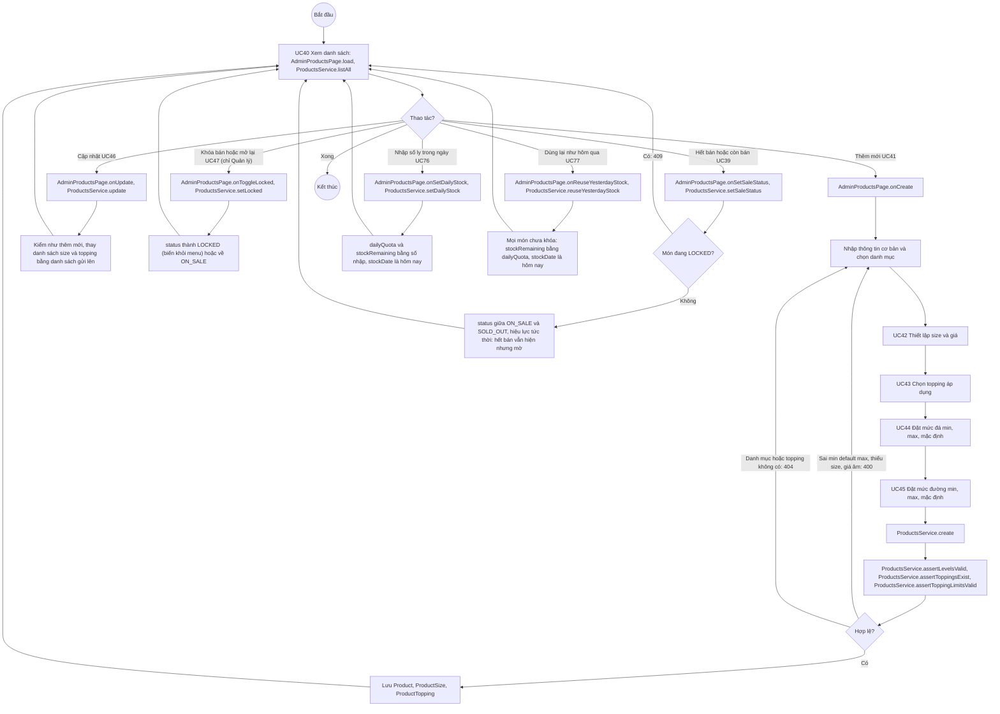

# 07 · Activity 07 — Quản lý sản phẩm (UC39–UC47, UC76, UC77, BFD nhóm 8)

Quản lý làm toàn bộ; Nhân viên chỉ làm UC39. Chi tiết gọi hàm ở `05-sequence/Sequence-10-QuanLySanPham.md`. Quy tắc: BR01, BR02, BR18, BR20.

