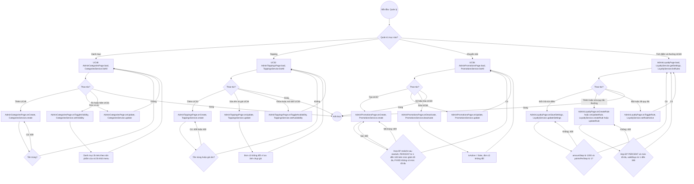

# 07 · Activity 08 — Quản trị danh mục, topping, khuyến mãi (UC48–UC59, BFD nhóm 8.5, 9, 11)

Ba nhóm cùng một khuôn nên vẽ chung: chọn nhóm, rồi xem / thêm / sửa / bật tắt. Điểm riêng nằm ở bước kiểm tra. Chi tiết gọi hàm ở `05-sequence/Sequence-11-QuanTriCRUD.md`. Chỉ `MANAGER`.

