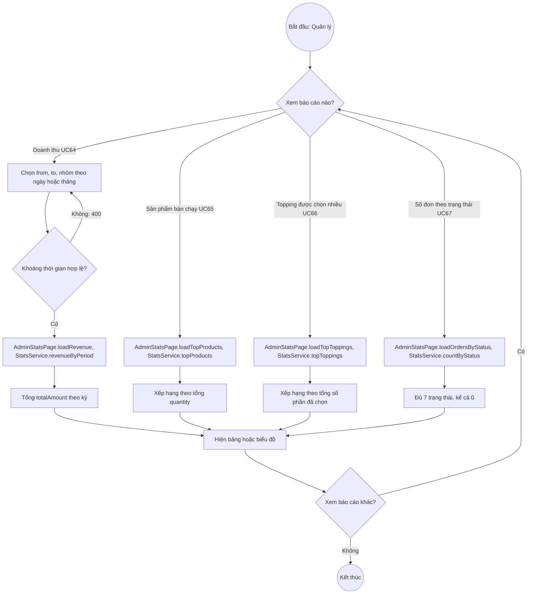

# 07 · Activity 10 — Thống kê báo cáo (UC64–UC67, BFD nhóm 13)

Chi tiết gọi hàm ở `05-sequence/Sequence-12-ThongKe.md`. Chỉ `MANAGER`. Quy tắc: BR21 (chỉ tính đơn PAID, PREPARING, READY, COMPLETED; UC67 đếm cả 7 trạng thái).

