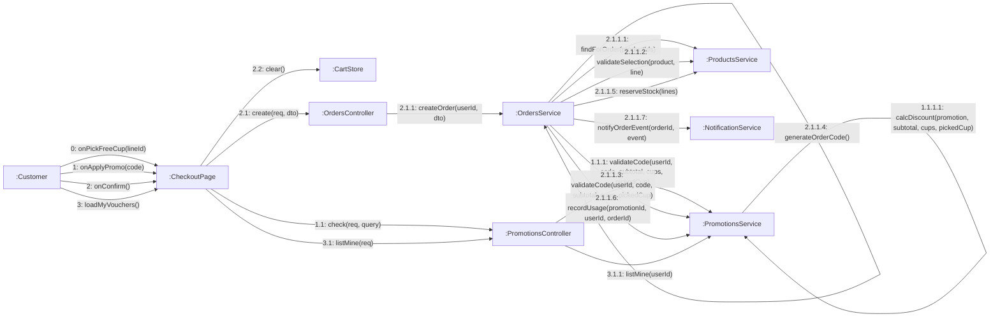

# 08 · Collaboration 01 — Đặt hàng (UC19, UC18)

Cùng nội dung với `05-sequence/Sequence-04-DatHang.md`, nhìn theo **liên kết giữa các đối tượng** và **số thứ tự thông điệp** (số thứ tự lồng nhau thể hiện lời gọi lồng). Thứ tự gọi hàm phải trùng với sequence.

| Số | Thông điệp | UC | Ghi chú |
|---|---|---|---|
| 0 | Chọn ly được tặng | UC19 | Chỉ với mã tặng ly: khách chọn một ly trong đơn thuộc danh sách món được tặng của mã (BR07) |
| 1 đến 1.1.1.1 | Áp mã khuyến mãi | UC19 | Tùy chọn, mã sai trả 422 và khách đặt tiếp không giảm giá |
| 2.1.1.1 | Tải sản phẩm | UC18 | 404 nếu sản phẩm ẩn hoặc không có |
| 2.1.1.2 | Kiểm từng dòng, trả `unitPrice` | UC18 | Lặp mỗi dòng giỏ, 422 nếu sai (BR02, BR04, BR05) |
| 2.1.1.3 | Kiểm lại mã khuyến mãi | UC18 | Chỉ khi đơn có `promotionCode` |
| 2.1.1.5 | Trừ số ly còn lại của từng món | UC18 | Cùng giao dịch với bước lưu đơn, đặt đồng thời không vượt số ly, thiếu thì 422 (BR49, BR50) |
| 2.1.1.6 | Giữ lượt dùng mã (chỉ khi đơn có mã) | UC18 | Tính ngay khi tạo đơn, trả lại nếu đơn bị hủy (BR39) |
| 3 đến 3.1.1 | Xem các mã giảm giá của mình để chọn | UC70 | Mã riêng còn dùng được và mã chung còn lượt |
| 2.1.1.7 | Gửi thông báo `ORDER_CREATED` | UC18 | SMS mock và email nếu có, xem `Collaboration-13-ThongBao` (BR28) |
| 2.2 | Dọn giỏ | UC18 | Sau khi tạo đơn thành công |
