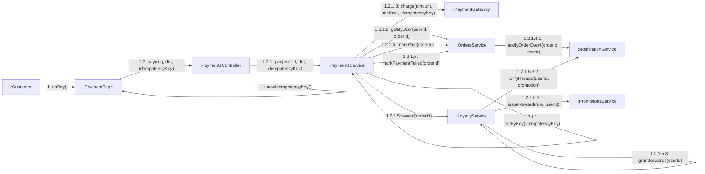

# 08 · Collaboration 02 — Thanh toán (UC22, UC23)

Cùng nội dung với `05-sequence/Sequence-05-ThanhToan.md`, nhìn theo liên kết đối tượng. Thứ tự gọi hàm trùng với sequence; hai nhánh kết quả (thành công, thất bại) loại trừ nhau.

| Số | Thông điệp | Ghi chú |
|---|---|---|
| 1.1 | Sinh key mới | Mỗi lần bấm thanh toán hoặc thử lại (UC23) có key riêng |
| 1.2.1.1 | Tra key | Trùng key thì trả kết quả cũ, dừng tại đây (BR10) |
| 1.2.1.2 | Kiểm đơn của khách và đúng trạng thái | 404 hoặc 409 nếu sai |
| 1.2.1.3 | Gọi cổng mock | Kết quả `SUCCESS` hoặc `FAILED` |
| 1.2.1.4 và 1.2.1.5 | Chỉ khi thành công | Đơn `PAID` rồi cộng điểm (BR11) |
| 1.2.1.5 đến 1.2.1.5.2 | Cộng điểm theo tiền (mỗi `amountStep` đồng được `pointsPerStep` điểm) và cộng số ly vào tổng số ly của khách (BR11, BR40) |
| 1.2.1.5.3 đến 1.2.1.5.3.2 | Chỉ khi khách đạt thêm mốc điểm hoặc mốc ly của một quy tắc thưởng đang bật: cấp mã riêng và gửi SMS báo (BR40) |
| 1.2.1.4.1 | Gửi thông báo `PAYMENT_SUCCESS` | SMS mock một dòng ngắn (mã đơn + mã giao dịch) và email hóa đơn nếu khách có email (BR28, BR38) |
| 1.2.1.6 | Chỉ khi thất bại | Đơn `PAYMENT_FAILED`, khách có thể thử lại |
