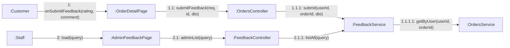

# 08 · Collaboration 03 — Phản hồi dịch vụ (UC28, UC37)

Cùng nội dung với `05-sequence/Sequence-08-PhanHoiDichVu.md`, nhìn theo liên kết đối tượng. Số 1 khách gửi phản hồi, 2 nhân viên xem danh sách phản hồi.

| Số | Ghi chú |
|---|---|
| 1.1.1 | Chỉ đơn `COMPLETED`, mỗi đơn một phản hồi, `rating` từ 1 đến 5 (BR14) |
| 1.1.1.1 | Đơn không phải của khách thì 404 |
| 2.1.1 | Lọc theo số sao, mới nhất trước. `STAFF` và `MANAGER` |
