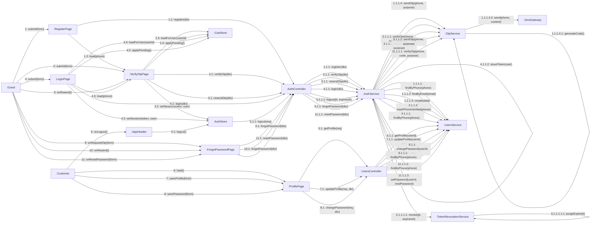

# 08 · Collaboration 04 — Tài khoản (UC01–UC06, UC68)

Cùng nội dung với `05-sequence/Sequence-01-TaiKhoan.md`, nhìn theo liên kết đối tượng. Số 1 đăng ký (tạo tài khoản và gửi OTP), 2 nhập OTP, 3 gửi lại OTP, 4 đăng nhập, 5 đăng xuất, 6 xem hồ sơ, 7 sửa hồ sơ, 8 đổi mật khẩu.

| Số | UC | Ghi chú |
|---|---|---|
| 1.1.1.1 và 1.1.1.2 | UC01 | Số điện thoại hoặc email trùng thì dừng và trả 409. 1.1.1.2 chỉ chạy khi khách điền email |
| 1.1.1.4 đến 1.1.1.4.2 | UC01 | Tạo và gửi mã OTP qua `SmsGateway` (mock), hạn 5 phút (BR27) |
| 2.1.1.1 | UC01 | Sai mã, hết hạn hoặc quá 5 lần nhập sai trả 422 |
| 2.1.1.3 và 4.1.1.2 | UC01, UC02 | Cùng hàm `AuthService.issueToken`. Chỉ đăng ký xong phải qua OTP rồi mới nhận token |
| 2.3, 2.4 và 4.4, 4.5 | UC01, UC02 | Sau khi vào phiên: nạp giỏ của tài khoản này, rồi thêm món khách đã chọn lúc chưa đăng nhập (BR29). 4.4 và 4.5 chỉ chạy khi đăng nhập thành công, không chạy ở nhánh 4.3 |
| 3.1.1.1 | UC01 | Gửi lại trong vòng 60 giây trả 422 |
| 4.1.1.1 | UC02 | Đăng nhập bằng số điện thoại. Sai thông tin 401, khóa 403. Chưa xác thực OTP thì 403 và chuyển 4.3 |
| 5.1 đến 5.1.1.1.1.1 | UC03 | Máy chủ ghi `jti` của thẻ vào danh sách thu hồi và dọn dòng quá hạn (BR19). Thẻ này từ nay bị từ chối 401. Client luôn xóa phiên cục bộ, kể cả khi gọi máy chủ thất bại |
| 6.1.1 đến 8.1.1 | UC04, UC05, UC06 | Cần JWT (`JwtAuthGuard`) |
| 9 đến 9.1.1.2 | UC68 | Xin mã đặt lại mật khẩu. Chỉ gửi OTP (mục đích `RESET_PASSWORD`) khi số đã đăng ký, đã xác thực, không bị khóa; câu trả lời luôn giống nhau (BR31) |
| 10 đến 10.1 | UC68 | Gửi lại mã, chạy lại đúng luồng 9; trong 60 giây trả 422 |
| 11 đến 11.1.1.3 | UC68 | Sai mã hoặc hết hạn trả 422, mật khẩu mới dưới 8 ký tự trả 400. Đúng thì lưu mật khẩu mới, khách quay về đăng nhập |

Số 9, 10, 11 là quên mật khẩu (UC68).
