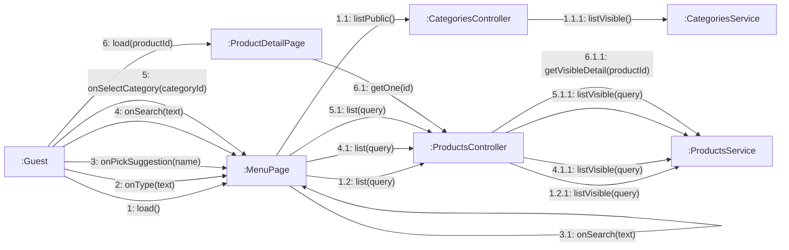

# 08 · Collaboration 05 — Xem menu (UC07–UC10)

Cùng nội dung với `05-sequence/Sequence-02-XemMenu.md`. Số 1 xem menu (UC07), 2 gợi ý khi gõ (làm trên client), 3 chọn gợi ý, 4 tìm kiếm (UC08), 5 lọc danh mục (UC09), 6 xem chi tiết (UC10).

| Số | UC | Ghi chú |
|---|---|---|
| 1.1.1 | UC07 | Chỉ danh mục `isVisible` (BR01) |
| 1.2.1, 4.1.1, 5.1.1 | UC07, UC08, UC09 | Cùng một hàm `listVisible`, khác tham số `search` và `categoryId` |
| 2 và 2.1 | UC08 | Gợi ý khi gõ: lọc ngay trên client từ danh sách món đã tải ở 1.2, tối đa 5 tên, **không gọi máy chủ** (BR32) |
| 3 và 3.1 | UC08 | Chọn một gợi ý thì chạy luôn tìm kiếm với tên đó. 4 là cách khác: khách tự bấm Enter |
| 6.1.1 | UC10 | Sản phẩm khóa bán thì 404. Sản phẩm hết bán vẫn trả về kèm `status = SOLD_OUT` (BR02) |
