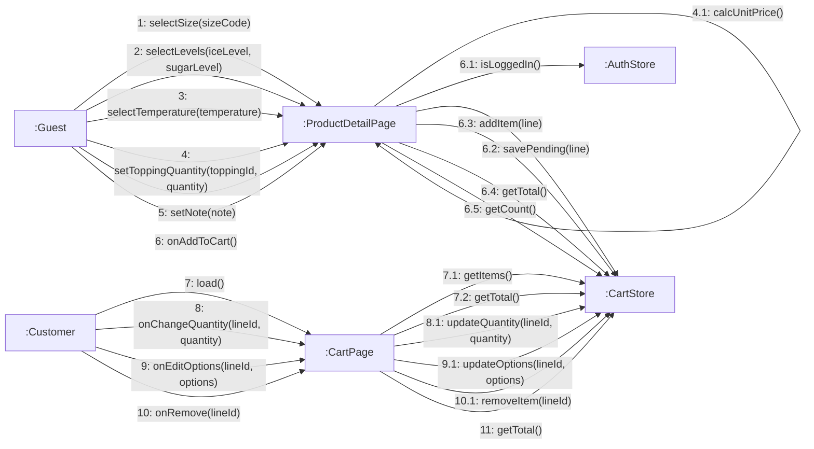

# 08 · Collaboration 06 — Giỏ hàng (UC11–UC17)

Cùng nội dung với `05-sequence/Sequence-03-GioHang.md`. Toàn bộ chạy ở client, không có thông điệp nào tới server (BR06). Số 1 chọn size, 2 chọn đá/đường, 3 chọn nóng/lạnh, 4 chọn topping, 5 ghi chú (khách vãng lai làm được), 6 thêm vào giỏ (cần đăng nhập), 7 mở giỏ, 8 đổi số lượng, 9 đổi tùy chọn, 10 xóa (Khách hàng).

| Số | UC | Ghi chú |
|---|---|---|
| 1, 2, 4 | UC12, UC13, UC14 | Là phần include của UC11, khách vãng lai vẫn chọn được. Mức đá/đường ngoài min–max thì UI không cho chọn (BR04) |
| 4 | UC14 | Chọn số phần cho từng topping. Nút tăng bị khóa khi đủ giới hạn mỗi loại hoặc tổng của món (BR37) |
| 3 | UC13 | Nóng/lạnh. Món chỉ có một nhiệt độ thì ô chọn bị khóa, bước này không xảy ra. Chọn nóng thì mức đá về 0 và bị khóa (BR35) |
| 5 | UC11 | Ghi chú tùy chọn, tối đa 20 từ (BR36) |
| 6.1 | UC11 | Kiểm đăng nhập trước khi thêm (BR29) |
| 6.2 | UC11 | Chỉ khi **chưa đăng nhập**: nhớ tạm món, chuyển sang đăng nhập hoặc đăng ký. Sau đó `CartStore.applyPending` thêm món (xem `Collaboration-04-TaiKhoan`) |
| 6.3 | UC11 | Chỉ khi **đã đăng nhập**. Cùng sản phẩm, size, đá, đường, nhiệt độ, ghi chú, topping thì cộng dồn số lượng |
| 8.1 | UC15 | Số lượng nhỏ hơn 1 không hợp lệ |
| 9.1 | UC16 | Trùng dòng khác thì gộp |
| 10.1 | UC17 | Xóa dòng |
| 6.4, 7.2, 11 | BFD 3.5 | Tính tổng tiền giỏ, là bước hệ thống |
