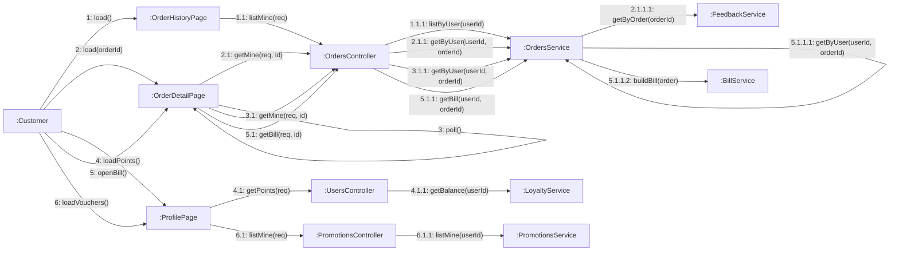

# 08 · Collaboration 07 — Theo dõi đơn hàng, điểm và mã giảm giá (UC24, UC25, UC26, UC29, UC70)

Cùng nội dung với `05-sequence/Sequence-06-TheoDoiDon.md`. Số 1 lịch sử, 2 chi tiết, 3 polling, 4 điểm, 5 xem hóa đơn, 6 xem mã giảm giá của tôi.

| Số | UC | Ghi chú |
|---|---|---|
| 1.1.1 | UC24 | Chỉ đơn của khách, mới nhất trước |
| 2.1.1 | UC25 | Đơn không phải của khách thì 404 |
| 2.1.1.1 | UC25 | Đính kèm phản hồi dịch vụ của đơn nếu có (BR14) |
| 3 đến 3.1.1 | UC26 | Cứ 10 giây gọi lại (BR24). Khi đơn `READY` thì hiện `pickupCode` |
| 4.1.1 | UC29 | Trả về điểm, số ly và còn thiếu bao nhiêu tới mốc thưởng kế tiếp. Điểm và ly chỉ cộng, không trừ (BR23, BR40) |
| 6 đến 6.1.1 | UC70 | Danh sách mã riêng của khách (còn dùng, đã dùng, hết hạn) và mã chung còn lượt |
| 5 đến 5.1.1.2 | UC25 | Xem hóa đơn của đơn đã thanh toán (BR38). Đơn chưa thanh toán thì 409. Bố cục ở `02-use_case/MauHoaDon.md` |
