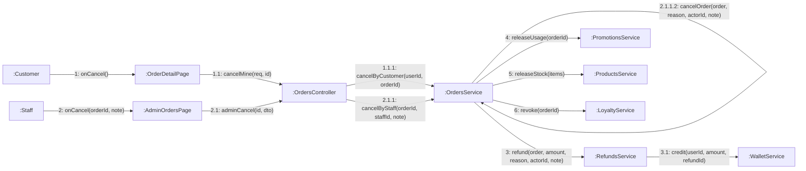

# 08 · Collaboration 08 — Hủy đơn và hoàn tiền (UC27, UC36, UC38)

Cùng nội dung với `05-sequence/Sequence-07-HuyDon.md`. Số 1 khách hủy, 2 nhân viên hủy, 3 hoàn tiền (chỉ khi đơn đã trả tiền).

| Số | Ghi chú |
|---|---|
| 1.1.1.2 và 2.1.1.2 | Cùng hàm `cancelOrder`, chỉ khác `reason`: `CUSTOMER_CANCEL` và `STAFF_CANCEL` |
| 1.1.1.2 và 2.1.1.2 (ghi chú thêm) | Đơn lưu người hủy (`cancelledByUserId`) và lý do (`cancelNote`). Nhân viên hủy bắt buộc nhập lý do từ 5 ký tự (BR13) |
| 3 và 3.1 | Chỉ chạy khi đơn `PAID`, hoàn đủ `totalAmount` **vào ví của khách**, `Refund.reason = CANCEL`. Đơn `PENDING` và `PAYMENT_FAILED` bỏ qua bước này |
| 4 | Chỉ khi đơn có dùng mã khuyến mãi: trả lại lượt dùng mã (BR39). Mã riêng còn hạn thì dùng lại được |
| 5 | Mọi đơn bị hủy đều trả lại số ly của các món (BR50), chỉ cộng khi `stockDate` là hôm nay và đơn tạo hôm nay |
| 6 | Chỉ khi đơn `PAID`: thu hồi điểm và số ly đã cộng lúc thanh toán (BR51). Mã thưởng đã cấp không thu hồi |
| Từ `PREPARING` trở đi | `cancelOrder` trả 409, không có thông điệp 3 |
