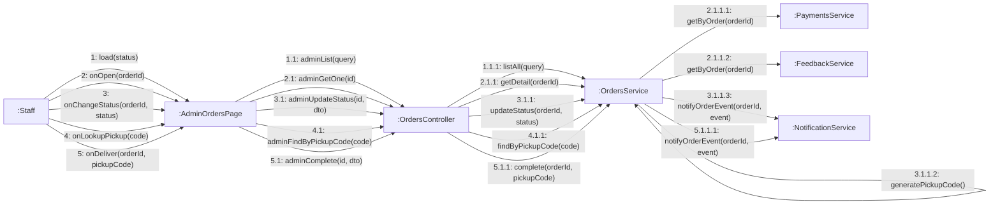

# 08 · Collaboration 09 — Nhân viên xử lý đơn (UC30–UC35)

Cùng nội dung với `05-sequence/Sequence-09-XuLyDon.md`. Số 1 danh sách, 2 chi tiết, 3 đổi trạng thái, 4 tra mã nhận hàng, 5 giao món.

| Số | UC | Ghi chú |
|---|---|---|
| 1.1.1 | UC30, UC31 | `status` rỗng thì lấy tất cả |
| 2.1.1.1 | UC32, UC33 | Chi tiết đơn kèm các `Payment` và `Refund` |
| 2.1.1.2 | UC32 | Kèm phản hồi dịch vụ của khách nếu có (BR14) |
| 3.1.1.1 | UC34 | Chỉ cho `PAID → PREPARING` và `PREPARING → READY`, ngoài ra 409 (BR12) |
| 3.1.1.2 | UC34 | Chỉ khi đích là `READY` |
| 3.1.1.3 | UC34 | Chỉ khi đích là `READY`: gửi thông báo `ORDER_READY` kèm mã nhận hàng (BR28) |
| 5.1.1.1 | UC35 | Gửi thông báo `ORDER_COMPLETED`, lời cảm ơn sau khi nhận món (BR28) |
| 4.1.1 và 5.1.1 | UC35 | Đơn phải `READY` (409), mã gửi lên phải khớp (422) |
