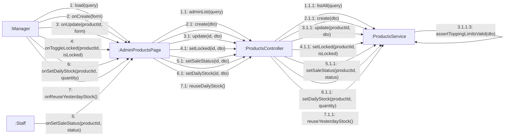

# 08 · Collaboration 10 — Quản lý sản phẩm và số ly bán trong ngày (UC39–UC47, UC76, UC77)

Cùng nội dung với `05-sequence/Sequence-10-QuanLySanPham.md`. Số 1 xem danh sách, 2 thêm mới, 3 cập nhật, 4 khóa bán / mở lại (chỉ Quản lý), 5 đặt hết bán / còn bán (Nhân viên cũng làm được), 6 thiết lập số ly bán trong ngày, 7 dùng lại số ly của hôm qua (chỉ Quản lý).

| Số | UC | Ghi chú |
|---|---|---|
| 2.1.1.1 | UC44, UC45 | `0 ≤ min ≤ default ≤ max ≤ 100` cho cả đá và đường. Nhiệt độ: ít nhất một trong nóng, lạnh; mặc định phải thuộc nhiệt độ được phép (BR35). Chỉ cho một nhiệt độ thì ô chọn nóng/lạnh bị khóa ở trang chi tiết |
| 2.1.1.2 | UC43 | Mọi `toppingId` phải tồn tại, sai thì 404 |
| 2.1.1.3 và 3.1.1.3 | UC43 | Giới hạn topping: món có topping thì `1 ≤ maxPerTopping ≤ maxToppingTotal ≤ 10`, không có topping thì cả hai bằng 0, sai thì 400 (BR37) |
| 2 và 3 | UC41 (UC42–UC45), UC46 | Size, giá và dung tích ml (UC42) nằm trong `dto.sizes`, kiểm trong `create` và `update` |
| 4.1.1 | UC47 | `status` thành `LOCKED` hoặc về `ON_SALE`. Chỉ `MANAGER` (BR33) |
| 6.1.1 | UC76 | `dailyQuota` và `stockRemaining` bằng `quantity`, `stockDate` là hôm nay. Chỉ `MANAGER` (BR49) |
| 7.1.1 | UC77 | Mọi món chưa khóa: `stockRemaining` bằng `dailyQuota`, `stockDate` là hôm nay (BR49) |
| 5.1.1 | UC39 | `status` giữa `ON_SALE` và `SOLD_OUT`, món `LOCKED` thì 409. Hiệu lực tức thời (BR20). Cho phép `STAFF` và `MANAGER` |
