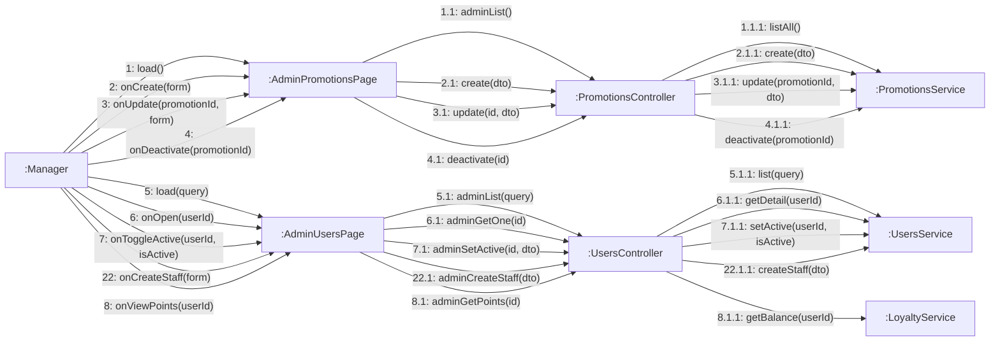
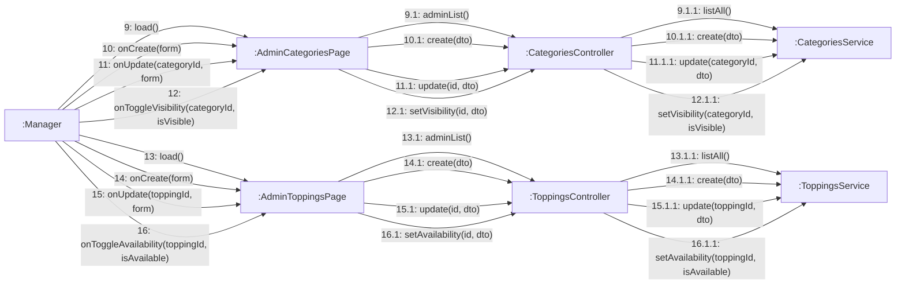
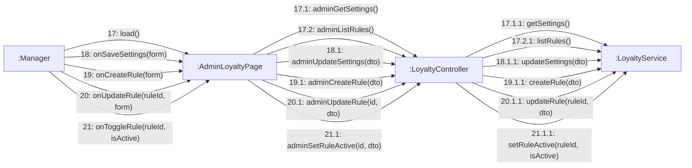

# 08 · Collaboration 11 — Quản trị danh mục, topping, khuyến mãi, người dùng, tích điểm, nhân viên (UC48–UC63, UC69, UC75)

Cùng nội dung với `05-sequence/Sequence-11-QuanTriCRUD.md`. Bốn nhóm cùng khuôn `Page → Controller → Service`. Số 1–4 khuyến mãi, 5–8 người dùng, 9–12 danh mục, 13–16 topping, 17–21 tích điểm và thưởng, 22 tạo tài khoản nhân viên. Chỉ `MANAGER`.

## A. Khuyến mãi (UC56–UC59) và người dùng (UC60–UC63)

## B. Danh mục (UC48–UC51) và topping (UC52–UC55)

| Số | UC | Ghi chú |
|---|---|---|
| 1–4 | UC56–UC59 | Tạo: `endsAt` sau `startsAt`, `PERCENT` từ 1 đến 100 kèm mức giảm tối đa bắt buộc, `FIXED` không có mức tối đa (400), mã trùng (409) |
| 5–8 | UC60–UC63 | 7: tự khóa chính mình trả 422. Khóa có hiệu lực lên JWT cũ, xem `Sequence-13-PhanQuyen` |
| 9–12 | UC48–UC51 | Tên danh mục trùng 409. Danh mục ẩn kéo theo sản phẩm ẩn khỏi menu (BR01) |
| 13–16 | UC52–UC55 | Tên topping trùng 409, giá âm 400. Đơn cũ không đổi (BR26) |
| 22 | UC75 | Quản lý tạo tài khoản nhân viên: số điện thoại trùng 409, dữ liệu sai 400. Không cần OTP (BR46) |
| 17–21 | UC69 | Tích điểm và thưởng, vẽ ở mục C bên dưới |

## C. Thiết lập tích điểm và thưởng (UC69)

Số 17 mở trang, 18 lưu tỉ lệ tích điểm, 19 thêm quy tắc thưởng, 20 sửa quy tắc, 21 bật hoặc tắt quy tắc. Chỉ `MANAGER`.

| Số | Ghi chú |
|---|---|
| 17 | Tải tỉ lệ tích điểm hiện tại và danh sách quy tắc thưởng |
| 18 | `amountStep` ≥ 1000 và `pointsPerStep` ≥ 1, sai thì 400. Áp dụng cho các đơn thanh toán từ lúc đổi trở đi (BR11) |
| 19, 20 | Quy tắc: cứ mỗi `threshold` điểm hoặc ly thì cấp một mã riêng; loại mã `PERCENT` phải có mức giảm tối đa, `validDays` từ 1 đến 365 (BR40) |
| 21 | Tắt quy tắc thì ngừng cấp mã mới, mã đã cấp vẫn dùng được |
