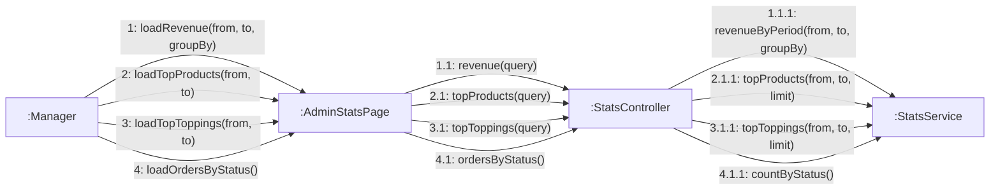

# 08 · Collaboration 12 — Thống kê báo cáo (UC64–UC67)

Cùng nội dung với `05-sequence/Sequence-12-ThongKe.md`. Số 1 doanh thu, 2 sản phẩm bán chạy, 3 topping được chọn nhiều, 4 số đơn theo trạng thái. Chỉ `MANAGER`.

| Số | UC | Ghi chú |
|---|---|---|
| 1.1.1 | UC64 | Chỉ đơn `PAID`, `PREPARING`, `READY`, `COMPLETED` (BR21). `from` sau `to` trả 400 |
| 2.1.1 | UC65 | Theo tổng `quantity` của các dòng |
| 3.1.1 | UC66 | Theo tổng số phần đã chọn, nhân `quantity` của dòng |
| 4.1.1 | UC67 | Đủ 7 trạng thái, kể cả 0 |
